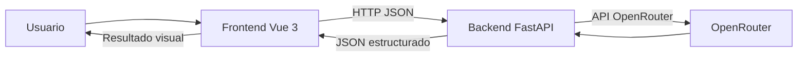

# Proyecto web con Vue, FastAPI y OpenRouter

Este repositorio corresponde a una aplicación web en desarrollo para una asignatura, con una estructura inicial basada en Vue 3 + TypeScript + Vite para el frontend y Python + FastAPI para el backend. El proyecto está todavía en una fase temprana y no tiene un nombre definitivo ni una temática funcional cerrada en el código actual.

## Tabla de contenidos

- [Presentación](#presentación)
- [Tecnologías y arquitectura](#tecnologías-y-arquitectura)
- [Requisitos previos e instalación](#requisitos-previos-e-instalación)
- [Configuración de OpenRouter](#configuración-de-openrouter)
- [Ejecución de la aplicación](#ejecución-de-la-aplicación)
- [Uso de la aplicación](#uso-de-la-aplicación)
- [API](#api)
- [Pruebas y calidad](#pruebas-y-calidad)
- [Desarrollo y colaboración](#desarrollo-y-colaboración)
- [Limitaciones y trabajo pendiente](#limitaciones-y-trabajo-pendiente)

## Presentación

### Objetivo general

La intención del proyecto es una web de una sola página en la que el usuario introduzca datos, el frontend los envíe al backend, el backend los procese mediante un modelo de IA y el resultado se muestre de forma visual en la interfaz.

El flujo previsto es este:

1. El usuario rellena un formulario en el frontend.
2. El frontend lo envía al backend mediante una API HTTP.
3. El backend consulta un modelo de IA a través de OpenRouter.
4. El backend devuelve una respuesta estructurada.
5. El frontend representa el resultado al usuario.

### Estado actual del desarrollo

El repositorio aún está en una fase inicial de arranque:

- El frontend es una aplicación Vue con la plantilla estándar de Vite.
- El backend es un servicio FastAPI mínimo con una ruta raíz de comprobación.
- No existe todavía un formulario funcional ni un contrato JSON definitivo entre frontend y backend.
- No hay una integración real con OpenRouter en el código actual.
- La documentación de Spec Kit y la constitución del proyecto sí están presentes en la carpeta `.specify`, y sirven de contexto para la forma de trabajo.

### Funcionalidades implementadas

- Frontend Vue 3 con TypeScript y Vite.
- Configuración básica de compilación y pruebas del frontend.
- Backend FastAPI con una ruta GET `/` que devuelve un mensaje de salud.
- Scripts para ejecutar el frontend y el backend desde el repositorio.
- Configuración de dependencias Python con `uv` y `pyproject.toml`.
- Prueba unitaria mínima del componente `App` en Vue.

### Funcionalidades pendientes

- Definición de la temática y del caso de uso real.
- Formulario de entrada con campos concretos.
- Envío de datos desde Vue al backend.
- Endpoint(s) reales para procesar solicitudes de IA.
- Integración con OpenRouter desde el backend.
- Validación de entrada, respuesta y errores.
- Contrato JSON explícito entre frontend y backend.
- Presentación visual de resultados en la interfaz.
- Uso real de variables de entorno para la clave API.
- Pruebas del backend y, si se decide, pruebas end-to-end.

## Tecnologías y arquitectura

### Tecnologías principales

| Capa | Tecnología | Uso real en este repositorio |
| --- | --- | --- |
| Frontend | Vue 3 + TypeScript + Vite | Aplicación principal del cliente web. |
| Backend | Python + FastAPI | Servidor HTTP mínimo de ejemplo y base del proyecto. |
| Comunicación | HTTP | Se prevé como canal de intercambio entre frontend y backend. |
| IA | OpenRouter | Se menciona como integración prevista, pero no está implementada aún. |
| Gestión de Python | `uv` | Se usa para gestionar dependencias y ejecutar el backend. |
| Pruebas frontend | Vitest + @vue/test-utils | Existe una prueba de montaje del componente `App`. |
| Calidad | ESLint + Oxlint + TypeScript + vue-tsc | Hay scripts y dependencias configuradas. |

### Arquitectura prevista y flujo actual

El flujo que se planea para la aplicación es el siguiente:



> Esta arquitectura refleja la intención del proyecto y la documentación de trabajo. La implementación actual del código no incluye todavía la integración real con OpenRouter ni un caso de uso completo de formulario y respuesta.

### Estructura relevante de carpetas

```text
.
├── .specify/              # artefactos de Spec Kit y reglas del proyecto
├── api/                   # backend Python/FastAPI
│   ├── main.py            # punto de entrada de la API
│   ├── pyproject.toml     # dependencias y configuración de Python
│   ├── uv.lock            # bloqueo de dependencias con uv
│   └── README.md          # README del backend (vacío actualmente)
├── public/                # activos públicos del frontend
├── src/                   # código del frontend Vue
│   ├── App.vue            # vista principal actual
│   ├── main.ts            # arranque de la aplicación Vue
│   └── __tests__/         # pruebas del frontend
├── .env.example           # ejemplo de variables de entorno
├── .gitignore             # archivos ignorados por Git
├── package.json           # scripts y dependencias del frontend
├── vite.config.ts         # configuración de Vite
├── vitest.config.ts       # configuración de Vitest
├── eslint.config.ts       # configuración de ESLint
├── tsconfig*.json         # configuración de TypeScript
├── README.md              # esta documentación
├── TUTORIAL_INICIO.md     # guía de introducción de Spec Kit
└── package-lock.json      # lockfile de npm
```

## Requisitos previos e instalación

### Herramientas necesarias

- Node.js 22.18 o superior, o 24.12 o superior según lo declarado en `package.json`.
- npm.
- Python 3.12 o superior.
- `uv` para gestionar dependencias del backend.
- Git.
- Opcional: VS Code con la extensión Volar de Vue para desarrollo más cómodo.

### Clonar el repositorio

```bash
git clone <URL-del-repositorio>
cd Practica01-Mini_App_Web
```

### Instalar dependencias del frontend

Desde la raíz del proyecto:

```bash
npm install
```

### Instalar dependencias del backend con uv

Desde la raíz del proyecto:

```bash
cd api
uv sync
```

Si `uv` no está instalado previamente, se puede instalar siguiendo la documentación oficial de `uv` y luego ejecutar el comando anterior.

### Preparar variables de entorno

El proyecto incluye un ejemplo de configuración en [.env.example](.env.example):

```env
OPENROUTER_API_KEY=TU_API_KEY_AQUÍ
```

Para prepararlo en un clon limpio:

- Copiar el archivo a `.env`.
- Sustituir el valor de ejemplo por la clave real en tu entorno local.
- No añadir la clave al repositorio ni compartirla en commits.

En Unix/macOS:

```bash
cp .env.example .env
```

En PowerShell:

```powershell
Copy-Item .env.example .env
```

> El proyecto prevé la variable `OPENROUTER_API_KEY`, pero la integración real con OpenRouter no está implementada todavía en el código actual.

## Configuración de OpenRouter

### Para qué se usa

OpenRouter es la vía prevista para consultar un modelo de IA desde el backend. La intención es mantener la clave API fuera del frontend para evitar exponer secretos en el cliente.

### Variable necesaria

La variable esperada es:

```env
OPENROUTER_API_KEY
```

El archivo [.env.example](.env.example) ya la documenta con un valor de ejemplo. El backend aún no incorpora la lógica de uso de OpenRouter en su código actual, así que esta configuración está prevista para la siguiente fase de desarrollo.

### Recomendaciones de uso

- Guardar la clave en `.env` local, nunca en el repositorio.
- Evitar modelos caros durante el desarrollo.
- Revisar el coste y la disponibilidad de cada modelo según la política actual de OpenRouter.
- No asumir que una opción concreta será siempre gratuita; la recomendación técnica del proyecto es usar opciones de bajo coste o gratuitas cuando sea posible.

### Gestión de errores

La documentación del proyecto establece que se deben gestionar:

- errores de validación,
- errores de comunicación con OpenRouter,
- respuestas inválidas del modelo,
- y evitar que la interfaz se bloquee.

Esto no está implementado todavía en la rama actual, pero es una obligación funcional que aparece en la documentación de trabajo y en la constitución del proyecto.

## Ejecución de la aplicación

### Iniciar el backend

Desde la raíz del proyecto:

```bash
npm run dev:api
```

El script ejecuta:

```bash
uv run --directory ./api uvicorn main:app --reload
```

> Si en tu entorno aparece un error como `No module named uvicorn`, vuelve a ejecutar `cd api && uv sync` para regenerar el entorno del proyecto y comprobar que las dependencias de Python se han instalado correctamente.

Este comando arranca la API FastAPI con recarga automática. La URL por defecto es la habitual de Uvicorn:

```text
http://127.0.0.1:8000
```

### Iniciar el frontend

Desde la raíz del proyecto:

```bash
npm run dev
```

Vite normalmente queda disponible en:

```text
http://localhost:5173
```

### Comprobar que el backend está operativo

En una terminal nueva:

```bash
curl http://127.0.0.1:8000/
```

o, en PowerShell:

```powershell
Invoke-RestMethod http://127.0.0.1:8000/
```

La respuesta actual esperada del backend es:

```json
{ "message": "La API funciona correctamente" }
```

### Detener los procesos

- Pulsa `Ctrl+C` en cada terminal que tenga el frontend o el backend ejecutándose.
- No existe un script combinado para arrancar ambos servicios a la vez en la configuración actual.

## Uso de la aplicación

Actualmente la aplicación no presenta un formulario funcional ni un flujo de negocio completo. La pantalla por defecto que aparece en el frontend es la plantilla estándar de Vue:

```text
You did it!
```

En el estado actual:

- el usuario abre la página del frontend;
- ve el contenido de la plantilla inicial;
- el backend responde en la ruta raíz con un mensaje de salud;
- no hay campos obligatorios, ni carga de resultados, ni estados de error definidos aún.

Cuando se implemente la funcionalidad real del proyecto, el flujo deberá mantener el contrato JSON y los estados de carga/error definidos por el equipo, pero ese nivel todavía no existe en el código presente.

## API

### Endpoint actual

| Método | Ruta | Descripción |
| --- | --- | --- |
| GET | `/` | Comprueba que la API responde correctamente. |

### Respuesta actual

```json
{
  "message": "La API funciona correctamente"
}
```

### Nota importante sobre el contrato

El backend actual no define modelos Pydantic ni un contrato formal de entrada/salida. No hay todavía un endpoint de IA ni una definición de JSON estable para la aplicación real. La documentación del proyecto pide que se defina explícitamente este contrato antes de avanzar con la integración funcional.

### Documentación automática de FastAPI

Cuando el backend está arrancado, FastAPI expone la documentación automática en:

- Swagger UI: `http://127.0.0.1:8000/docs`
- ReDoc: `http://127.0.0.1:8000/redoc`

Esto es un comportamiento estándar de FastAPI y está disponible con la configuración por defecto.

## Pruebas y calidad

### Pruebas del frontend

```bash
npm run test:unit
```

La prueba existente en [src/__tests__/App.spec.ts](src/__tests__/App.spec.ts) monta el componente `App` y comprueba que el texto `You did it!` aparece. Es una prueba mínima de base para confirmar que la aplicación Vue arranca correctamente.

### Verificación de tipos y build

```bash
npm run type-check
npm run build
```

El script `build` incluye la comprobación de tipos y la compilación de la aplicación con Vite.

### Linting

```bash
npm run lint
```

El repositorio tiene configuración de ESLint, Oxlint y Prettier en el frontend. El comando `lint` ejecuta ambos análisis.

### Estado de las pruebas en backend

No se observa configuración ni suites de prueba del backend (`pytest`, tests de API o Playwright) en este repositorio. La validación real disponible actualmente está centrada en el frontend y en la comprobación básica de que la API responde.

## Desarrollo y colaboración

### Convenciones de trabajo

- Mantener la arquitectura simple.
- No añadir dependencias innecesarias.
- Mantener separación clara entre frontend y backend.
- Guardar secretos fuera del repositorio.
- Documentar decisiones técnicas relevantes.
- No hacer cambios ajenos al alcance de la tarea actual.

### Recomendaciones para contribuir

- Si se modifica el formulario, también debe revisarse el contrato del backend.
- Si cambia la estructura de respuesta de la IA, frontend y backend deben estar sincronizados.
- Antes de dar un cambio por terminado, conviene ejecutar la comprobación relevante para la zona afectada.
- Para la gestión de requisitos y diseño, el repositorio incluye artefactos de Spec Kit en `.specify` y la guía de inicio en [TUTORIAL_INICIO.md](TUTORIAL_INICIO.md).

### Regla de la constitución del proyecto

La constitución del proyecto en [.specify/memory/constitution.md](.specify/memory/constitution.md) establece principios de simplicidad, separación de capas, uso de OpenRouter desde el backend, validación de datos y gestión de errores. Es la base de trabajo para evitar añadir complejidad innecesaria.

## Limitaciones y trabajo pendiente

- El proyecto aún no tiene una temática funcional definida ni un nombre estable.
- La integración con OpenRouter no está implementada en el código actual.
- El formulario de usuario y la lógica de IA aún no existen.
- El backend no tiene un contrato JSON formal ni endpoints de negocio definidos.
- Las pruebas del backend no están configuradas todavía.
- La documentación se basa en la implementación real y en la intención del proyecto, no en funcionalidades no desarrolladas.

En resumen, este repositorio es un punto de partida sólido para un proyecto web en dos capas, pero requiere todavía definir el problema de negocio, el flujo completo del formulario, el esquema de la respuesta de IA y la integración real con OpenRouter antes de considerarlo una aplicación funcional completa.
