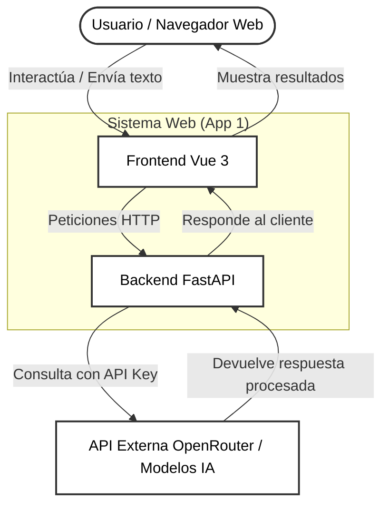
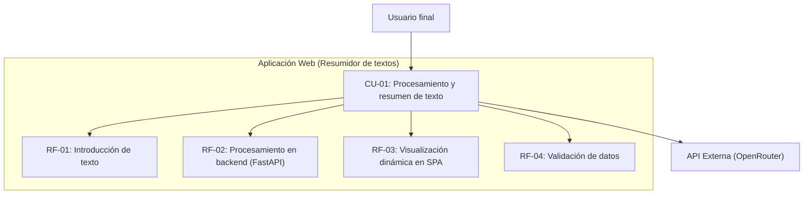

# Especificación de Requisitos del Software (ERS)

## Datos del documento

| Campo               | Valor                                                                      |
| ------------------- | -------------------------------------------------------------------------- |
| Nombre del proyecto | ResumidorAI                                                                |
| Autores             | Francisco Luis Cara García & Mario Delgado Ruiz                            |
| Curso y grupo       | Aprendizaje Automático: Gestión de Datos y Entrenamiento - Grupo 4         |
| Asignatura o módulo | Desarrollo de Componentes Software para Sistemas de Aprendizaje Automático |
| Docente             | Francisco Manuel Matías Prados                                             |
| Fecha               | 08/10/2026                                                                 |
| Versión             | 0.1                                                                        |
| Estado              | Borrador                                                                   |

### Historial de cambios

| Versión | Fecha      | Autor/es          | Cambios realizados            |
| ------- | ---------- | ----------------- | ----------------------------- |
| 0.1     | 08/10/2026 | Francisco & Mario | Primera versión del documento |

## Instrucciones para completar la plantilla

- Sustituye los textos entre corchetes por la información de tu proyecto.
- Describe **qué debe hacer el sistema** y las condiciones que debe cumplir. Evita detallar su implementación, salvo que exista una restricción obligatoria.
- Asigna un identificador único a cada requisito y mantenlo aunque cambie su descripción.
- Redacta una sola obligación por requisito, con un lenguaje claro y comprobable. Evita expresiones como «rápido», «fácil» o «seguro» sin definir cómo se comprobarán.
- Duplica las fichas y filas que necesites. Si una sección no corresponde a tu proyecto, indica «No aplica» y explica el motivo.
- Marca como «Pendiente» la información que todavía no se haya acordado; no presentes las suposiciones como hechos confirmados.
- Elimina estas instrucciones y los ejemplos antes de entregar la versión final.

## 1. Introducción

### 1.1. Propósito del documento

Esta Especificación de Requisitos del Software (ERS) tiene como finalidad definir las necesidades, el alcance, los requisitos funcionales y no funcionales, las interfaces y los criterios de aceptación de la aplicación web.

El documento servirá como referencia para los integrantes del equipo durante el análisis, desarrollo, pruebas y validación del sistema, así como para comprobar el cumplimiento de los requisitos establecidos en la práctica.

### 1.2. Problema y objetivos

**Problema o necesidad:** Se pretende crear un sistema que permita resumir textos sintetizando la información más importante y dando respuestas adecuadas, permitiendo la posibilidad de extraer conceptos relevantes e ideas principales dentro del contexto del texto.

| ID     | Objetivo del proyecto                                                                                               | Indicador de logro                                                                                                          |
| ------ | ------------------------------------------------------------------------------------------------------------------- | --------------------------------------------------------------------------------------------------------------------------- |
| OBJ-01 | Desarrollar una aplicación web modular de doble capa (frontend y backend) orientada al análisis y resumen de textos | La arquitectura desplegada separa correctamente las responsabilidades de interfaz y lógica de negocio                       |
| OBJ-02 | Implementar una interfaz de usuario interactiva y fluida en el frontend                                             | El usuario puede introducir texto, seleccionar opciones de síntesis y visualizar el resultado de manera clara               |
| OBJ-03 | Construir un servicio backend robusto capaz de procesar peticiones y gestionar la lógica de análisis                | Los endpoints expuestos devuelven respuestas estructuradas en formato JSON mediante HTTP                                    |
| OBJ-04 | Integrar capacidades de procesamiento de lenguaje natural para la extracción de ideas clave y resúmenes             | El sistema genera resúmenes coherentes y extrae conceptos relevantes a partir de entradas de texto                          |
| OBJ-05 | Garantizar la calidad del código y la fiabilidad del sistema mediante pruebas automatizadas                         | Se ejecutan con éxito tanto las pruebas unitarias y de integración del backend como los tests de componentes en el frontend |
| OBJ-06 | Documentar el proceso de desarrollo y diseño de la solución de manera clara y estructurada                          | Se cuenta con una especificación de requisitos completa                                                                     |

### 1.3. Alcance

**El sistema incluirá:**

- Una aplicación web de una sola página.
- Un único formulario para introducir los datos necesarios para realizar una función útil.
- El envío de los datos al backend para su validación y procesamiento.
- Una llamada a una única API de IA por cada envío válido.
- La visualización del resultado en la misma pantalla.
- La gestión de los estados de espera y error.

**Queda fuera del alcance:**

- Bases de datos y persistencia de las entradas o resultados.
- Historial de solicitudes o conversaciones.
- CRUD, paneles de administración y dashboards.
- Múltiples pantallas o rutas de navegación.
- Gestión propia de usuarios.
- Subida y procesamiento de archivos, RAG, agentes encadenados u otros servicios adicionales.

### 1.4. Definiciones y abreviaturas

| Término  | Definición                                                        |
| -------- | ----------------------------------------------------------------- |
| ERS      | Especificación de Requisitos del Software                         |
| SPA      | Aplicación web de una sola página                                 |
| API      | Interfaz que permite la comunicación entre sistemas software      |
| IA       | Inteligencia artificial                                           |
| HTTP     | Protocolo utilizado para la comunicación entre cliente y servidor |
| JSON     | Formato de intercambio de datos estructurados                     |
| Frontend | Parte de la aplicación con la que interactúa el usuario           |
| Backend  | Parte que valida los datos y se comunica con la API de IA         |
| RF       | Requisito funcional                                               |
| RNF      | Requisito no funcional                                            |

### 1.5. Referencias y fuentes

| ID     | Fuente                                  | Fecha o versión | Ubicación                  |
| ------ | --------------------------------------- | --------------- | -------------------------- |
| FUE-01 | Enunciado del desarrollo de la práctica | 08/10/2026      | [Práctica 01](PR01-UD1.md) |

## 2. Descripción general del sistema

### 2.1. Contexto y perspectiva del producto

[Explica si es un sistema nuevo o una ampliación, dónde se utilizará y con qué otros sistemas se relaciona. Puedes añadir un diagrama de contexto.]

Este proyecto es una aplicación web que posee una arquitectura limpia y separada en dos partes: por un lado, una interfaz web moderna y fluida para que cualquier usuario interactúe sin complicaciones, y por otro, un servidor backend que se encargue de procesar la lógica y comunicarse con los servicios de inteligencia artificial. El sistema funciona de forma autónoma en el entorno del usuario; el navegador se conecta con la API en el backend.

### 2.2. Personas interesadas y tipos de usuario

| ID     | Persona, colectivo o rol | Necesidad o responsabilidad                                                                                                                                                        | Permisos                                                                                                      | Conocimientos relevantes                                                                 |
| ------ | ------------------------ | ---------------------------------------------------------------------------------------------------------------------------------------------------------------------------------- | ------------------------------------------------------------------------------------------------------------- | ---------------------------------------------------------------------------------------- |
| ACT-01 | Usuario final            | Necesita una herramienta rápida y sencilla para introducir textos densos, obtener resúmenes claros y extraer ideas principales o respuestas contextuales sin complicaciones        | Acceso libre a la interfaz web para realizar consultas y procesar textos                                      | Ninguno técnico específico; uso intuitivo de navegadores web                             |
| ACT-02 | Docente                  | Necesita comprobar el correcto funcionamiento de la herramienta, evaluar la calidad de los resúmenes generados por la IA y revisar el cumplimiento de los objetivos de la práctica | Acceso completo a la interfaz web y, opcionalmente, a la revisión de la documentación y endpoints del sistema | Perfil académico/técnico con capacidad de análisis crítico                               |
| ACT-03 | Equipo de desarrollo     | Responsable de implementar la aplicación, mantener la arquitectura limpia, configurar el backend y conexión con APIs y asegurar que el sistema sea estable                         | Control total sobre el código fuente, despliegues, configuración de entorno, tests, etc.                      | Competencias técnicas en desarrollo web, Python, JavaScript/TypeScript y gestión de APIs |

### 2.3. Funciones principales

[Resume las capacidades principales del sistema. Los requisitos detallados se documentan en la sección 3.]

El sistema centra su funcionamiento en una única pantalla. Sus capacidades principales son las siguientes:

- Introducción y envío de texto mediante un único formulario web.
- Validación de los datos introducidos en el cliente y en el servidor.
- Procesamiento de la solicitud enviándola a la API de IA a través del backend.
- Recepción de la respuesta y visualización del resultado procesado en la misma pantalla.

### 2.4. Entorno de uso

| Aspecto                    | Descripción                                                                                                                                                                                           |
| -------------------------- | ----------------------------------------------------------------------------------------------------------------------------------------------------------------------------------------------------- |
| Dispositivos y plataformas | Aplicación web accesible desde cualquier ordenador de escritorio o dispositivo móvil a través de un navegador web moderno                                                                             |
| Condiciones de uso         | Diseñado para entornos de trabajo o académicos con acceso estable a Internet. Requiere conectividad continua para permitir la comunicación entre el navegador, el backend desplegado y la API externa |
| Volumen esperado           | Pensado para un uso personal o de pruebas académicas esporádicas, donde una sola persona hace peticiones individuales                                                                                 |

### 2.5. Restricciones

[Indica las limitaciones impuestas por el proyecto. Distingue las obligaciones de las preferencias del equipo.]

| ID     | Restricción                              | Origen o justificación                                                                                                        |
| ------ | ---------------------------------------- | ----------------------------------------------------------------------------------------------------------------------------- |
| RES-01 | Python y FastAPI (backend)               | Impuesto por los requisitos de la asignatura para garantizar la validación del servidor y el manejo del contrato JSON         |
| RES-02 | API única de IA                          | Impuesto por el docente para limitar la complejidad y centralizar las peticiones en un único proveedor                        |
| RES-03 | Vue, TypeScript y TailwindCSS (frontend) | Decisión tecnológica del equipo para construir una interfaz limpia, moderna, reactiva y adaptada a móviles                    |
| RES-04 | Pantalla única                           | Impuesto por el docente, limitando la aplicación a un único formulario y resultado                                            |
| RES-05 | Ausencia de persitencia o bases de datos | Impuesto por el docente para evitar almacenar historiales, perfiles, ficheros de datos, etc.                                  |
| RES-06 | Uso de una sola llamada por envío válido | Impuesto por el docente para evitar conversaciones con memoria, agentes encadenados o llamadas redundantes al proveedor de IA |

### 2.6. Suposiciones y dependencias

| ID     | Tipo        | Descripción                                                                                                                                                                  | Consecuencia si no se cumple                                                                                                                      |
| ------ | ----------- | ---------------------------------------------------------------------------------------------------------------------------------------------------------------------------- | ------------------------------------------------------------------------------------------------------------------------------------------------- |
| SUP-01 | Suposición  | La API de OpenRouter mantendrá un formato de respuesta estable y compatible durante el ciclo de desarrollo de la práctica                                                    | Si el proveedor modifica su estructura de manera imprevisible, el backend fallará al deserializar la respuesta y requerirá ajustes en el contrato |
| DEP-01 | Dependencia | Disponibilidad continua de conexión a Internet y créditos activos (o uso de modelos gratuitos) en la cuenta de OpenRouter para poder realizar las llamadas de prueba a la IA | Si el servicio externo se cae o se agotan los créditos, la aplicación no podrá procesar ninguna solicitud                                         |
| DEP-02 | Dependencia | Funcionamiento correcto de Vercel como plataforma de despliegue serverless tanto para el frontend como para el backend                                                       | Si surgen incompatibilidades de ejecución en servidor, se deberá reconfigurar el despliegue o buscar alternativas compatibles                     |

## 3. Requisitos funcionales

Los requisitos funcionales describen las acciones y comportamientos que debe ofrecer el sistema.

**Prioridades:** Alta = imprescindible para la versión prevista; Media = importante, pero puede aplazarse mediante acuerdo; Baja = deseable.

### 3.1. Catálogo de requisitos funcionales

| ID    | Nombre                                           | Prioridad             | Fuente                         | Estado                             |
| ----- | ------------------------------------------------ | --------------------- | ------------------------------ | ---------------------------------- |
| RF-00 | [Nombre breve]                                   | [Alta / Media / Baja] | [FUE-01 o rol que lo solicita] | [Propuesto / Validado / Pendiente] |
| RF-01 | Introducción de texto para resumen               | Alta                  | Desarrollador/es               | Propuesto                          |
| RF-02 | Procesamiento de solicitudes en el backend       | Alta                  | Desarrollador/es               | Propuesto                          |
| RF-03 | Visualización del resultado y gestión de estados | Alta                  | Desarrollador/es               | Propuesto                          |
| RF-04 | Validación de datos y control de errores         | Media                 | Desarrollador/es               | Pendiente                          |

### 3.2. Ficha de requisito funcional

#### RF-00. [Nombre del requisito] - TEMPLATE DE COPIA Y PEGA

| Campo                     | Descripción                                                                                  |
| ------------------------- | -------------------------------------------------------------------------------------------- |
| Enunciado                 | El sistema deberá [acción observable sobre un objeto, indicando las condiciones relevantes]. |
| Justificación             | [Necesidad que satisface]                                                                    |
| Actor                     | [Rol o sistema que inicia o recibe la acción]                                                |
| Prioridad                 | [Alta / Media / Baja]                                                                        |
| Fuente                    | [Referencia a la fuente]                                                                     |
| Precondiciones            | [Qué debe cumplirse antes de ejecutar la acción]                                             |
| Entradas                  | [Datos necesarios y sus condiciones de validez]                                              |
| Comportamiento esperado   | [Qué debe hacer el sistema]                                                                  |
| Salidas y postcondiciones | [Resultado observable y estado final]                                                        |
| Errores o alternativas    | [Qué debe ocurrir ante entradas incorrectas o situaciones excepcionales]                     |
| Dependencias              | [IDs de requisitos o reglas relacionados, o «Ninguna»]                                       |

**Criterios de aceptación:**

- **CA-RF01-01:** Dado [estado inicial], cuando [acción o evento], entonces [resultado concreto y verificable].
- **CA-RF01-02:** Dado [situación de error o caso límite], cuando [acción o evento], entonces [respuesta esperada].

#### RF-01. Introducción de texto para resumen

| Campo                     | Descripción                                                                                                                                                                   |
| ------------------------- | ----------------------------------------------------------------------------------------------------------------------------------------------------------------------------- |
| Enunciado                 | El sistema deberá permitir al usuario introducir un texto a través de un único formulario web para solicitar su resumen o procesamiento                                       |
| Justificación             | Es el punto de entrada indispensable de la aplicación para que el usuario pueda aportar la información que desea procesar                                                     |
| Actor                     | Usuario final                                                                                                                                                                 |
| Prioridad                 | Alta                                                                                                                                                                          |
| Fuente                    | Desarrollador/es                                                                                                                                                              |
| Precondiciones            | La aplicación web está abierta en el navegador y el formulario se encuentra disponible                                                                                        |
| Entradas                  | Texto libre introducido por el usuario en el área de texto del formulario                                                                                                     |
| Comportamiento esperado   | El sistema habilita un campo de texto interactivo, valida de forma preliminar que no esté vacío ni supere un máximo establecido y permite al usuario pulsar el botón de envío |
| Salidas y postcondiciones | Los datos del formulario quedan preparados para ser enviados al backend mediante una petición HTTP POST                                                                       |
| Errores o alternativas    | Si se detecta algún tipo de error en el campo de texto, el sistema muestra un aviso visual impidiendo la solicitud                                                            |
| Dependencias              | «Ninguna»                                                                                                                                                                     |

**Criterios de aceptación:**

- **CA-RF01-01:** Dado el formulario vacío, cuando el usuario introduce un texto válido y pulsa enviar, entonces se genera la petición HTTP hacia el servidor.
- **CA-RF01-02:** Dado el formulario vacío, cuando el usuario intenta enviar sin introducir contenido o contenido no permitido, entonces el sistema muestra una advertencia y no realiza la petición.

#### RF-02. Procesamiento de solicitudes en el backend

| Campo                     | Descripción                                                                                                                                                                                       |
| ------------------------- | ------------------------------------------------------------------------------------------------------------------------------------------------------------------------------------------------- |
| Enunciado                 | El sistema deberá recibir la petición en el backend con FastAPI, validar los datos de entrada, comunicarse de forma segura con la API de OpenRouter y devolver una respuesta estructurada en JSON |
| Justificación             | Centraliza la lógica de negocio y protege la clave privada de la API de IA, evitando exponer credenciales en el cliente                                                                           |
| Actor                     | Sistema backend (FastAPI) / API Externa (OpenRouter)                                                                                                                                              |
| Prioridad                 | Alta                                                                                                                                                                                              |
| Fuente                    | Desarrollador/es                                                                                                                                                                                  |
| Precondiciones            | El backend está activo y cuenta con la clave de OpenRouter configurada en las variables de entorno                                                                                                |
| Entradas                  | Objeto JSON recibido mediante POST conteniendo el texto enviado por el frontend                                                                                                                   |
| Comportamiento esperado   | El backend valida la estructura de la entrada, realiza una única llamada al proveedor de IA utilizando la clave privada, procesa la respuesta obtenida y la devuelve en formato JSON              |
| Salidas y postcondiciones | Respuesta HTTP con código de éxito (200) y el contenido procesado, o un código de error controlado en caso de fallo                                                                               |
| Errores o alternativas    | Si el proveedor externo falla o se agota el tiempo de espera, el backend intercepta el error y devuelve un código HTTP adecuado (ej. 502 o 504) con un mensaje JSON claro                         |
| Dependencias              | RF-01                                                                                                                                                                                             |

**Criterios de aceptación:**

- **CA-RF02-01:** Dado un texto válido recibido en el endpoint del backend, cuando se procesa correctamente con la IA, entonces se devuelve un JSON con el resultado esperado y estado 200.
- **CA-RF02-02:** Dado un fallo de comunicación con el proveedor de IA, cuando el backend detecta el error o timeout, entonces responde con un JSON de error controlado sin exponer trazas internas ni credenciales.

#### RF-03. Visualización del resultado y gestión de estados

| Campo                     | Descripción                                                                                                                                                                                                                  |
| ------------------------- | ---------------------------------------------------------------------------------------------------------------------------------------------------------------------------------------------------------------------------- |
| Enunciado                 | El sistema deberá mostrar los diferentes estados de la interfaz de forma dinámica en la misma pantalla sin recargar la página                                                                                                |
| Justificación             | Proporciona una experiencia de usuario fluida y transparente mientras la aplicación se comunica con el servidor y la IA                                                                                                      |
| Actor                     | Usuario final / Frontend SPA (Vue)                                                                                                                                                                                           |
| Prioridad                 | Alta                                                                                                                                                                                                                         |
| Fuente                    | Desarrollador/es                                                                                                                                                                                                             |
| Precondiciones            | El usuario ha enviado una solicitud a través del formulario                                                                                                                                                                  |
| Entradas                  | Respuesta JSON obtenida desde el backend (éxito o error) o estado de carga pendiente                                                                                                                                         |
| Comportamiento esperado   | El frontend bloquea temporalmente el envío duplicado y muestra un indicador visual de carga; al recibir la respuesta, muestra el resultado formateado limpiamente en la misma pantalla o el mensaje de error correspondiente |
| Salidas y postcondiciones | El resultado o el error quedan visibles para el usuario en la interfaz, restaurando el formulario para nuevas consultas                                                                                                      |
| Errores o alternativas    | Si la respuesta del servidor indica un error, el texto descriptivo del fallo se muestra destacado en la interfaz                                                                                                             |
| Dependencias              | RF-01, RF-02                                                                                                                                                                                                                 |

**Criterios de aceptación:**

- **CA-RF03-01:** Dada una petición en curso, cuando el usuario pulsa enviar, entonces el botón se deshabilita y aparece un indicador de carga visible.
- **CA-RF03-02:** Dada una respuesta correcta del backend, cuando se procesa el JSON, entonces el resultado se renderiza de forma legible en la misma pantalla.

#### RF-04. Validación de datos y control de límites

| Campo                     | Descripción                                                                                                                                            |
| ------------------------- | ------------------------------------------------------------------------------------------------------------------------------------------------------ |
| Enunciado                 | El sistema deberá rechazar en el backend aquellas peticiones que superen los límites de longitud establecidos o contengan formatos de datos no válidos |
| Justificación             | Garantiza la robustez del servidor frente a abusos, entradas excesivamente grandes o datos malformados                                                 |
| Actor                     | Sistema backend (FastAPI)                                                                                                                              |
| Prioridad                 | Media                                                                                                                                                  |
| Fuente                    | Desarrollador/es                                                                                                                                       |
| Precondiciones            | El backend cuenta con esquemas de validación definidos, como Pydantic                                                                                  |
| Entradas                  | Datos JSON enviados desde el cliente con textos excesivamente largos o vacíos                                                                          |
| Comportamiento esperado   | El backend comprueba la longitud y el tipo de los datos; si no cumplen los criterios, rechaza la operación inmediatamente sin llamar al servicio de IA |
| Salidas y postcondiciones | Respuesta HTTP 422 (Unprocessable Entity) con un mensaje explicativo sobre el error de validación                                                      |
| Errores o alternativas    | Si la entrada es válida, el flujo continúa normalmente hacia la IA                                                                                     |
| Dependencias              | RF-02                                                                                                                                                  |

**Criterios de aceptación:**

- **CA-RF04-01:** Dado un texto que supera el límite máximo de caracteres permitido, cuando se envía al backend, entonces se rechaza con código 422 sin consumir créditos de la IA.
- **CA-RF04-02:** Dado un formato JSON inválido o ausente en la petición, cuando el backend lo evalúa, entonces devuelve el error de validación correspondiente.

## 4. Requisitos no funcionales

Describen propiedades de calidad y condiciones de funcionamiento. Incluye únicamente las categorías relevantes y define una comprobación objetiva para cada requisito.

| ID     | Categoría                  | Requisito medible                                                                                                                             | Condiciones de comprobación                                                                                                  | Criterio de aceptación                                                                                                                     | Prioridad |
| ------ | -------------------------- | --------------------------------------------------------------------------------------------------------------------------------------------- | ---------------------------------------------------------------------------------------------------------------------------- | ------------------------------------------------------------------------------------------------------------------------------------------ | --------- |
| RNF-01 | Rendimiento                | El backend deberá responder a la petición de procesamiento en un tiempo máximo de 10 segundos, dependiendo de la latencia del proveedor de IA | Entorno de pruebas local con un texto de prueba estándar de 500 palabras y conexión estable a Internet                       | El tiempo de respuesta de la API se mantiene por debajo de 10 segundos en al menos 9 de cada 10 solicitudes consecutivas                   | Alta      |
| RNF-02 | Seguridad y privacidad     | La clave de la API de IA no debe exponerse al frontend y las entradas y resultados no deben persistirse                                       | Inspección de código fuente, variables de entorno y análisis de tráfico de red durante la ejecución                          | El frontend nunca recibe ni expone la clave de la IA, y ningún dato del formulario queda guardado en bases de datos o almacenamiento local | Alta      |
| RNF-03 | Usabilidad y accesibilidad | El formulario y los mensajes deben permitir comprender cómo introducir los datos y qué ocurre al enviar la solicitud                          | Pruebas manuales en navegadores actuales reduciendo y ampliando la ventana de visualización                                  | El formulario se adapta correctamente a pantallas de escritorio y móviles, indicando visualmente cuándo hay una petición en curso          | Media     |
| RNF-04 | Fiabilidad y recuperación  | El sistema debe gestionar los fallos del proveedor sin mostrar errores técnicos sensibles                                                     | Simulación de corte de conexión o error de respuesta del proveedor externo mediante pruebas automatizadas con mocks (pytest) | El sistema responde con el código de error HTTP acordado y un mensaje JSON legible, sin mostrar trazas internas ni caídas de servidor      | Alta      |
| RNF-05 | Compatibilidad             | La aplicación web debe ser compatible con los estándares web modernos                                                                         | Ejecución de compilación y despliegue de prueba en el entorno de Vercel para frontend y backend                              | La SPA compila sin errores de TypeScript y el backend despliega la instancia de FastAPI procesando correctamente las peticiones            | Alta      |

**Ejemplo orientativo — eliminar al completar:**

> RNF-01: El sistema deberá mostrar los resultados de búsqueda en un máximo de 2 segundos para al menos el 95 % de 100 búsquedas de prueba, con 20 usuarios simultáneos y 10 000 registros, en el entorno de pruebas acordado y descrito en la sección 2.4.

## 5. Datos y reglas de negocio

### 5.1. Información que gestionará el sistema

| ID     | Entidad o conjunto de datos        | Campos principales                                                                                 | Validaciones                                                           | Acceso y conservación                                                                                                                 |
| ------ | ---------------------------------- | -------------------------------------------------------------------------------------------------- | ---------------------------------------------------------------------- | ------------------------------------------------------------------------------------------------------------------------------------- |
| DAT-00 | [Usuario, producto, reserva, etc.] | [Campos y tipos de datos]                                                                          | [Obligatoriedad, unicidad, rangos y relaciones]                        | [Quién puede consultar o modificar; cuándo se elimina]                                                                                |
| DAT-01 | Petición de resumen (Transitoria)  | **texto (String):** Contenido a resumir                                                            | Obligatorio, no vacío; longitud máxima permitida (ej. 5000 caracteres) | Acceso exclusivo temporal en memoria durante el procesamiento de la request; no se conserva ni almacena en ningún soporte persistente |
| DAT-02 | Petición de resumen (Transitoria)  | **resultado (String):** Texto procesado/resumen   **estado (Integer):** Código HTTP de control | Formato JSON válido estructurado por el backend                        | Se transmite inmediatamente al frontend para su visualización y se desecha de la memoria del servidor                                 |

### 5.2. Reglas de negocio

Las reglas de negocio expresan condiciones del ámbito del problema que el sistema debe respetar.

| ID    | Regla                                                                                                                                                                                                              | Requisitos relacionados | Fuente               |
| ----- | ------------------------------------------------------------------------------------------------------------------------------------------------------------------------------------------------------------------ | ----------------------- | -------------------- |
| RN-00 | [Ejemplo: un usuario no puede tener más de tres reservas activas a la vez.]                                                                                                                                        | [RF-01, etc.]           | [Fuente de la regla] |
| RN-01 | **No aplica:** El sistema no gestiona lógica de dominio ni reglas funcionales de negocio complejas; únicamente aplica validaciones técnicas de formato, longitud de entrada y control de llamadas a la API externa | RF-02, RF-04            | FUE-01               |

## 6. Interfaces externas

### 6.1. Interfaz de usuario

| ID    | Pantalla o interacción | Usuarios      | Información y acciones necesarias                                                                                                                                                | Requisitos relacionados |
| ----- | ---------------------- | ------------- | -------------------------------------------------------------------------------------------------------------------------------------------------------------------------------- | ----------------------- |
| IU-01 | [Nombre]               | [Roles]       | [Datos visibles, entradas, acciones y mensajes]                                                                                                                                  | [RF / RNF]              |
| IU-01 | Vista única principal  | Usuario final | **Entrada:** Área de texto para introducir el contenido   **Acciones:** Botón de envío   **Salida:** Indicador de carga y bloque de visualización del resultado o error. | RF-01, RF-03            |

[Añade enlaces o imágenes de bocetos si ayudan a aclarar los requisitos. Indica si son orientativos o vinculantes.]

> FALTA POR DEFINIR EN CASO NECESARIO

### 6.2. Interfaces con otros sistemas o dispositivos

| ID     | Sistema o dispositivo externo  | Información intercambiada                                                                                                                            | Dirección y momento del intercambio                                                                | Formato o protocolo exigido                | Respuesta ante fallos                                                                                               |
| ------ | ------------------------------ | ---------------------------------------------------------------------------------------------------------------------------------------------------- | -------------------------------------------------------------------------------------------------- | ------------------------------------------ | ------------------------------------------------------------------------------------------------------------------- |
| INT-00 | [Nombre]                       | [Datos enviados o recibidos]                                                                                                                         | [Entrada / Salida / Ambas; cuándo]                                                                 | [Formato acordado o «Pendiente»]           | [Comportamiento esperado]                                                                                           |
| INT-01 | API Externa de IA (OpenRouter) | **Envío:** Prompt estructurado con el texto a resumir y la configuración del modelo   **Recepción:** Respuesta del modelo con el texto procesado | Salida y Entrada se ejecutan de forma síncrona en cada petición válida enviada desde el formulario | HTTP / HTTPS y clave privada en el backend | Interceptación de excepciones, control de timeout e inversión de códigos de error HTTP controlados hacia el cliente |

> FALTA POR DEFINIR EN CASO NECESARIO

## 7. Casos de uso o escenarios de usuario

Los escenarios muestran cómo se combinan los requisitos para realizar una tarea. Referencia sus identificadores para evitar duplicar especificaciones.

### CU-00. [Nombre del caso de uso] - TEMPLATE PARA COPIA Y PEGA

| Campo                   | Descripción                         |
| ----------------------- | ----------------------------------- |
| Objetivo                | [Qué quiere conseguir el actor]     |
| Actor principal         | [Rol]                               |
| Precondiciones          | [Estado necesario antes de empezar] |
| Evento de inicio        | [Qué desencadena el escenario]      |
| Requisitos relacionados | [RF-01, RNF-01, RN-01, etc.]        |

**Flujo principal:**

1. [El actor realiza una acción.]
2. [El sistema responde.]
3. [El actor o el sistema completa la tarea.]

**Flujos alternativos y excepciones:**

- **A1 — [Nombre]:** En el paso [n], si [condición], el sistema [respuesta] y el flujo [continúa en el paso… / termina].

**Postcondiciones:** [Estado final cuando se completa la tarea y cuando falla, si corresponde.]

### CU-01. Procesamiento y resumen de texto en la aplicación

| Campo                   | Descripción                                                                                                                                    |
| ----------------------- | ---------------------------------------------------------------------------------------------------------------------------------------------- |
| Objetivo                | Introducir un texto en la interfaz web para obtener un resumen o procesamiento generado por la inteligencia artificial de forma rápida y clara |
| Actor principal         | Usuario final                                                                                                                                  |
| Precondiciones          | La aplicación web está abierta en el navegador, el backend se encuentra en ejecución y el servicio externo de IA está disponible               |
| Evento de inicio        | El usuario accede a la única pantalla de la aplicación y pulsa el botón de envío tras introducir el texto en el formulario                     |
| Requisitos relacionados | RF-01, RF-02, RF-03, RF-04, RNF-01, RNF-02, RNF-03, RNF-04                                                                                     |

**Flujo principal:**

1. El usuario introduce o pega el texto que desea procesar en el área de texto del formulario único.
2. El usuario hace clic en el botón de envío de la solicitud.
3. El frontend valida preliminarmente que el campo no esté vacío, deshabilita temporalmente el botón y muestra un indicador visual de carga.
4. El frontend envía una petición HTTP POST con los datos JSON al backend en FastAPI.
5. El backend valida la estructura y longitud de los datos de entrada.
6. El backend realiza de forma síncrona una única llamada segura al proveedor de IA (OpenRouter) utilizando la clave privada configurada en el servidor.
7. El proveedor de IA procesa la solicitud y devuelve el resultado generado al backend.
8. El backend empaqueta el resultado en una respuesta JSON con código HTTP 200 y la envía al frontend.
9. El frontend recibe la respuesta, oculta el indicador de carga y muestra el resultado procesado de forma limpia y legible en la misma pantalla.

**Flujos alternativos y excepciones:**

- **A1 — Entrada inválida o vacía:** En el paso 3 o 5, si el texto introducido está vacío o supera los límites permitidos, el sistema rechaza la petición, muestra una advertencia o error, y restaura el formulario sin realizar ninguna llamada a la IA.
- **A2 — Fallo de comunicación o timeout del proveedor de IA:** En el paso 6 o 7, si el servicio externo de IA falla, experimenta un tiempo de espera excesivo o no responde, el backend intercepta la excepción y responde al cliente con un código de error controlado (ej. 502/504) y un mensaje JSON descriptivo. El frontend lo muestra en pantalla de forma limpia.
- **A3 — Acceso no autorizado (App 2 con Clerk):** En el paso 4, si se trata de la App 2 y la petición no incluye un token de sesión válido de Clerk (o ha caducado), el backend rechaza la solicitud con un código HTTP 401, impidiendo el consumo de la IA y mostrando un aviso de autenticación en la interfaz.

**Postcondiciones:**

- **Éxito:** El resultado generado por la IA queda visible en la interfaz para el usuario, sin haberse almacenado ningún dato de forma persistente.
- **Fallo:** Se muestra un mensaje de error comprensible en la pantalla y la aplicación permanece limpia, lista para que el usuario intente una nueva consulta.

**Diagrama**

## 8. Verificación y trazabilidad

Relaciona cada requisito con su origen y con una prueba, inspección o demostración que permita comprobarlo. Añade tantas filas como necesites para cubrir todos los requisitos funcionales y no funcionales.

| Requisito | Objetivo o necesidad de origen | Criterio de aceptación                                                  | ID de prueba | Método y datos de comprobación                                                                    | Resultado esperado                                                                              |
| --------- | ------------------------------ | ----------------------------------------------------------------------- | ------------ | ------------------------------------------------------------------------------------------------- | ----------------------------------------------------------------------------------------------- |
| RF-00     | [OBJ-01 / FUE-01]              | [CA-RF01-01]                                                            | [PR-00]      | [Pasos y datos concretos]                                                                         | [Resultado observable]                                                                          |
| RNF-00    | [OBJ-01 / FUE-01]              | [Criterio de la sección 4]                                              | [PR-00]      | [Procedimiento y entorno]                                                                         | [Umbral exigido]                                                                                |
| RF-01     | FUE-01 / OBJ-02                | CA-RF01-01                                                              | PR-01        | Introducir un texto válido en el campo del formulario de la SPA y pulsar el botón de envío        | Se genera correctamente la petición HTTP y se prepara el envío de datos                         |
| RF-02     | FUE-01 / OBJ-03                | CA-RF02-01                                                              | PR-02        | Enviar una petición POST simulada con un JSON válido directamente al endpoint del backend         | El backend procesa la llamada con la IA y devuelve un JSON con código 200                       |
| RF-03     | FUE-01 / OBJ-02                | CA-RF03-01                                                              | PR-03        | Enviar la solicitud desde la interfaz y comprobar el comportamiento visual de la pantalla         | El botón se deshabilita temporalmente y aparece el indicador de carga visible                   |
| RF-04     | FUE-01 / OBJ-03                | CA-RF04-01                                                              | PR-04        | Enviar un texto que supere el límite de longitud o esté vacío al backend o formulario             | El sistema rechaza la operación inmediatamente (código 422 o aviso visual) sin llamar a la IA   |
| RNF-01    | FUE-01 / OBJ-03                | El tiempo de respuesta se mantiene por debajo de 10s en el 90% de casos | PR-05        | Medir el tiempo de respuesta del backend con un texto estándar de 500 palabras y conexión estable | El sistema responde en un tiempo inferior a 10 segundos                                         |
| RNF-02    | FUE-01 / OBJ-03                | Clave oculta y ausencia absoluta de persistencia                        | PR-06        | Inspección de código fuente, variables de entorno y análisis de tráfico de red / bases de datos   | El frontend no expone credenciales y no se almacena ningún dato de forma persistente            |
| RNF-03    | FUE-01 / OBJ-02                | Adaptabilidad móvil/escritorio e indicadores visuales claros            | PR-07        | Pruebas manuales en navegadores actuales ajustando el tamaño de la ventana y ejecutando envíos    | El diseño se adapta correctamente y muestra con claridad los estados de carga o error           |
| RNF-04    | FUE-01 / OBJ-05                | Respuesta controlada ante fallos o timeout de la IA                     | PR-08        | Ejecutar test unitario con pytest simulando un fallo externo mediante mocks                       | El backend captura la excepción y responde con el código HTTP de error y JSON descriptivo       |
| RNF-05    | FUE-01 / OBJ-01                | Compilación correcta en TS y despliegue en Vercel                       | PR-09        | Ejecutar la compilación del proyecto y realizar un despliegue de prueba en Vercel                 | La SPA compila sin errores y el backend despliega la instancia de FastAPI procesando peticiones |

## 9. Cuestiones pendientes

| ID     | Duda o decisión pendiente                        | Requisitos afectados | Responsable de resolverla | Fecha prevista | Resolución                                                |
| ------ | ------------------------------------------------ | -------------------- | ------------------------- | -------------- | --------------------------------------------------------- |
| PEN-00 | [Qué falta por aclarar]                          | [IDs]                | [Persona o rol]           | [Fecha]        | [Pendiente / Decisión acordada y fecha]                   |
| PEN-01 | ¿Qué necesidad concreta resolverá la aplicación? | RF-01                | Desarrollador/es          | 08/10/2026     | Resumir textos de forma rápida y automatizada mediante IA |
| PEN-02 | ¿Qué campos tendrá el formulario?                | RF-01, IU-01         | Desarrollador/es          | [Fecha]        | [Pendiente]                                               |
| PEN-03 | ¿Qué proveedor y modelo de IA utilizaremos?      | RF-02, INT-01        | Desarrollador/es          | [Fecha]        | [Pendiente]                                               |
| PEN-04 | ¿Qué límite de entrada y timeout estableceremos? | RNF-01, RF-04        | Desarrollador/es          | [Fecha]        | [Pendiente]                                               |
| PEN-05 | ¿Qué esquema JSON devolverá el backend?          | RF-02                | Desarrollador/es          | [Fecha]        | [Pendiente]                                               |
| PEN-06 | ¿Qué condiciones de uso vamos a considerar?      | RNF-02               | Desarrollador/es          | [Fecha]        | [Pendiente]                                               |

## 10. Revisión y conformidad

### 10.1. Lista de comprobación antes de entregar

- [ ] El problema, los objetivos y los límites del sistema están definidos.
- [ ] Se identifican los usuarios y sus permisos.
- [ ] Cada requisito tiene un identificador único.
- [ ] Los requisitos son claros, necesarios y no se contradicen.
- [ ] Cada requisito funcional expresa una obligación y tiene criterios de aceptación verificables.
- [ ] Se contemplan los errores y los casos límite relevantes.
- [ ] Los requisitos no funcionales incluyen medidas y condiciones de comprobación.
- [ ] Los datos, las reglas de negocio y las interfaces están descritos.
- [ ] Todos los requisitos están relacionados con su origen y su comprobación.
- [ ] Las dudas pendientes están identificadas y tienen un responsable.
- [ ] Se han sustituido los marcadores, eliminado los ejemplos y justificado los apartados que no aplican.
- [ ] Se han actualizado la fecha, la versión y el historial de cambios.

### 10.2. Registro de revisión

| Revisor y rol     | Versión revisada | Fecha      | Resultado                     | Observaciones                                    |
| ----------------- | ---------------- | ---------- | ----------------------------- | ------------------------------------------------ |
| [Nombre y rol]    | [Versión]        | [Fecha]    | [Conforme / Requiere cambios] | [Comentarios]                                    |
| Francisco & Mario | 0.1              | 08/10/2026 | Requiere cambios              | Revisión inicial de requisitos y estructura base |
| Francisco & Mario | 0.1              | 13/10/2026 | Conforme                      | Primera versión de ERS completada                |

## Anexos

[Incluye, si procede, diagramas, bocetos, ejemplos de datos, entrevistas u otro material que ayude a comprender los requisitos. Referencia cada anexo desde la sección correspondiente.]
