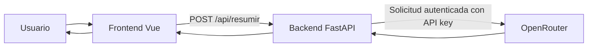
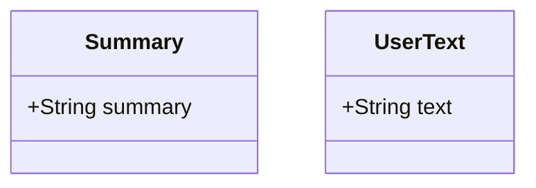
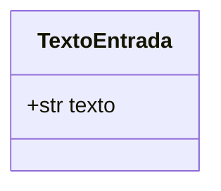

# Especificación de Requisitos del Software (ERS), App 1

## Datos del documento

| Campo             | Valor                                                                      |
| ----------------- | -------------------------------------------------------------------------- |
| Proyecto          | ResumidorIA, App 1                                                         |
| Autores           | Francisco Luis Cara García y Mario Delgado Ruiz                            |
| Asignatura        | Desarrollo de Componentes Software para Sistemas de Aprendizaje Automático |
| Fecha de revisión | 02/11/2026                                                                 |
| Versión           | 0.2                                                                        |
| Estado            | Revisada; pruebas automatizadas comprobadas y despliegue pendiente         |

### Historial de cambios

| Versión | Fecha      | Cambios                                                                                                                                         |
| ------- | ---------- | ----------------------------------------------------------------------------------------------------------------------------------------------- |
| 0.1     | 08/10/2026 | Primera versión                                                                                                                                 |
| 0.2     | 02/11/2026 | Eliminación de instrucciones de plantilla y ajuste al comportamiento implementado; definición del contrato de errores y trazabilidad de pruebas |

## 1. Introducción

### 1.1. Propósito

Este documento define el alcance, los requisitos funcionales y no funcionales y los criterios de aceptación de App 1. Se utiliza como referencia para el desarrollo y la comprobación de la aplicación.

### 1.2. Problema y objetivos

App 1 permite obtener una síntesis de un texto sin que el usuario tenga que seleccionar manualmente sus ideas principales. El navegador presenta el formulario y el backend valida la entrada y consulta al proveedor de IA.

Objetivos:

- Permitir introducir texto de forma sencilla.
- Generar un resumen mediante OpenRouter.
- Validar la entrada tanto en la interfaz como en el servidor.
- Mostrar estados de carga y mensajes de error comprensibles.
- Mantener la clave privada del proveedor en el backend.
- Comprobar el comportamiento mediante pruebas automatizadas.

### 1.3. Alcance

La aplicación incluye una interfaz web de una sola pantalla, un área de texto, contador de palabras y caracteres, borrado del contenido, carga por arrastre de archivos `.txt` y `.md`, generación de un resumen y visualización del resultado.

La aplicación admite un máximo de 5000 caracteres de texto y un máximo de 1 MiB por archivo. El contenido de un archivo admitido se limita a los primeros 5000 caracteres antes de utilizarlo.

Quedan fuera del alcance la autenticación propia, el almacenamiento persistente, el historial de consultas, la base de datos y la gestión de conversaciones.

### 1.4. Definiciones

| Término  | Definición                                                      |
| -------- | --------------------------------------------------------------- |
| API      | Interfaz de comunicación entre aplicaciones                     |
| Backend  | Parte del servidor que valida la petición y consulta OpenRouter |
| Frontend | Interfaz web que utiliza el usuario                             |
| IA       | Inteligencia artificial                                         |
| JSON     | Formato de intercambio de datos                                 |
| ERS      | Especificación de Requisitos del Software                       |

## 2. Descripción general

### 2.1. Contexto

App 1 es una aplicación web cliente-servidor. El frontend está desarrollado con Vue 3, TypeScript y Vite. El backend utiliza FastAPI y realiza las peticiones a OpenRouter. El navegador no recibe la clave privada del proveedor.



### 2.2. Actores

| Actor                | Responsabilidad                                               |
| -------------------- | ------------------------------------------------------------- |
| Usuario final        | Introduce o carga un texto y consulta el resumen              |
| Backend              | Valida la entrada, llama al proveedor y devuelve el resultado |
| OpenRouter           | Procesa la solicitud de generación de texto                   |
| Equipo de desarrollo | Mantiene el código, las pruebas y la documentación            |

### 2.3. Restricciones y dependencias

- El backend utiliza Python, FastAPI y Uvicorn.
- El frontend utiliza Vue 3, TypeScript y Vite.
- La generación depende de la disponibilidad de OpenRouter y de una clave API válida.
- La aplicación no almacena de forma persistente los textos ni los resultados.
- El punto de entrada local es `app1/main.py`, que crea la instancia `app` y registra las rutas de `app1/backend/routes.py`.

## 3. Requisitos funcionales

| ID    | Requisito                                           | Prioridad |
| ----- | --------------------------------------------------- | --------- |
| RF-01 | Introducir texto mediante el formulario             | Alta      |
| RF-02 | Cargar archivos `.txt` y `.md` mediante arrastre    | Media     |
| RF-03 | Validar el texto y sus límites                      | Alta      |
| RF-04 | Enviar la petición al backend y generar el resumen  | Alta      |
| RF-05 | Mostrar el resultado y los estados de carga y error | Alta      |
| RF-06 | Permitir borrar el texto introducido                | Media     |

### RF-01. Introducción de texto

El sistema permitirá escribir o pegar texto en el área de entrada.

Criterios de aceptación:

- CA-01. El formulario muestra un área de texto y el contador de caracteres.
- CA-02. El botón de envío permanece deshabilitado cuando no hay texto o mientras se procesa una petición.

### RF-02. Carga de archivos

El sistema permitirá cargar por arrastre archivos con extensión `.txt` o `.md`, siempre que no superen 1 MiB.

Criterios de aceptación:

- CA-03. Un archivo admitido se lee y su contenido se introduce en el área de texto.
- CA-04. Una extensión no admitida o un archivo superior a 1 MiB produce un mensaje de error visible.
- CA-05. El contenido leído se limita a 5000 caracteres.

### RF-03. Validación de entrada

El backend aceptará un objeto JSON con el campo `texto`, de tipo cadena y longitud entre 1 y 5000 caracteres. También rechazará cadenas que solo contengan espacios en blanco.

Criterios de aceptación:

- CA-06. Una entrada válida se limpia de espacios exteriores antes de enviarse al proveedor.
- CA-07. Una entrada vacía, compuesta solo por espacios o superior al límite se rechaza con HTTP 422.

### RF-04. Generación del resumen

El backend expondrá `POST /api/resumir`. Para una entrada válida realizará una única solicitud a OpenRouter y devolverá `{"resumen": "..."}` cuando la respuesta sea correcta.

Criterios de aceptación:

- CA-08. Una respuesta válida del proveedor produce HTTP 200 y un campo `resumen` no vacío.
- CA-09. La clave de OpenRouter se utiliza exclusivamente en el backend.
- CA-10. Una respuesta vacía o mal formada del proveedor se trata como error del proveedor.

### RF-05. Visualización y gestión de estados

El frontend mostrará el resumen recibido, indicará que la petición está en curso y presentará un mensaje visible cuando falle.

Criterios de aceptación:

- CA-11. Mientras se procesa la solicitud se muestra un estado de carga y se deshabilita el envío.
- CA-12. Si la petición falla, se muestra un aviso de error separado del área del resumen.
- CA-13. Al iniciar un nuevo intento se limpia el mensaje de error anterior.

### RF-06. Borrado del texto

El usuario podrá borrar el contenido del área de texto mediante el botón correspondiente.

Criterios de aceptación:

- CA-14. Al pulsar el botón de borrado, el área de texto queda vacía y el envío vuelve a estar deshabilitado.

## 4. Contrato HTTP y errores

Endpoint: `POST /api/resumir`

Petición:

```json
{
	"texto": "Texto que se desea resumir"
}
```

Respuesta correcta, HTTP 200:

```json
{
	"resumen": "Resumen generado por el proveedor"
}
```

Todas las respuestas de error utilizan un objeto JSON con el campo `detail`, de tipo cadena.

| Situación                                                              | HTTP | Ejemplo de respuesta                                                     |
| ---------------------------------------------------------------------- | ---: | ------------------------------------------------------------------------ |
| Entrada vacía, solo espacios, tipo incorrecto o más de 5000 caracteres |  422 | `{"detail":"El campo 'texto' debe contener entre 1 y 5000 caracteres."}` |
| Fallo del proveedor o respuesta no válida                              |  502 | `{"detail":"No se pudo obtener un resumen válido de OpenRouter."}`       |
| Tiempo de espera agotado                                               |  504 | `{"detail":"El proveedor tardó demasiado en responder."}`                |

El formato de error evita devolver trazas internas, credenciales o detalles técnicos innecesarios. Los mensajes concretos pueden variar para errores controlados distintos, pero mantienen el campo `detail`.

## 5. Requisitos no funcionales

| ID     | Requisito                                                                                                                     |
| ------ | ----------------------------------------------------------------------------------------------------------------------------- |
| RNF-01 | La clave privada de OpenRouter no aparecerá en el código del frontend ni en las respuestas HTTP.                              |
| RNF-02 | El backend aplicará un límite de 5000 caracteres a la entrada.                                                                |
| RNF-03 | La interfaz indicará visualmente los estados de carga y error.                                                                |
| RNF-04 | Las pruebas automatizadas del backend simularán las respuestas del proveedor y no dependerán de llamadas reales a OpenRouter. |
| RNF-05 | El proyecto incluirá instrucciones para instalar dependencias y arrancar la aplicación desde un entorno nuevo.                |
| RNF-06 | La aplicación no persistirá textos ni resúmenes en una base de datos.                                                         |

## 6. Interfaces externas

### 6.1. Interfaz de usuario

La interfaz ofrece un área de texto, un contador de palabras y caracteres, un botón para borrar, una zona de arrastre de archivos y un botón para generar el resumen. Los resultados y errores se presentan en la misma pantalla.

### 6.2. Interfaz HTTP

El frontend realiza una petición `POST` a `/api/resumir` con un cuerpo JSON que contiene `texto`. El backend devuelve el resultado o un error con el formato definido en la sección 4.

### 6.3. Proveedor externo

El backend envía una petición a la API de OpenRouter utilizando la clave configurada mediante la variable de entorno `OPENROUTER_API_KEY`. La conexión tiene límites de espera configurados en el cliente HTTP.

## 7. Escenario principal

1. El usuario abre la aplicación.
2. Introduce texto o carga un archivo permitido.
3. La interfaz comprueba los límites de entrada.
4. El usuario pulsa «Resumir Texto».
5. El frontend muestra el estado de carga y envía la petición al backend.
6. El backend valida la entrada y solicita el resumen a OpenRouter.
7. El backend devuelve el resultado en JSON.
8. El frontend muestra el resumen.

Si la entrada no es válida o falla el proveedor, se muestra un mensaje de error y la interfaz permanece operativa.

## 8. Verificación y trazabilidad

| Requisito           | Evidencia de verificación                                                      |
| ------------------- | ------------------------------------------------------------------------------ |
| RF-01, RF-05, RF-06 | `app1/frontend/src/__tests__/App.spec.ts`                                      |
| RF-02               | Validación de archivo en `app1/frontend/src/App.vue`; suite frontend ejecutada |
| RF-03, RF-04        | `app1/backend/tests/test_routes.py` y `app1/backend/tests/test_openrouter.py`  |
| RNF-01              | Inspección de configuración y código; verificación de despliegue pendiente     |
| RNF-04              | Pruebas de backend con mocks                                                   |

Comando de pruebas del backend:

```bash
cd app1
uv run pytest -q
```

El 02/11/2026 se ejecutaron 18 pruebas del backend desde `app1/`. También pasaron 8 pruebas de Vitest y la compilación del frontend desde `app1/frontend`.

## 9. Modelos de datos

Los modelos de datos utilizados para la aplicación están divididos en dos principalmente:

- Los que hay en el frontend
- Y los que existen en el backend

**Frontend:**

1. `Summary` se usa para almacenar la respuesta del backend que contiene el resumen del texto introducido por el usuario.
2. `UserText` se usa para contener el texto introducido por el usuario, el que se envía al backend (API) para que el modelo sea igual y evitar problemas de modelado entre input/output.



**Backend:**

`TextoEntrada` se usa para recibir el texto que proviene del frontend y contiene el texto del usuario para ser resumido.



## 10. Pendientes de validación

- Verificar el flujo completo en la URL publicada de Vercel.
- Revisar los criterios de aceptación con el equipo y el docente.
- Adjuntar evidencias de despliegue y pruebas manuales.

## 11. Revisión

Esta versión describe el comportamiento observado en el código revisado el 02/11/2026. La suite backend se ejecutó con 18 pruebas superadas, la suite frontend con 8 pruebas superadas y la compilación terminó correctamente. La verificación del despliegue sigue pendiente.
