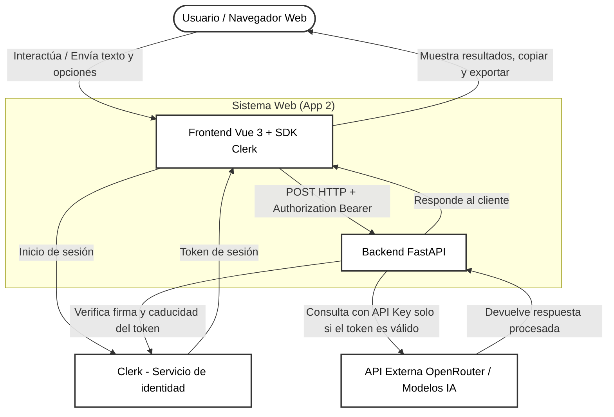
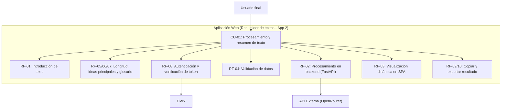

# Especificación de Requisitos del Software (ERS)

## Datos del documento

| Campo               | Valor                                                                      |
| ------------------- | -------------------------------------------------------------------------- |
| Nombre del proyecto | ResumidorIA (App 2)                                                        |
| Autores             | Francisco Luis Cara García & Mario Delgado Ruiz                            |
| Curso y grupo       | Aprendizaje Automático: Gestión de Datos y Entrenamiento - Grupo 4         |
| Asignatura o módulo | Desarrollo de Componentes Software para Sistemas de Aprendizaje Automático |
| Docente             | Francisco Manuel Matías Prados                                             |
| Fecha               | 18/10/2026                                                                 |
| Versión             | 0.1                                                                        |
| Estado              | Borrador                                                                   |

### Historial de cambios

| Versión | Fecha      | Autor/es          | Cambios realizados                                                                                                              |
| ------- | ---------- | ----------------- | ------------------------------------------------------------------------------------------------------------------------------- |
| 0.1     | 18/10/2026 | Francisco & Mario | Primera versión de la ERS de la App 2, derivada de la ERS de la App 1 (versión 0.1, 08/10/2026). Se añaden funcionalidades extra y autenticación con Clerk |

## Instrucciones para completar la plantilla

- Sustituye los textos entre corchetes por la información de tu proyecto.
- Describe **qué debe hacer el sistema** y las condiciones que debe cumplir. Evita detallar su implementación, salvo que exista una restricción obligatoria.
- Asigna un identificador único a cada requisito y mantenlo aunque cambie su descripción.
- Redacta una sola obligación por requisito, con un lenguaje claro y comprobable. Evita expresiones como «rápido», «fácil» o «seguro» sin definir cómo se comprobarán.
- Duplica las fichas y filas que necesites. Si una sección no corresponde a tu proyecto, indica «No aplica» y explica el motivo.
- Marca como «Pendiente» la información que todavía no se haya acordado; no presentes las suposiciones como hechos confirmados.
- Elimina estas instrucciones y los ejemplos antes de entregar la versión final.

## 1. Introducción

### 1.1. Propósito del documento

Esta Especificación de Requisitos del Software (ERS) tiene como finalidad definir las necesidades, el alcance, los requisitos funcionales y no funcionales, las interfaces y los criterios de aceptación de la **App 2** de la aplicación web ResumidorIA. La App 2 resuelve la misma necesidad que la App 1 e incorpora opciones adicionales de procesamiento, acciones sobre el resultado (copiar y exportar) y autenticación mediante Clerk.

El documento servirá como referencia para los integrantes del equipo durante el análisis, desarrollo, pruebas y validación del sistema, como entrada para la especificación dirigida con GitHub Spec Kit y para comprobar el cumplimiento de los requisitos establecidos en la práctica.

### 1.2. Problema y objetivos

**Problema o necesidad:** Se pretende crear un sistema que permita resumir textos sintetizando la información más importante y dando respuestas adecuadas, permitiendo además ajustar la longitud del resumen, extraer las ideas principales y obtener un glosario breve de conceptos clave dentro del contexto del texto. El usuario podrá, además, copiar o exportar el resultado obtenido.

| ID     | Objetivo del proyecto                                                                                                                      | Indicador de logro                                                                                                                         |
| ------ | ------------------------------------------------------------------------------------------------------------------------------------------ | ------------------------------------------------------------------------------------------------------------------------------------------ |
| OBJ-01 | Desarrollar una aplicación web modular de doble capa (frontend y backend) orientada al análisis y resumen de textos                        | La arquitectura desplegada separa correctamente las responsabilidades de interfaz y lógica de negocio                                      |
| OBJ-02 | Implementar una interfaz de usuario interactiva y fluida en el frontend, con opciones de personalización del resultado                     | El usuario puede introducir texto, seleccionar la longitud y las opciones adicionales y visualizar el resultado de manera clara            |
| OBJ-03 | Construir un servicio backend robusto capaz de procesar peticiones y gestionar la lógica de análisis                                       | Los endpoints expuestos devuelven respuestas estructuradas en formato JSON mediante HTTP                                                   |
| OBJ-04 | Integrar capacidades de procesamiento de lenguaje natural para la generación de resúmenes, extracción de ideas clave y glosario de términos | El sistema genera resúmenes coherentes con la longitud solicitada y, si se solicitan, ideas principales y glosario a partir de entradas de texto |
| OBJ-05 | Garantizar la calidad del código y la fiabilidad del sistema mediante pruebas automatizadas                                                | Se ejecutan con éxito tanto las pruebas unitarias y de integración del backend como los tests de componentes en el frontend                |
| OBJ-06 | Documentar el proceso de desarrollo y diseño de la solución de manera clara y estructurada                                                 | Se cuenta con una especificación de requisitos completa                                                                                    |
| OBJ-07 | Proteger el procesamiento de textos mediante autenticación externa con Clerk, sin gestión propia de usuarios                               | El backend rechaza con 401 toda petición sin token de sesión válido y no llama a la API de IA                                              |
| OBJ-08 | Aplicar un desarrollo dirigido por especificaciones con GitHub Spec Kit y asistencia de IA, con revisión humana                            | Existen especificación, plan y tareas versionados antes de la implementación, y un registro de uso de IA                                   |

### 1.3. Alcance

**El sistema incluirá:**

- Una aplicación web de una sola página.
- Un único formulario para introducir los datos necesarios para realizar una función útil: el texto (escrito, pegado o cargado localmente desde un archivo .txt/.md) y las opciones de procesamiento (longitud del resumen, ideas principales y glosario).
- El envío de los datos al backend para su validación y procesamiento.
- Una llamada a una única API de IA por cada envío válido.
- La visualización del resultado en la misma pantalla.
- La copia del resultado al portapapeles y su exportación a archivo (.txt y .md) generada en el navegador.
- La gestión de los estados de espera y error.
- Un acceso mediante Clerk integrado en la misma pantalla (componente modal o integrado) y la validación del token de sesión en el backend.

**Queda fuera del alcance:**

- Bases de datos y persistencia de las entradas o resultados.
- Historial de solicitudes o conversaciones.
- CRUD, paneles de administración y dashboards.
- Múltiples pantallas o rutas de navegación (incluidas páginas de login, registro o perfil).
- Gestión propia de usuarios (tablas, contraseñas, roles, perfiles, endpoints de cuentas).
- Subida de archivos al servidor y su procesamiento en el backend. El contenido de un archivo .txt/.md solo se lee en el navegador para rellenar el área de texto.
- Exportación a formatos .pdf y .docx (posible ampliación futura, no incluida en esta versión).
- RAG, agentes encadenados, múltiples proveedores de IA u otros servicios adicionales.

### 1.4. Definiciones y abreviaturas

| Término       | Definición                                                                                                    |
| ------------- | ------------------------------------------------------------------------------------------------------------- |
| ERS           | Especificación de Requisitos del Software                                                                     |
| SPA           | Aplicación web de una sola página                                                                             |
| API           | Interfaz que permite la comunicación entre sistemas software                                                  |
| IA            | Inteligencia artificial                                                                                       |
| HTTP          | Protocolo utilizado para la comunicación entre cliente y servidor                                             |
| JSON          | Formato de intercambio de datos estructurados                                                                 |
| Frontend      | Parte de la aplicación con la que interactúa el usuario                                                       |
| Backend       | Parte que valida los datos y se comunica con la API de IA                                                     |
| RF            | Requisito funcional                                                                                           |
| RNF           | Requisito no funcional                                                                                        |
| Clerk         | Servicio externo de identidad utilizado para autenticar al usuario                                            |
| Token de sesión | Credencial técnica emitida por Clerk que el frontend envía al backend en la cabecera `Authorization: Bearer` |
| Spec Kit      | Herramienta de GitHub para el desarrollo dirigido por especificaciones                                        |
| Glosario      | Lista breve de términos clave del texto con su definición según el contexto del documento                     |
| Ideas principales | Lista de las ideas más relevantes extraídas del texto introducido                                         |

### 1.5. Referencias y fuentes

| ID     | Fuente                                                  | Fecha o versión | Ubicación                                                         |
| ------ | ------------------------------------------------------- | --------------- | ----------------------------------------------------------------- |
| FUE-01 | Enunciado del desarrollo de la práctica                 | 08/10/2026      | [Práctica 01](PR01-UD1.md)                                        |
| FUE-02 | ERS de la App 1 (ResumidorIA)                           | 0.1 (08/10/2026) | [ERS App 1](./ERS-app1.md)                                                    |
| FUE-03 | Repositorio oficial de GitHub Spec Kit                  | 06/10/2026      | [github/spec-kit](https://github.com/github/spec-kit)             |
| FUE-04 | Clerk: tokens de sesión y verificación manual de JWT    | 06/10/2026      | [Clerk docs](https://clerk.com/docs/guides/sessions/session-tokens) |

## 2. Descripción general del sistema

### 2.1. Contexto y perspectiva del producto

Este proyecto es una aplicación web que posee una arquitectura limpia y separada en dos partes: por un lado, una interfaz web moderna y fluida para que cualquier usuario interactúe sin complicaciones, y por otro, un servidor backend que se encargue de procesar la lógica y comunicarse con los servicios de inteligencia artificial.

La App 2 es un sistema nuevo, desarrollado desde cero con Spec Kit, que ofrece la misma función base que la App 1 (resumir textos) y la amplía con opciones de procesamiento, acciones sobre el resultado y autenticación. El navegador se conecta con la API en el backend; la identidad del usuario la gestiona Clerk como servicio externo, distinto del proveedor de IA.

### 2.2. Personas interesadas y tipos de usuario

| ID     | Persona, colectivo o rol | Necesidad o responsabilidad                                                                                                                                                                         | Permisos                                                                                                                     | Conocimientos relevantes                                                                 |
| ------ | ------------------------ | --------------------------------------------------------------------------------------------------------------------------------------------------------------------------------------------------- | ---------------------------------------------------------------------------------------------------------------------------- | ---------------------------------------------------------------------------------------- |
| ACT-01 | Usuario final            | Necesita una herramienta rápida y sencilla para introducir textos densos, obtener resúmenes de la longitud deseada, extraer ideas principales y glosario, y copiar o exportar el resultado        | Acceso a la interfaz web; el procesamiento de textos requiere haberse autenticado con Clerk                                  | Ninguno técnico específico; uso intuitivo de navegadores web                             |
| ACT-02 | Docente                  | Necesita comprobar el correcto funcionamiento de la herramienta, evaluar la calidad de los resúmenes generados por la IA y revisar el cumplimiento de los objetivos de la práctica                  | Acceso completo a la interfaz web y, opcionalmente, a la revisión de la documentación y endpoints del sistema                | Perfil académico/técnico con capacidad de análisis crítico                               |
| ACT-03 | Equipo de desarrollo     | Responsable de implementar la aplicación, mantener la arquitectura limpia, configurar el backend, la conexión con APIs y Clerk, dirigir a la IA con Spec Kit y asegurar que el sistema sea estable | Control total sobre el código fuente, despliegues, configuración de entorno, tests, etc.                                     | Competencias técnicas en desarrollo web, Python, JavaScript/TypeScript y gestión de APIs |

### 2.3. Funciones principales

El sistema centra su funcionamiento en una única pantalla. Sus capacidades principales son las siguientes:

- Acceso del usuario mediante Clerk en la misma pantalla.
- Introducción y envío de texto mediante un único formulario web (escrito, pegado o cargado desde un archivo .txt/.md).
- Selección de la longitud del resumen (breve, medio, extenso) y de las opciones adicionales (ideas principales y glosario).
- Validación de los datos introducidos en el cliente y en el servidor.
- Procesamiento de la solicitud enviándola a la API de IA a través del backend, tras verificar el token de sesión.
- Recepción de la respuesta y visualización del resultado procesado en la misma pantalla.
- Copia del resultado al portapapeles y exportación a archivo .txt o .md.

### 2.4. Entorno de uso

| Aspecto                    | Descripción                                                                                                                                                                                                                                  |
| -------------------------- | -------------------------------------------------------------------------------------------------------------------------------------------------------------------------------------------------------------------------------------------- |
| Dispositivos y plataformas | Aplicación web accesible desde cualquier ordenador de escritorio o dispositivo móvil a través de un navegador web moderno                                                                                                                    |
| Condiciones de uso         | Diseñado para entornos de trabajo o académicos con acceso estable a Internet. Requiere conectividad continua para permitir la comunicación entre el navegador, Clerk, el backend desplegado y la API externa. El acceso se realiza por HTTPS |
| Volumen esperado           | Pensado para un uso personal o de pruebas académicas esporádicas, donde una sola persona hace peticiones individuales                                                                                                                        |

### 2.5. Restricciones

| ID     | Restricción                                              | Origen o justificación                                                                                                                          |
| ------ | -------------------------------------------------------- | ----------------------------------------------------------------------------------------------------------------------------------------------- |
| RES-01 | Python y FastAPI (backend)                               | Impuesto por los requisitos de la asignatura para garantizar la validación del servidor y el manejo del contrato JSON                           |
| RES-02 | API única de IA                                          | Impuesto por el docente para limitar la complejidad y centralizar las peticiones en un único proveedor                                          |
| RES-03 | Vue, TypeScript y TailwindCSS (frontend)                 | Decisión tecnológica del equipo para construir una interfaz limpia, moderna, reactiva y adaptada a móviles                                      |
| RES-04 | Pantalla única                                           | Impuesto por el docente, limitando la aplicación a un único formulario y resultado. El acceso Clerk se integra en esa misma pantalla            |
| RES-05 | Ausencia de persistencia o bases de datos                | Impuesto por el docente para evitar almacenar historiales, perfiles, ficheros de datos, etc. Incluye la exportación, que se genera en el navegador sin guardar nada en servidor |
| RES-06 | Uso de una sola llamada por envío válido                 | Impuesto por el docente. Resumen, ideas principales y glosario se obtienen en una única llamada al proveedor de IA                              |
| RES-07 | Autenticación con Clerk, sin gestión propia de usuarios  | Impuesto por el docente para la App 2. El backend valida el token; solo la clave publishable de Clerk puede estar en el frontend               |
| RES-08 | Desarrollo con GitHub Spec Kit y asistencia de IA        | Impuesto por el docente para la App 2. La especificación, el plan y las tareas deben ser anteriores a la implementación                         |
| RES-09 | Despliegue con Vercel, Docker y AWS EC2 (HTTPS)          | Impuesto por el docente para la App 2                                                                                                           |
| RES-10 | Exportación limitada a .txt y .md                        | Decisión del equipo para esta versión. Los formatos .pdf y .docx quedan como ampliación futura                                                  |

### 2.6. Suposiciones y dependencias

| ID     | Tipo        | Descripción                                                                                                                                                                  | Consecuencia si no se cumple                                                                                                                      |
| ------ | ----------- | ---------------------------------------------------------------------------------------------------------------------------------------------------------------------------- | ------------------------------------------------------------------------------------------------------------------------------------------------- |
| SUP-01 | Suposición  | La API de OpenRouter mantendrá un formato de respuesta estable y compatible durante el ciclo de desarrollo de la práctica                                                    | Si el proveedor modifica su estructura de manera imprevisible, el backend fallará al deserializar la respuesta y requerirá ajustes en el contrato |
| SUP-02 | Suposición  | El modelo de IA elegido es capaz de devolver, en una sola respuesta, el resumen, las ideas principales y el glosario con un formato que el backend pueda validar (Pendiente de confirmar) | Si el modelo no respeta el formato, el backend devolverá un error controlado o habrá que simplificar el contrato                                  |
| DEP-01 | Dependencia | Disponibilidad continua de conexión a Internet y créditos activos (o uso de modelos gratuitos) en la cuenta de OpenRouter para poder realizar las llamadas de prueba a la IA | Si el servicio externo se cae o se agotan los créditos, la aplicación no podrá procesar ninguna solicitud                                         |
| DEP-02 | Dependencia | Funcionamiento correcto de Vercel como plataforma de despliegue serverless tanto para el frontend como para el backend                                                       | Si surgen incompatibilidades de ejecución en servidor, se deberá reconfigurar el despliegue o buscar alternativas compatibles                     |
| DEP-03 | Dependencia | Disponibilidad del servicio Clerk y configuración correcta de sus orígenes/URLs de desarrollo y despliegue                                                                   | Si Clerk no está disponible, ningún usuario podrá autenticarse y el backend rechazará todas las peticiones de procesamiento                       |
| DEP-04 | Dependencia | Acceso a una cuenta de AWS (región y presupuesto confirmados con el docente) y a un nombre DNS para publicar la App 2 en EC2 con HTTPS (Pendiente)                           | Sin HTTPS no puede probarse Clerk de forma segura en EC2 y el despliegue final no se considera completo                                          |
| DEP-05 | Dependencia | Disponibilidad de un agente de IA compatible con Spec Kit y de sus créditos de uso                                                                                           | Si no está disponible, se retrasa la generación de especificación, plan y tareas de la App 2                                                      |

## 3. Requisitos funcionales

Los requisitos funcionales describen las acciones y comportamientos que debe ofrecer el sistema.

**Prioridades:** Alta = imprescindible para la versión prevista; Media = importante, pero puede aplazarse mediante acuerdo; Baja = deseable.

### 3.1. Catálogo de requisitos funcionales

| ID    | Nombre                                            | Prioridad             | Fuente                         | Estado                             |
| ----- | ------------------------------------------------- | --------------------- | ------------------------------ | ---------------------------------- |
| RF-00 | [Nombre breve]                                    | [Alta / Media / Baja] | [FUE-01 o rol que lo solicita] | [Propuesto / Validado / Pendiente] |
| RF-01 | Introducción de texto para resumen                | Alta                  | Desarrollador/es               | Propuesto                          |
| RF-02 | Procesamiento de solicitudes en el backend        | Alta                  | Desarrollador/es               | Propuesto                          |
| RF-03 | Visualización del resultado y gestión de estados  | Alta                  | Desarrollador/es               | Propuesto                          |
| RF-04 | Validación de datos y control de errores          | Media                 | Desarrollador/es               | Pendiente                          |
| RF-05 | Selección de la longitud del resumen              | Alta                  | Desarrollador/es               | Propuesto                          |
| RF-06 | Extracción de ideas principales                   | Media                 | Desarrollador/es               | Propuesto                          |
| RF-07 | Generación de glosario de conceptos clave         | Baja                  | Desarrollador/es               | Propuesto                          |
| RF-08 | Autenticación con Clerk y protección del endpoint | Alta                  | FUE-01                         | Propuesto                          |
| RF-09 | Copia del resultado al portapapeles               | Media                 | Desarrollador/es               | Propuesto                          |
| RF-10 | Exportación del resultado a archivo               | Media                 | Desarrollador/es               | Propuesto                          |

### 3.2. Ficha de requisito funcional

#### RF-00. [Nombre del requisito] - TEMPLATE DE COPIA Y PEGA

| Campo                     | Descripción                                                                                  |
| ------------------------- | -------------------------------------------------------------------------------------------- |
| Enunciado                 | El sistema deberá [acción observable sobre un objeto, indicando las condiciones relevantes]. |
| Justificación             | [Necesidad que satisface]                                                                    |
| Actor                     | [Rol o sistema que inicia o recibe la acción]                                                |
| Prioridad                 | [Alta / Media / Baja]                                                                        |
| Fuente                    | [Referencia a la fuente]                                                                     |
| Precondiciones            | [Qué debe cumplirse antes de ejecutar la acción]                                             |
| Entradas                  | [Datos necesarios y sus condiciones de validez]                                              |
| Comportamiento esperado   | [Qué debe hacer el sistema]                                                                  |
| Salidas y postcondiciones | [Resultado observable y estado final]                                                        |
| Errores o alternativas    | [Qué debe ocurrir ante entradas incorrectas o situaciones excepcionales]                     |
| Dependencias              | [IDs de requisitos o reglas relacionados, o «Ninguna»]                                       |

**Criterios de aceptación:**

- **CA-RF01-01:** Dado [estado inicial], cuando [acción o evento], entonces [resultado concreto y verificable].
- **CA-RF01-02:** Dado [situación de error o caso límite], cuando [acción o evento], entonces [respuesta esperada].

#### RF-01. Introducción de texto para resumen

| Campo                     | Descripción                                                                                                                                                                                                                                  |
| ------------------------- | -------------------------------------------------------------------------------------------------------------------------------------------------------------------------------------------------------------------------------------------- |
| Enunciado                 | El sistema deberá permitir al usuario introducir un texto a través de un único formulario web, escribiéndolo, pegándolo o cargando localmente un archivo .txt o .md, para solicitar su resumen o procesamiento                              |
| Justificación             | Es el punto de entrada indispensable de la aplicación para que el usuario pueda aportar la información que desea procesar                                                                                                                    |
| Actor                     | Usuario final                                                                                                                                                                                                                                |
| Prioridad                 | Alta                                                                                                                                                                                                                                         |
| Fuente                    | Desarrollador/es                                                                                                                                                                                                                             |
| Precondiciones            | La aplicación web está abierta en el navegador y el formulario se encuentra disponible                                                                                                                                                       |
| Entradas                  | Texto libre introducido por el usuario en el área de texto del formulario, o contenido de un archivo .txt/.md arrastrado y soltado o seleccionado en el formulario                                                                           |
| Comportamiento esperado   | El sistema habilita un campo de texto interactivo; si el usuario carga un archivo .txt/.md, lee su contenido en el navegador y lo vuelca en el campo de texto sin enviarlo ni almacenarlo; valida de forma preliminar que el texto no esté vacío ni supere un máximo establecido y permite al usuario pulsar el botón de envío |
| Salidas y postcondiciones | Los datos del formulario quedan preparados para ser enviados al backend mediante una petición HTTP POST                                                                                                                                      |
| Errores o alternativas    | Si se detecta algún tipo de error en el campo de texto o el archivo no es .txt/.md o supera el límite, el sistema muestra un aviso visual impidiendo la solicitud                                                                            |
| Dependencias              | RF-08                                                                                                                                                                                                                                        |

**Criterios de aceptación:**

- **CA-RF01-01:** Dado el formulario vacío, cuando el usuario introduce un texto válido y pulsa enviar, entonces se genera la petición HTTP hacia el servidor.
- **CA-RF01-02:** Dado el formulario vacío, cuando el usuario intenta enviar sin introducir contenido o contenido no permitido, entonces el sistema muestra una advertencia y no realiza la petición.
- **CA-RF01-03:** Dado el formulario vacío, cuando el usuario arrastra un archivo .txt o .md válido, entonces su contenido aparece en el área de texto y no se realiza ninguna petición al servidor hasta pulsar enviar.
- **CA-RF01-04:** Dado el formulario vacío, cuando el usuario arrastra un archivo con otra extensión, entonces el sistema muestra un aviso y no modifica el área de texto.

#### RF-02. Procesamiento de solicitudes en el backend

| Campo                     | Descripción                                                                                                                                                                                                                                                       |
| ------------------------- | ----------------------------------------------------------------------------------------------------------------------------------------------------------------------------------------------------------------------------------------------------------------- |
| Enunciado                 | El sistema deberá recibir la petición en el backend con FastAPI, validar los datos de entrada, comunicarse de forma segura con la API de OpenRouter mediante una única llamada que contemple las opciones seleccionadas y devolver una respuesta estructurada en JSON |
| Justificación             | Centraliza la lógica de negocio y protege la clave privada de la API de IA, evitando exponer credenciales en el cliente                                                                                                                                           |
| Actor                     | Sistema backend (FastAPI) / API Externa (OpenRouter)                                                                                                                                                                                                              |
| Prioridad                 | Alta                                                                                                                                                                                                                                                              |
| Fuente                    | Desarrollador/es                                                                                                                                                                                                                                                  |
| Precondiciones            | El backend está activo, cuenta con la clave de OpenRouter configurada en las variables de entorno y la petición incluye un token de sesión válido (RF-08)                                                                                                          |
| Entradas                  | Objeto JSON recibido mediante POST conteniendo el texto, la longitud del resumen y las opciones adicionales (ideas principales, glosario) enviados por el frontend                                                                                                |
| Comportamiento esperado   | El backend valida la estructura de la entrada, construye la solicitud a la IA según las opciones, realiza una única llamada al proveedor utilizando la clave privada, valida y procesa la respuesta obtenida y la devuelve en formato JSON sin metadatos del proveedor |
| Salidas y postcondiciones | Respuesta HTTP con código de éxito (200) y el contenido procesado (resumen y, si se solicitaron, ideas principales y glosario), o un código de error controlado en caso de fallo                                                                                   |
| Errores o alternativas    | Si el proveedor externo falla o se agota el tiempo de espera, el backend intercepta el error y devuelve un código HTTP adecuado (ej. 502 o 504) con un mensaje JSON claro. Si la respuesta del proveedor es inválida o vacía, devuelve un error controlado         |
| Dependencias              | RF-01, RF-05, RF-06, RF-07, RF-08                                                                                                                                                                                                                                 |

**Criterios de aceptación:**

- **CA-RF02-01:** Dado un texto válido recibido en el endpoint del backend, cuando se procesa correctamente con la IA, entonces se devuelve un JSON con el resultado esperado y estado 200 tras una única llamada al proveedor.
- **CA-RF02-02:** Dado un fallo de comunicación con el proveedor de IA, cuando el backend detecta el error o timeout, entonces responde con un JSON de error controlado sin exponer trazas internas ni credenciales.
- **CA-RF02-03:** Dada una respuesta vacía o con formato inesperado del proveedor, cuando el backend la evalúa, entonces devuelve un error controlado y no envía al frontend la respuesta bruta del proveedor.

#### RF-03. Visualización del resultado y gestión de estados

| Campo                     | Descripción                                                                                                                                                                                                                                      |
| ------------------------- | ------------------------------------------------------------------------------------------------------------------------------------------------------------------------------------------------------------------------------------------ |
| Enunciado                 | El sistema deberá mostrar los diferentes estados de la interfaz de forma dinámica en la misma pantalla sin recargar la página, incluyendo el resumen y, si se solicitaron, las ideas principales y el glosario                                    |
| Justificación             | Proporciona una experiencia de usuario fluida y transparente mientras la aplicación se comunica con el servidor y la IA                                                                                                                          |
| Actor                     | Usuario final / Frontend SPA (Vue)                                                                                                                                                                                                               |
| Prioridad                 | Alta                                                                                                                                                                                                                                             |
| Fuente                    | Desarrollador/es                                                                                                                                                                                                                                 |
| Precondiciones            | El usuario ha enviado una solicitud a través del formulario                                                                                                                                                                                      |
| Entradas                  | Respuesta JSON obtenida desde el backend (éxito o error) o estado de carga pendiente                                                                                                                                                             |
| Comportamiento esperado   | El frontend bloquea temporalmente el envío duplicado y muestra un indicador visual de carga; al recibir la respuesta, muestra el resultado como texto (sin interpretar HTML ni código) en secciones diferenciadas, o el mensaje de error correspondiente |
| Salidas y postcondiciones | El resultado o el error quedan visibles para el usuario en la interfaz, restaurando el formulario para nuevas consultas sin conservar la entrada anterior                                                                                       |
| Errores o alternativas    | Si la respuesta del servidor indica un error, el texto descriptivo del fallo se muestra destacado en la interfaz. Si el error es 401, se muestra un aviso para iniciar sesión                                                                      |
| Dependencias              | RF-01, RF-02                                                                                                                                                                                                                                     |

**Criterios de aceptación:**

- **CA-RF03-01:** Dada una petición en curso, cuando el usuario pulsa enviar, entonces el botón se deshabilita y aparece un indicador de carga visible.
- **CA-RF03-02:** Dada una respuesta correcta del backend, cuando se procesa el JSON, entonces el resultado se renderiza de forma legible en la misma pantalla.
- **CA-RF03-03:** Dada una respuesta que contiene etiquetas HTML, cuando se muestra el resultado, entonces se presentan como texto y no se ejecutan.

#### RF-04. Validación de datos y control de límites

| Campo                     | Descripción                                                                                                                                                                      |
| ------------------------- | -------------------------------------------------------------------------------------------------------------------------------------------------------------------------------- |
| Enunciado                 | El sistema deberá rechazar en el backend aquellas peticiones que superen los límites de longitud establecidos o contengan formatos de datos o valores de opciones no válidos       |
| Justificación             | Garantiza la robustez del servidor frente a abusos, entradas excesivamente grandes o datos malformados                                                                           |
| Actor                     | Sistema backend (FastAPI)                                                                                                                                                        |
| Prioridad                 | Media                                                                                                                                                                            |
| Fuente                    | Desarrollador/es                                                                                                                                                                 |
| Precondiciones            | El backend cuenta con esquemas de validación definidos, como Pydantic                                                                                                            |
| Entradas                  | Datos JSON enviados desde el cliente con textos excesivamente largos o vacíos, o con una longitud de resumen distinta de las permitidas (breve, medio, extenso)                  |
| Comportamiento esperado   | El backend comprueba la longitud y el tipo de los datos y los valores permitidos de las opciones; si no cumplen los criterios, rechaza la operación inmediatamente sin llamar al servicio de IA |
| Salidas y postcondiciones | Respuesta HTTP 422 (Unprocessable Entity) con un mensaje explicativo sobre el error de validación                                                                                |
| Errores o alternativas    | Si la entrada es válida, el flujo continúa normalmente hacia la IA                                                                                                               |
| Dependencias              | RF-02, RF-05                                                                                                                                                                     |

**Criterios de aceptación:**

- **CA-RF04-01:** Dado un texto que supera el límite máximo de caracteres permitido, cuando se envía al backend, entonces se rechaza con código 422 sin consumir créditos de la IA.
- **CA-RF04-02:** Dado un formato JSON inválido o ausente en la petición, cuando el backend lo evalúa, entonces devuelve el error de validación correspondiente.
- **CA-RF04-03:** Dado un valor de longitud no permitido (por ejemplo, «larguísimo»), cuando se envía al backend, entonces se rechaza con código 422 sin llamar a la IA.

#### RF-05. Selección de la longitud del resumen

| Campo                     | Descripción                                                                                                                                       |
| ------------------------- | ------------------------------------------------------------------------------------------------------------------------------------------------- |
| Enunciado                 | El sistema deberá permitir al usuario seleccionar la longitud del resumen entre tres niveles: breve, medio y extenso                              |
| Justificación             | Permite adaptar el resultado a la necesidad del usuario sin crear nuevas pantallas ni funciones                                                   |
| Actor                     | Usuario final                                                                                                                                     |
| Prioridad                 | Alta                                                                                                                                              |
| Fuente                    | Desarrollador/es                                                                                                                                  |
| Precondiciones            | El formulario se encuentra disponible                                                                                                             |
| Entradas                  | Una opción de longitud (breve, medio o extenso). Valor por defecto: medio (Pendiente de confirmar)                                                |
| Comportamiento esperado   | El frontend envía la longitud seleccionada junto con el texto y el backend la incorpora a la solicitud a la IA para que el resumen se ajuste al nivel pedido |
| Salidas y postcondiciones | El resumen mostrado corresponde al nivel de longitud seleccionado                                                                                 |
| Errores o alternativas    | Si se recibe un valor de longitud no permitido, se aplica RF-04                                                                                   |
| Dependencias              | RF-01, RF-02, RF-04                                                                                                                               |

**Criterios de aceptación:**

- **CA-RF05-01:** Dado un texto válido, cuando el usuario selecciona «breve» y envía, entonces la petición incluye la longitud «breve» y el backend construye la solicitud a la IA con ese nivel.
- **CA-RF05-02:** Dado un texto válido y sin cambiar la selección, cuando el usuario envía, entonces se usa la longitud por defecto.

#### RF-06. Extracción de ideas principales

| Campo                     | Descripción                                                                                                                                                    |
| ------------------------- | -------------------------------------------------------------------------------------------------------------------------------------------------------------- |
| Enunciado                 | El sistema deberá incluir en la respuesta una lista de las ideas principales del texto cuando el usuario active la opción correspondiente del formulario      |
| Justificación             | Permite obtener una síntesis estructurada complementaria al resumen                                                                                            |
| Actor                     | Usuario final / Sistema backend (FastAPI)                                                                                                                      |
| Prioridad                 | Media                                                                                                                                                          |
| Fuente                    | Desarrollador/es                                                                                                                                               |
| Precondiciones            | El formulario se encuentra disponible                                                                                                                          |
| Entradas                  | Opción booleana «ideas principales» (casilla o interruptor). Desactivada por defecto (Pendiente de confirmar)                                                  |
| Comportamiento esperado   | Si la opción está activa, el backend la incluye en la misma llamada a la IA y devuelve las ideas principales como lista en el JSON; si no, el campo no se devuelve o se devuelve vacío |
| Salidas y postcondiciones | El frontend muestra las ideas principales en una sección diferenciada del resultado                                                                            |
| Errores o alternativas    | Si la IA no devuelve las ideas principales en un formato válido, se aplica el error controlado de RF-02                                                        |
| Dependencias              | RF-02, RF-03                                                                                                                                                   |

**Criterios de aceptación:**

- **CA-RF06-01:** Dado un texto válido, cuando el usuario activa «ideas principales» y envía, entonces la respuesta incluye una lista no vacía de ideas principales mostrada en una sección propia, tras una sola llamada a la IA.
- **CA-RF06-02:** Dado un texto válido, cuando la opción está desactivada, entonces la respuesta no incluye ideas principales.

#### RF-07. Generación de glosario de conceptos clave

| Campo                     | Descripción                                                                                                                                                         |
| ------------------------- | ------------------------------------------------------------------------------------------------------------------------------------------------------------------- |
| Enunciado                 | El sistema deberá incluir en la respuesta un glosario breve de conceptos clave del texto, con una definición corta basada en su contexto, cuando el usuario active la opción correspondiente |
| Justificación             | Facilita la comprensión de términos relevantes del texto. Funcionalidad opcional y de baja prioridad                                                                |
| Actor                     | Usuario final / Sistema backend (FastAPI)                                                                                                                           |
| Prioridad                 | Baja                                                                                                                                                                |
| Fuente                    | Desarrollador/es                                                                                                                                                    |
| Precondiciones            | El formulario se encuentra disponible                                                                                                                               |
| Entradas                  | Opción booleana «glosario». Desactivada por defecto (Pendiente de confirmar)                                                                                        |
| Comportamiento esperado   | Si la opción está activa, el backend la incluye en la misma llamada a la IA y devuelve una lista de pares término-definición; el número máximo de términos se limita (Pendiente de definir) |
| Salidas y postcondiciones | El frontend muestra el glosario en una sección diferenciada del resultado                                                                                           |
| Errores o alternativas    | Si la IA no devuelve el glosario en un formato válido, se aplica el error controlado de RF-02                                                                       |
| Dependencias              | RF-02, RF-03                                                                                                                                                        |

**Criterios de aceptación:**

- **CA-RF07-01:** Dado un texto válido, cuando el usuario activa «glosario» y envía, entonces la respuesta incluye una lista de términos con su definición, mostrada en una sección propia, tras una sola llamada a la IA.
- **CA-RF07-02:** Dado un texto válido, cuando la opción está desactivada, entonces la respuesta no incluye glosario.

#### RF-08. Autenticación con Clerk y protección del endpoint

| Campo                     | Descripción                                                                                                                                                                                                                       |
| ------------------------- | --------------------------------------------------------------------------------------------------------------------------------------------------------------------------------------------------------------------------------- |
| Enunciado                 | El sistema deberá permitir al usuario autenticarse mediante Clerk desde la misma pantalla y el backend deberá aceptar solo peticiones de procesamiento con un token de sesión válido                                               |
| Justificación             | Requisito obligatorio de la App 2. Evita el uso no controlado del proveedor de IA sin implementar gestión propia de usuarios                                                                                                      |
| Actor                     | Usuario final / Clerk / Sistema backend (FastAPI)                                                                                                                                                                                 |
| Prioridad                 | Alta                                                                                                                                                                                                                              |
| Fuente                    | FUE-01                                                                                                                                                                                                                            |
| Precondiciones            | La aplicación Clerk está configurada con los orígenes/URLs necesarios; el backend dispone de la configuración para verificar tokens                                                                                               |
| Entradas                  | Credenciales introducidas en el componente de acceso de Clerk; token de sesión enviado en `Authorization: Bearer` en cada petición de procesamiento                                                                               |
| Comportamiento esperado   | El frontend muestra el acceso de Clerk (modal o integrado) sin rutas nuevas, obtiene el token de sesión y lo envía al backend. El backend verifica firma, emisor y caducidad del token antes de validar o procesar y, si es válido, continúa el flujo |
| Salidas y postcondiciones | Con token válido, el flujo continúa hacia RF-02. Con token ausente, inválido o caducado, el backend devuelve 401 sin llamar a la IA. No se almacenan datos funcionales en la sesión                                                |
| Errores o alternativas    | Si el usuario no ha iniciado sesión, el frontend le solicita acceder antes de permitir el envío. Si el token caduca durante el uso, se muestra un aviso para volver a iniciar sesión                                                |
| Dependencias              | Ninguna                                                                                                                                                                                                                           |

**Criterios de aceptación:**

- **CA-RF08-01:** Dado un usuario autenticado, cuando envía un texto válido, entonces la petición incluye el token en la cabecera `Authorization` y el backend la procesa.
- **CA-RF08-02:** Dada una petición directa al endpoint sin token, cuando el backend la recibe, entonces responde 401 y no llama a la IA.
- **CA-RF08-03:** Dada una petición con un token inválido o caducado, cuando el backend lo verifica, entonces responde 401 y no llama a la IA.

#### RF-09. Copia del resultado al portapapeles

| Campo                     | Descripción                                                                                                                       |
| ------------------------- | --------------------------------------------------------------------------------------------------------------------------------- |
| Enunciado                 | El sistema deberá permitir al usuario copiar al portapapeles el texto del resultado mostrado mediante un botón                    |
| Justificación             | Facilita reutilizar el resultado en otras aplicaciones sin selección manual                                                       |
| Actor                     | Usuario final                                                                                                                     |
| Prioridad                 | Media                                                                                                                             |
| Fuente                    | Desarrollador/es                                                                                                                  |
| Precondiciones            | Existe un resultado visible en la pantalla                                                                                        |
| Entradas                  | Pulsación del botón «Copiar»                                                                                                      |
| Comportamiento esperado   | El frontend copia al portapapeles el contenido del resultado visible (resumen y, si existen, ideas principales y glosario) y confirma la acción con un aviso visual |
| Salidas y postcondiciones | El portapapeles contiene el texto del resultado; no se realiza ninguna petición al backend ni se almacena nada                    |
| Errores o alternativas    | Si el navegador no permite el acceso al portapapeles, se muestra un aviso de error                                                |
| Dependencias              | RF-03                                                                                                                             |

**Criterios de aceptación:**

- **CA-RF09-01:** Dado un resultado visible, cuando el usuario pulsa «Copiar», entonces el portapapeles contiene el texto del resultado y se muestra una confirmación.
- **CA-RF09-02:** Dada una pantalla sin resultado, entonces el botón «Copiar» no está disponible o está deshabilitado.

#### RF-10. Exportación del resultado a archivo

| Campo                     | Descripción                                                                                                                                                       |
| ------------------------- | ----------------------------------------------------------------------------------------------------------------------------------------------------------------- |
| Enunciado                 | El sistema deberá permitir al usuario descargar el resultado mostrado como archivo de texto plano (.txt) o Markdown (.md)                                         |
| Justificación             | Permite al usuario conservar el resultado fuera de la aplicación, que no lo almacena                                                                              |
| Actor                     | Usuario final                                                                                                                                                     |
| Prioridad                 | Media                                                                                                                                                             |
| Fuente                    | Desarrollador/es                                                                                                                                                  |
| Precondiciones            | Existe un resultado visible en la pantalla                                                                                                                        |
| Entradas                  | Selección del formato (.txt o .md) y pulsación del botón de exportación                                                                                           |
| Comportamiento esperado   | El frontend genera el archivo en el navegador a partir del resultado visible y lanza su descarga; en .md las secciones se marcan con encabezados y listas          |
| Salidas y postcondiciones | El usuario obtiene el archivo en su dispositivo; no se envía ni se guarda nada en el servidor                                                                     |
| Errores o alternativas    | Los formatos .pdf y .docx no se ofrecen en esta versión (ampliación futura). Si falla la generación del archivo, se muestra un aviso de error                     |
| Dependencias              | RF-03                                                                                                                                                             |

**Criterios de aceptación:**

- **CA-RF10-01:** Dado un resultado visible, cuando el usuario exporta en .txt, entonces se descarga un archivo .txt cuyo contenido coincide con el resultado mostrado.
- **CA-RF10-02:** Dado un resultado visible con ideas principales y glosario, cuando el usuario exporta en .md, entonces se descarga un archivo .md con cada sección identificada con su encabezado.
- **CA-RF10-03:** Dada la exportación, cuando se completa, entonces no se realiza ninguna petición al backend.

## 4. Requisitos no funcionales

Describen propiedades de calidad y condiciones de funcionamiento. Incluye únicamente las categorías relevantes y define una comprobación objetiva para cada requisito.

| ID     | Categoría                  | Requisito medible                                                                                                                                                  | Condiciones de comprobación                                                                                                           | Criterio de aceptación                                                                                                                                    | Prioridad |
| ------ | -------------------------- | ------------------------------------------------------------------------------------------------------------------------------------------------------------------ | ------------------------------------------------------------------------------------------------------------------------------------- | --------------------------------------------------------------------------------------------------------------------------------------------------------- | --------- |
| RNF-01 | Rendimiento                | El backend deberá responder a la petición de procesamiento en un tiempo máximo de 10 segundos, dependiendo de la latencia del proveedor de IA | Entorno de pruebas local con un texto de prueba estándar de no más de 5000 palabras y conexión estable a Internet                                | El tiempo de respuesta de la API se mantiene por debajo de 10 segundos en al menos 9 de cada 10 solicitudes consecutivas                                  | Alta      |
| RNF-02 | Seguridad y privacidad     | La clave de la API de IA y la clave secreta de Clerk no deben exponerse al frontend y las entradas y resultados no deben persistirse                               | Inspección de código fuente, variables de entorno, análisis de tráfico de red y de almacenamiento del navegador durante la ejecución | El frontend nunca recibe ni expone las claves privadas (solo la clave publishable de Clerk) y ningún dato del formulario queda guardado en bases de datos, archivos del servidor ni almacenamiento del navegador | Alta      |
| RNF-03 | Usabilidad y accesibilidad | El formulario, las opciones y los mensajes deben permitir comprender cómo introducir los datos y qué ocurre al enviar la solicitud                                  | Pruebas manuales en navegadores actuales reduciendo y ampliando la ventana de visualización                                           | El formulario se adapta correctamente a pantallas de escritorio y móviles, indicando visualmente cuándo hay una petición en curso; un texto largo no rompe el diseño | Media     |
| RNF-04 | Fiabilidad y recuperación  | El sistema debe gestionar los fallos del proveedor sin mostrar errores técnicos sensibles                                                                          | Simulación de corte de conexión, timeout o respuesta inválida del proveedor externo mediante pruebas automatizadas con mocks (pytest) | El sistema responde con el código de error HTTP acordado y un mensaje JSON legible, sin mostrar trazas internas ni caídas de servidor                     | Alta      |
| RNF-05 | Compatibilidad y despliegue | La aplicación web debe ser compatible con los estándares web modernos y desplegarse en Vercel y, mediante Docker, en AWS EC2 con HTTPS                            | Compilación y despliegue de prueba en Vercel y arranque con `docker compose` en EC2, accediendo desde otro dispositivo               | La SPA compila sin errores de TypeScript, el backend procesa correctamente las peticiones en ambos entornos y la URL de EC2 se sirve por HTTPS           | Alta      |
| RNF-06 | Seguridad (autenticación)  | El backend debe verificar firma, emisor y caducidad del token de Clerk antes de procesar y no debe limitarse a decodificar el JWT                                   | Pruebas automatizadas con pytest y verificador simulado, más una prueba real controlada de acceso y cierre de sesión                  | El 100 % de las peticiones sin token, con token inválido o caducado reciben 401 y no generan llamadas al proveedor de IA                                  | Alta      |

**Ejemplo orientativo — eliminar al completar:**

> RNF-01: El sistema deberá mostrar los resultados de búsqueda en un máximo de 2 segundos para al menos el 95 % de 100 búsquedas de prueba, con 20 usuarios simultáneos y 10 000 registros, en el entorno de pruebas acordado y descrito en la sección 2.4.

## 5. Datos y reglas de negocio

### 5.1. Información que gestionará el sistema

| ID     | Entidad o conjunto de datos           | Campos principales                                                                                                                                                                                                                  | Validaciones                                                                                                                   | Acceso y conservación                                                                                                                                  |
| ------ | ------------------------------------- | ----------------------------------------------------------------------------------------------------------------------------------------------------------------------------------------------------------------------------------- | ------------------------------------------------------------------------------------------------------------------------------ | ------------------------------------------------------------------------------------------------------------------------------------------------------ |
| DAT-00 | [Usuario, producto, reserva, etc.]    | [Campos y tipos de datos]                                                                                                                                                                                                           | [Obligatoriedad, unicidad, rangos y relaciones]                                                                                | [Quién puede consultar o modificar; cuándo se elimina]                                                                                                 |
| DAT-01 | Petición de resumen (Transitoria)     | **texto (String):** Contenido a resumir   **longitud (String):** breve, medio o extenso   **ideas_principales (Boolean):** Incluir ideas principales   **glosario (Boolean):** Incluir glosario                          | texto obligatorio, no vacío y con longitud máxima permitida (ej. 5000 caracteres); longitud dentro de los valores permitidos   | Acceso exclusivo temporal en memoria durante el procesamiento de la request; no se conserva ni almacena en ningún soporte persistente                  |
| DAT-02 | Respuesta de resumen (Transitoria)    | **resumen (String):** Texto resumido   **ideas_principales (Lista de String, opcional):** Ideas principales   **glosario (Lista de término/definición, opcional):** Conceptos clave   **estado (Integer):** Código HTTP de control | Formato JSON válido estructurado y validado por el backend                                                                     | Se transmite inmediatamente al frontend para su visualización y se desecha de la memoria del servidor; el frontend lo mantiene solo mientras se muestra |
| DAT-03 | Token de sesión de Clerk (Técnico)    | **token (String):** Credencial emitida por Clerk                                                                                                                                                                                    | Firma, emisor y caducidad verificados por el backend                                                                           | Gestionado por el SDK de Clerk con fines exclusivos de autenticación; el backend no lo almacena ni lo registra en logs                                 |
| DAT-04 | Archivo de exportación (Transitoria)  | **contenido (String):** Resultado a exportar   **formato (String):** txt o md                                                                                                                                                   | Formato dentro de los permitidos                                                                                               | Se genera en el navegador y se descarga al dispositivo del usuario; no se envía al servidor ni se conserva en la aplicación                            |

### 5.2. Reglas de negocio

Las reglas de negocio expresan condiciones del ámbito del problema que el sistema debe respetar.

| ID    | Regla                                                                                                                                                                                                                                       | Requisitos relacionados | Fuente               |
| ----- | ------------------------------------------------------------------------------------------------------------------------------------------------------------------------------------------------------------------------------------------- | ----------------------- | -------------------- |
| RN-00 | [Ejemplo: un usuario no puede tener más de tres reservas activas a la vez.]                                                                                                                                                                 | [RF-01, etc.]           | [Fuente de la regla] |
| RN-01 | **No aplica:** El sistema no gestiona lógica de dominio ni reglas funcionales de negocio complejas; únicamente aplica validaciones técnicas de formato, longitud de entrada, valores de opciones, autenticación y control de llamadas a la API externa | RF-02, RF-04, RF-08     | FUE-01               |

## 6. Interfaces externas

### 6.1. Interfaz de usuario

| ID    | Pantalla o interacción | Usuarios      | Información y acciones necesarias                                                                                                                                                                                                                                                                                                                                                         | Requisitos relacionados                     |
| ----- | ---------------------- | ------------- | ----------------------------------------------------------------------------------------------------------------------------------------------------------------------------------------------------------------------------------------------------------------------------------------------------------------------------------------------------------------------------------------- | ------------------------------------------- |
| IU-01 | [Nombre]               | [Roles]       | [Datos visibles, entradas, acciones y mensajes]                                                                                                                                                                                                                                                                                                                                           | [RF / RNF]                                  |
| IU-01 | Vista única principal  | Usuario final | **Acceso:** Componente de Clerk (modal o integrado) para iniciar y cerrar sesión   **Entrada:** Área de texto (escribir, pegar o arrastrar .txt/.md) y selector de longitud (breve, medio, extenso)   **Opciones:** Casillas «Ideas principales» y «Glosario»   **Acciones:** Botón de envío   **Salida:** Indicador de carga y bloque de resultado (resumen, ideas principales, glosario) o error, con botón «Copiar» y exportación a .txt/.md | RF-01, RF-03, RF-05, RF-06, RF-07, RF-08, RF-09, RF-10, RNF-03 |

[Añade enlaces o imágenes de bocetos si ayudan a aclarar los requisitos. Indica si son orientativos o vinculantes.]

> FALTA POR DEFINIR EN CASO NECESARIO

### 6.2. Interfaces con otros sistemas o dispositivos

| ID     | Sistema o dispositivo externo           | Información intercambiada                                                                                                                                                       | Dirección y momento del intercambio                                                                                 | Formato o protocolo exigido                                                       | Respuesta ante fallos                                                                                                         |
| ------ | --------------------------------------- | ------------------------------------------------------------------------------------------------------------------------------------------------------------------------------- | ------------------------------------------------------------------------------------------------------------------- | --------------------------------------------------------------------------------- | ----------------------------------------------------------------------------------------------------------------------------- |
| INT-00 | [Nombre]                                | [Datos enviados o recibidos]                                                                                                                                                    | [Entrada / Salida / Ambas; cuándo]                                                                                  | [Formato acordado o «Pendiente»]                                                  | [Comportamiento esperado]                                                                                                     |
| INT-01 | API Externa de IA (OpenRouter)          | **Envío:** Prompt estructurado con el texto a resumir, la longitud y las opciones adicionales, y configuración del modelo   **Recepción:** Respuesta del modelo con el texto procesado | Salida y Entrada se ejecutan de forma síncrona en cada petición válida y autenticada enviada desde el formulario    | HTTP / HTTPS y clave privada en el backend                                        | Interceptación de excepciones, control de timeout y traducción a códigos de error HTTP controlados hacia el cliente (502/504) |
| INT-02 | Clerk (servicio de identidad)           | **Frontend:** inicio/cierre de sesión y obtención del token de sesión   **Backend:** verificación del token con las claves públicas del emisor                              | Ambas; el frontend al autenticar y en cada petición, el backend en cada petición de procesamiento antes de llamar a la IA | HTTPS; JWT en `Authorization: Bearer`; solo clave publishable en el frontend       | Si el token es ausente, inválido o caducado, el backend responde 401 sin llamar a la IA; si Clerk no está disponible, se muestra un error controlado |
| INT-03 | Contrato HTTP frontend-backend          | **Petición:** `POST /api/procesar` con JSON `{texto, longitud, ideas_principales, glosario}`   **Respuesta:** JSON `{resumen, ideas_principales?, glosario?}` o `{error: {codigo, mensaje}}` | Entrada y salida síncronas en cada envío                                                                            | HTTP/JSON. Códigos: 200, 401, 422, 502, 504. Esquema exacto: Pendiente (PEN-05)   | El frontend interpreta el error y lo muestra en pantalla sin mostrar detalles técnicos                                        |

> FALTA POR DEFINIR EN CASO NECESARIO

## 7. Casos de uso o escenarios de usuario

Los escenarios muestran cómo se combinan los requisitos para realizar una tarea. Referencia sus identificadores para evitar duplicar especificaciones.

### CU-00. [Nombre del caso de uso] - TEMPLATE PARA COPIA Y PEGA

| Campo                   | Descripción                         |
| ----------------------- | ----------------------------------- |
| Objetivo                | [Qué quiere conseguir el actor]     |
| Actor principal         | [Rol]                               |
| Precondiciones          | [Estado necesario antes de empezar] |
| Evento de inicio        | [Qué desencadena el escenario]      |
| Requisitos relacionados | [RF-01, RNF-01, RN-01, etc.]        |

**Flujo principal:**

1. [El actor realiza una acción.]
2. [El sistema responde.]
3. [El actor o el sistema completa la tarea.]

**Flujos alternativos y excepciones:**

- **A1 — [Nombre]:** En el paso [n], si [condición], el sistema [respuesta] y el flujo [continúa en el paso… / termina].

**Postcondiciones:** [Estado final cuando se completa la tarea y cuando falla, si corresponde.]

### CU-01. Procesamiento y resumen de texto en la aplicación

| Campo                   | Descripción                                                                                                                                                                  |
| ----------------------- | ---------------------------------------------------------------------------------------------------------------------------------------------------------------------------- |
| Objetivo                | Introducir un texto en la interfaz web, elegir la longitud y las opciones deseadas y obtener un resumen (con ideas principales y glosario si se piden) generado por la inteligencia artificial, pudiendo copiarlo o exportarlo |
| Actor principal         | Usuario final                                                                                                                                                                |
| Precondiciones          | La aplicación web está abierta en el navegador, el backend se encuentra en ejecución, Clerk está disponible y el servicio externo de IA está disponible                      |
| Evento de inicio        | El usuario accede a la única pantalla de la aplicación, inicia sesión con Clerk y pulsa el botón de envío tras introducir el texto y seleccionar las opciones en el formulario |
| Requisitos relacionados | RF-01, RF-02, RF-03, RF-04, RF-05, RF-06, RF-07, RF-08, RF-09, RF-10, RNF-01, RNF-02, RNF-03, RNF-04, RNF-05, RNF-06                                                         |

**Flujo principal:**

1. El usuario inicia sesión mediante el acceso de Clerk integrado en la pantalla.
2. El usuario introduce o pega el texto que desea procesar (o arrastra un archivo .txt/.md) en el área de texto del formulario único.
3. El usuario selecciona la longitud del resumen y, opcionalmente, activa «Ideas principales» y/o «Glosario».
4. El usuario hace clic en el botón de envío de la solicitud.
5. El frontend valida preliminarmente que el campo no esté vacío, deshabilita temporalmente el botón y muestra un indicador visual de carga.
6. El frontend obtiene el token de sesión y envía una petición HTTP POST con los datos JSON y la cabecera `Authorization: Bearer` al backend en FastAPI.
7. El backend verifica el token de sesión (firma, emisor y caducidad).
8. El backend valida la estructura, longitud y valores de los datos de entrada.
9. El backend realiza de forma síncrona una única llamada segura al proveedor de IA (OpenRouter) utilizando la clave privada configurada en el servidor.
10. El proveedor de IA procesa la solicitud y devuelve el resultado generado al backend.
11. El backend valida la respuesta, la empaqueta en una respuesta JSON con código HTTP 200 y la envía al frontend.
12. El frontend recibe la respuesta, oculta el indicador de carga y muestra el resultado procesado de forma limpia y legible en la misma pantalla.
13. Opcionalmente, el usuario copia el resultado al portapapeles o lo exporta como archivo .txt o .md.

**Flujos alternativos y excepciones:**

- **A1 — Entrada inválida o vacía:** En el paso 5 u 8, si el texto introducido está vacío, supera los límites permitidos o las opciones no son válidas, el sistema rechaza la petición (422 en backend), muestra una advertencia o error, y restaura el formulario sin realizar ninguna llamada a la IA.
- **A2 — Fallo de comunicación o timeout del proveedor de IA:** En el paso 9 o 10, si el servicio externo de IA falla, experimenta un tiempo de espera excesivo, no responde o devuelve una respuesta inválida, el backend intercepta la excepción y responde al cliente con un código de error controlado (ej. 502/504) y un mensaje JSON descriptivo. El frontend lo muestra en pantalla de forma limpia.
- **A3 — Acceso no autorizado (Clerk):** En el paso 6 o 7, si la petición no incluye un token de sesión válido de Clerk (o ha caducado), el backend rechaza la solicitud con un código HTTP 401, impidiendo el consumo de la IA, y el frontend muestra un aviso de autenticación para volver a iniciar sesión.

**Postcondiciones:**

- **Éxito:** El resultado generado por la IA queda visible en la interfaz para el usuario, sin haberse almacenado ningún dato de forma persistente. Si el usuario lo exporta, el archivo queda solo en su dispositivo.
- **Fallo:** Se muestra un mensaje de error comprensible en la pantalla y la aplicación permanece limpia, lista para que el usuario intente una nueva consulta.

**Diagrama**

## 8. Verificación y trazabilidad

Relaciona cada requisito con su origen y con una prueba, inspección o demostración que permita comprobarlo. Añade tantas filas como necesites para cubrir todos los requisitos funcionales y no funcionales.

| Requisito | Objetivo o necesidad de origen | Criterio de aceptación                                                  | ID de prueba | Método y datos de comprobación                                                                                                     | Resultado esperado                                                                                          |
| --------- | ------------------------------ | ----------------------------------------------------------------------- | ------------ | ---------------------------------------------------------------------------------------------------------------------------------- | ----------------------------------------------------------------------------------------------------------- |
| RF-00     | [OBJ-01 / FUE-01]              | [CA-RF01-01]                                                            | [PR-00]      | [Pasos y datos concretos]                                                                                                          | [Resultado observable]                                                                                      |
| RNF-00    | [OBJ-01 / FUE-01]              | [Criterio de la sección 4]                                              | [PR-00]      | [Procedimiento y entorno]                                                                                                          | [Umbral exigido]                                                                                            |
| RF-01     | FUE-01 / OBJ-02                | CA-RF01-01, CA-RF01-03, CA-RF01-04                                      | PR-01        | Introducir un texto válido y pulsar enviar; arrastrar un .txt/.md válido y uno con otra extensión                                  | Se genera la petición HTTP con texto válido; el archivo válido rellena el área de texto; el inválido se rechaza con aviso |
| RF-02     | FUE-01 / OBJ-03 / OBJ-04       | CA-RF02-01, CA-RF02-03                                                  | PR-02        | Enviar una petición POST con un JSON válido y token simulado al endpoint, con el proveedor de IA simulado (mock)                   | El backend realiza una sola llamada al mock y devuelve un JSON con código 200; ante respuesta inválida devuelve error controlado |
| RF-03     | FUE-01 / OBJ-02                | CA-RF03-01, CA-RF03-02, CA-RF03-03                                      | PR-03        | Enviar la solicitud desde la interfaz y comprobar el comportamiento visual; test de componente con texto que contiene HTML         | El botón se deshabilita y aparece el indicador de carga; el resultado se muestra como texto sin ejecutar HTML |
| RF-04     | FUE-01 / OBJ-03                | CA-RF04-01, CA-RF04-03                                                  | PR-04        | Enviar un texto que supere el límite, vacío o con una longitud no permitida al backend o formulario                                | El sistema rechaza la operación inmediatamente (código 422 o aviso visual) sin llamar a la IA               |
| RF-05     | OBJ-02 / OBJ-04                | CA-RF05-01, CA-RF05-02                                                  | PR-05        | Enviar el mismo texto con cada nivel de longitud y comprobar la solicitud construida (mock)                                        | La petición y la solicitud a la IA reflejan el nivel elegido; sin selección se usa el valor por defecto     |
| RF-06     | OBJ-02 / OBJ-04                | CA-RF06-01, CA-RF06-02                                                  | PR-06        | Enviar con la opción activa y desactivada con el proveedor simulado                                                                | Con la opción activa hay lista de ideas principales; desactivada, no; en ambos casos una sola llamada       |
| RF-07     | OBJ-02 / OBJ-04                | CA-RF07-01, CA-RF07-02                                                  | PR-07        | Enviar con la opción activa y desactivada con el proveedor simulado                                                                | Con la opción activa hay glosario con términos y definiciones; desactivada, no                              |
| RF-08     | FUE-01 / OBJ-07                | CA-RF08-01, CA-RF08-02, CA-RF08-03                                      | PR-08        | pytest con verificador simulado (token válido, ausente, inválido, caducado) y prueba real controlada de acceso y cierre de sesión | Token válido: 200; ausente/inválido/caducado: 401 sin llamada a la IA                                       |
| RF-09     | OBJ-02                         | CA-RF09-01, CA-RF09-02                                                  | PR-09        | Test de componente y prueba manual: pulsar «Copiar» con y sin resultado                                                            | El portapapeles contiene el resultado y se muestra confirmación; sin resultado el botón no está disponible  |
| RF-10     | OBJ-02                         | CA-RF10-01, CA-RF10-02, CA-RF10-03                                      | PR-10        | Exportar un resultado en .txt y .md y revisar el contenido y el tráfico de red                                                     | Se descargan los archivos con el contenido esperado y sin peticiones al backend                             |
| RNF-01    | FUE-01 / OBJ-03                | El tiempo de respuesta se mantiene por debajo de 10s en el 90% de casos | PR-11        | Medir el tiempo de respuesta del backend con un texto estándar de 500 palabras y conexión estable                                  | El sistema responde en un tiempo inferior a 10 segundos                                                     |
| RNF-02    | FUE-01 / OBJ-03 / OBJ-07       | Claves privadas ocultas y ausencia absoluta de persistencia             | PR-12        | Inspección de código fuente, variables de entorno, análisis de tráfico de red, base de datos y almacenamiento del navegador        | El frontend no expone credenciales privadas y no se almacena ningún dato de forma persistente               |
| RNF-03    | FUE-01 / OBJ-02                | Adaptabilidad móvil/escritorio e indicadores visuales claros            | PR-13        | Pruebas manuales en navegadores actuales ajustando el tamaño de la ventana y ejecutando envíos con textos largos                   | El diseño se adapta correctamente y muestra con claridad los estados de carga o error                       |
| RNF-04    | FUE-01 / OBJ-05                | Respuesta controlada ante fallos o timeout de la IA                     | PR-14        | Ejecutar test unitario con pytest simulando un fallo externo mediante mocks                                                        | El backend captura la excepción y responde con el código HTTP de error y JSON descriptivo                   |
| RNF-05    | FUE-01 / OBJ-01                | Compilación correcta en TS, despliegue en Vercel y en EC2 con HTTPS     | PR-15        | Ejecutar la compilación, desplegar en Vercel y levantar `docker compose` en EC2; probar desde otro dispositivo                     | La SPA compila sin errores, el backend procesa peticiones y EC2 se sirve por HTTPS                          |
| RNF-06    | FUE-01 / OBJ-07                | 100 % de peticiones sin token válido rechazadas con 401                 | PR-16        | pytest con verificador simulado y petición directa al endpoint desplegado sin token                                                | 401 en todos los casos sin llamar a la IA                                                                   |

## 9. Cuestiones pendientes

| ID     | Duda o decisión pendiente                                                                                               | Requisitos afectados   | Responsable de resolverla | Fecha prevista | Resolución                                                                                       |
| ------ | ----------------------------------------------------------------------------------------------------------------------- | ---------------------- | ------------------------- | -------------- | ------------------------------------------------------------------------------------------------ |
| PEN-00 | [Qué falta por aclarar]                                                                                                 | [IDs]                  | [Persona o rol]           | [Fecha]        | [Pendiente / Decisión acordada y fecha]                                                          |
| PEN-01 | ¿Qué necesidad concreta resolverá la aplicación?                                                                        | RF-01                  | Desarrollador/es          | 08/10/2026     | Resumir textos de forma rápida y automatizada mediante IA, con opciones de longitud, ideas principales y glosario |
| PEN-02 | ¿Qué campos tendrá el formulario?                                                                                       | RF-01, RF-05, RF-06, RF-07, IU-01 | Desarrollador/es | [Fecha]  | Propuesta: texto (o archivo .txt/.md), longitud, ideas principales y glosario. Pendiente de confirmar |
| PEN-03 | ¿Qué proveedor y modelo de IA utilizaremos?                                                                             | RF-02, INT-01          | Desarrollador/es          | [Fecha]        | Proveedor: OpenRouter. Modelo: Pendiente                                                         |
| PEN-04 | ¿Qué límite de entrada y timeout estableceremos (considerando ideas principales y glosario activos)?                    | RNF-01, RF-04          | Desarrollador/es          | [Fecha]        | [Pendiente]                                                                                      |
| PEN-05 | ¿Qué esquema JSON devolverá el backend?                                                                                 | RF-02, INT-03          | Desarrollador/es          | [Fecha]        | Propuesta en INT-03; Pendiente de confirmar nombres de campos                                    |
| PEN-06 | ¿Qué condiciones de uso vamos a considerar?                                                                             | RNF-02                 | Desarrollador/es          | [Fecha]        | [Pendiente]                                                                                      |
| PEN-07 | ¿Es compatible con el enunciado la carga local de archivos .txt/.md (el enunciado excluye «subida y procesamiento de archivos»)? | RF-01          | Desarrollador/es / Docente | [Fecha]       | [Pendiente: consultar al docente]                                                                |
| PEN-08 | ¿Se acepta que la exportación a .txt/.md y la copia entren dentro de la única función útil del enunciado?               | RF-09, RF-10           | Desarrollador/es / Docente | [Fecha]       | [Pendiente: consultar al docente]                                                                |
| PEN-09 | ¿Qué configuración de Clerk (modal o componente integrado) es compatible con la pantalla única?                         | RF-08, IU-01           | Desarrollador/es          | [Fecha]        | [Pendiente]                                                                                      |
| PEN-10 | ¿Valores por defecto de longitud, ideas principales y glosario, y número máximo de términos del glosario?               | RF-05, RF-06, RF-07    | Desarrollador/es          | [Fecha]        | [Pendiente]                                                                                      |
| PEN-11 | ¿Se implementarán las exportaciones a .pdf y .docx?                                                                     | RF-10                  | Desarrollador/es          | [Fecha]        | Fuera del alcance de esta versión; ampliación futura                                             |

## 10. Revisión y conformidad

### 10.1. Lista de comprobación antes de entregar

- [ ] El problema, los objetivos y los límites del sistema están definidos.
- [ ] Se identifican los usuarios y sus permisos.
- [ ] Cada requisito tiene un identificador único.
- [ ] Los requisitos son claros, necesarios y no se contradicen.
- [ ] Cada requisito funcional expresa una obligación y tiene criterios de aceptación verificables.
- [ ] Se contemplan los errores y los casos límite relevantes.
- [ ] Los requisitos no funcionales incluyen medidas y condiciones de comprobación.
- [ ] Los datos, las reglas de negocio y las interfaces están descritos.
- [ ] Todos los requisitos están relacionados con su origen y su comprobación.
- [ ] Las dudas pendientes están identificadas y tienen un responsable.
- [ ] Se han sustituido los marcadores, eliminado los ejemplos y justificado los apartados que no aplican.
- [ ] Se han actualizado la fecha, la versión y el historial de cambios.

### 10.2. Registro de revisión

| Revisor y rol  | Versión revisada | Fecha   | Resultado                     | Observaciones |
| -------------- | ---------------- | ------- | ----------------------------- | ------------- |
| [Nombre y rol] | [Versión]        | [Fecha] | [Conforme / Requiere cambios] | [Comentarios] |
| Francisco & Mario | 0.1           | [Fecha] | Pendiente                     | Pendiente de revisión cruzada de la ERS de la App 2 |

## Anexos

[Incluye, si procede, diagramas, bocetos, ejemplos de datos, entrevistas u otro material que ayude a comprender los requisitos. Referencia cada anexo desde la sección correspondiente.]
