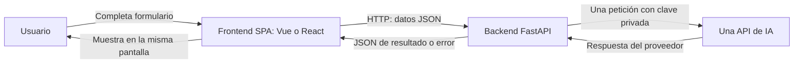
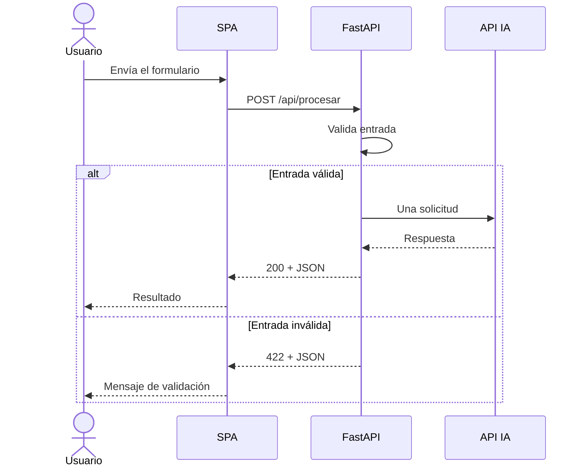

# UD1 · Mini aplicación web con una API de inteligencia artificial

**Curso especialización:** Aprendizaje automático: gestión de datos y entrenamiento  
**Módulo:** Desarrollo de componentes software para sistemas de aprendizaje automático  
**Organización:** grupos de 2 o 3 integrantes, salvo excepciones autorizadas por el docente.  
**Dedicación:** unas 4 horas presenciales orientativas de introducción y seguimiento, más trabajo autónomo. Las 4 horas no representan el tiempo total necesario para completar todas las fases.  
**Entrega:** antes de la exposición, por el medio que indique el docente, previsiblemente Moodle. Fecha, tiempo de exposición y acceso a cuentas: pendientes de concretar en clase.

## 1. El reto

Elegid una necesidad real y pequeña y resolvedla con una mini aplicación web que consulte una API de IA. Recorreréis el proceso completo de análisis, desarrollo, pruebas, control de versiones, despliegue y defensa. La complejidad está en realizar y explicar bien el proceso, no en añadir funciones.

Desarrollaréis dos aplicaciones equivalentes:

- **Aplicación 1:** construcción manual y progresiva por el equipo, con decisiones y código comprendidos por sus integrantes.
- **Aplicación 2:** proyecto nuevo desde cero, guiado por especificaciones con **GitHub Spec Kit** y asistencia de IA. Resuelve la misma necesidad e incorpora autenticación con **Clerk**.

Después desplegaréis la App 2 con Docker en AWS EC2 y compararéis ambos procesos de desarrollo. La App 1 tendrá frontend y backend en Vercel. La App 2 también deberá demostrar su integración de Clerk en Vercel antes de su despliegue en EC2.

### Resultados de aprendizaje de la práctica

Al terminar deberéis poder definir requisitos verificables, separar frontend y backend, consumir una API externa de forma segura, probar errores sin gastar créditos, justificar un historial Git incremental y reproducir un despliegue. También deberéis evaluar críticamente el código y las decisiones que proponga la IA.

## 2. Regla obligatoria de simplicidad

> **Una sola pantalla, un solo formulario, una sola función útil y una sola API de IA. Sin excepciones al alcance.** Esta regla se mantiene en la App 1, la App 2 y todos sus despliegues.

### Flujo obligatorio

1. El usuario introduce datos en el único formulario de una SPA.
2. El frontend envía una petición HTTP a FastAPI.
3. FastAPI valida los datos y realiza una llamada a la única API de IA elegida.
4. La API de IA devuelve su respuesta.
5. FastAPI transforma o valida esa respuesta y devuelve JSON al frontend.
6. El frontend muestra el resultado en la misma pantalla.

Cada envío válido da lugar a una sola consulta a la API de IA. No habrá conversaciones con memoria, encadenamientos de agentes, múltiples proveedores ni llamadas adicionales para enriquecer el resultado. Podéis volver a usar el mismo formulario con otra entrada, sin conservar la anterior.

### Prohibiciones expresas, sin excepciones

- **Bases de datos de cualquier tipo:** SQL, NoSQL, SQLite, bases en memoria, vectoriales o servicios equivalentes.
- **Persistencia de datos de la aplicación:** archivos con solicitudes o resultados, históricos, cachés de resultados, almacenamiento remoto, `localStorage`, `sessionStorage` o IndexedDB para datos del formulario o de la IA.
- **CRUD**, catálogos, reservas, tareas gestionables o sistemas para crear, consultar, modificar y eliminar registros.
- **Paneles de administración**, dashboards, estadísticas de uso o perfiles.
- **Múltiples pantallas, vistas o rutas de navegación del frontend.** No se necesita un router.
- **Gestión de usuarios propia:** tablas de usuarios, contraseñas, roles, perfiles, endpoints de registro o administración de cuentas.
- Cualquier función que complique el flujo: chat con historial, subida y procesamiento de archivos, pagos, correo, búsquedas adicionales, RAG, colas, procesos en segundo plano o servicios extra.

**Qué significa no persistir:** el texto y el resultado pueden existir transitoriamente en memoria mientras se procesa o muestra la petición. No se almacenan para recuperar sesiones, resultados ni conversaciones. El repositorio, la ERS, las evidencias académicas con datos ficticios, los archivos de configuración y las imágenes Docker son materiales del proyecto, no persistencia funcional de datos de la aplicación. Los registros técnicos no deben incluir textos, respuestas, tokens ni secretos.

**Clerk y el alcance:** Clerk es el servicio externo obligatorio de identidad de la App 2. Su sesión técnica es necesaria para autenticar, pero no autoriza a guardar datos funcionales ni a implementar usuarios propios. Usad un componente de acceso integrado o modal en la misma SPA. No añadáis páginas de login, registro, perfil o administración. Configurad el flujo compatible con esa única pantalla y comprobadlo antes de implementar.

**Rutas HTTP del backend:** un endpoint de procesamiento y, si hace falta, uno técnico de salud no son nuevas pantallas. La prohibición de rutas se refiere a navegación e interfaces adicionales del frontend.

### Ideas válidas

| Idea                              | Entrada del formulario   | Resultado único                         |
| --------------------------------- | ------------------------ | --------------------------------------- |
| Resumidor de apuntes              | Texto breve              | Resumen                                 |
| Adaptador de textos               | Texto y nivel de lectura | Texto adaptado                          |
| Corrector de redacción            | Texto breve              | Versión corregida con explicación breve |
| Clasificador de mensajes          | Mensaje ficticio         | Categoría y justificación               |
| Generador de preguntas de estudio | Fragmento de apuntes     | Lista corta de preguntas                |

Elegid **una** idea. Antes de programar, explicad en una frase quién la utilizará y para qué. Si necesitáis historial, base de datos o más pantallas, reformulad la propuesta. Un chatbot completo o una plataforma educativa no encajan.

## 3. Tecnologías y contrato mínimo

| Capa                 | Obligatorio                                                | Resultado esperado                                  |
| -------------------- | ---------------------------------------------------------- | --------------------------------------------------- |
| Backend              | Python y FastAPI                                           | Validación, una llamada a IA y respuesta JSON       |
| IA                   | Una API: OpenAI/ChatGPT, Claude, Gemini, OpenRouter u otra | Proveedor y modelo documentados                     |
| Pruebas              | pytest                                                     | Casos significativos y API externa simulada         |
| Frontend             | Vue.js **o** React                                         | Única SPA, formulario y resultado                   |
| Diseño               | Tailwind CSS                                               | Interfaz legible, usable y adaptable                |
| Control de versiones | Git y GitHub                                               | Un repositorio por grupo e historial identificable  |
| Despliegue inicial   | Vercel para ambas capas                                    | Frontend estático y FastAPI como función serverless |
| App 2                | GitHub Spec Kit y asistencia de IA                         | Especificación, plan, tareas y nueva implementación |
| Identidad App 2      | Clerk                                                      | Backend protegido sin usuarios propios              |
| Despliegue final     | Docker y AWS EC2                                           | App 2 reproducible en contenedores                  |

### Contrato de ejemplo, adaptable a vuestra idea

Un endpoint como `POST /api/procesar` recibirá datos JSON. Especificad sus campos, tipos y límites en la ERS y conservad un contrato estable para integrar el frontend.

```json
{ "texto": "Fragmento ficticio que se desea resumir" }
```

Respuesta correcta orientativa:

```json
{ "resultado": "Resumen del fragmento" }
```

Error controlado orientativo:

```json
{
  "error": {
    "codigo": "IA_NO_DISPONIBLE",
    "mensaje": "No se ha podido completar la petición. Inténtalo más tarde."
  }
}
```

Documentad códigos HTTP y esquemas reales: por ejemplo 200 para éxito, 422 para validación, 502 para fallo del proveedor y 504 para timeout. En App 2, 401 para token ausente o inválido. FastAPI puede devolver su esquema estándar de validación, siempre que el frontend lo trate correctamente y el contrato lo describa.

> **JSON no significa que el modelo tenga que devolver JSON.** Puede producir texto y FastAPI envolverlo en `{"resultado": "..."}`. Si solicitáis salida estructurada al modelo, validarla es responsabilidad del backend. Nunca enviéis al frontend la respuesta completa del proveedor con metadatos innecesarios.

Definid un máximo de entrada y un timeout razonables, documentados y probados. El resultado es contenido no confiable: mostradlo como texto, sin ejecutar HTML ni código devuelto por la IA. No prometáis exactitud absoluta del contenido generado.

## 4. Análisis y ERS con la plantilla real

Partid del archivo facilitado **`plantillaERS.md`** y guardad vuestra versión como `docs/ERS.md`. Conservad su estructura y sus identificadores. La plantilla original contiene «Datos del documento», un historial, las secciones 1 a 10 y anexos. **No hay que inventar contenido para rellenar todo:** completad lo aplicable e indicad **«No aplica: [motivo concreto]»** donde corresponda. Eliminad marcadores, instrucciones y ejemplos orientativos de la versión entregada.

Orientación: **3–6 requisitos funcionales y 2–4 no funcionales** bien redactados. No es una cuota rígida: App 2 puede necesitar un requisito adicional de autenticación. Cada requisito debe expresar una obligación y tener una comprobación objetiva. «La app será rápida y segura» no es verificable.

### Guía por apartados de `plantillaERS.md`

| Apartado original               | Qué documentar en esta práctica                                                                                                                      |
| ------------------------------- | ---------------------------------------------------------------------------------------------------------------------------------------------------- |
| Datos del documento e historial | Proyecto, integrantes, curso, módulo, docente, fecha, versión y estado. Actualizad cambios reales.                                                   |
| 1.1 Propósito                   | Quién usará la ERS y qué decisiones permite revisar.                                                                                                 |
| 1.2 Problema y objetivos        | Necesidad concreta y objetivos `OBJ-xx` con indicador de logro.                                                                                      |
| 1.3 Alcance                     | La única función y todas las exclusiones obligatorias de esta práctica.                                                                              |
| 1.4 Definiciones                | ERS, SPA, API, JSON y términos relevantes de vuestro problema.                                                                                       |
| 1.5 Referencias y fuentes       | Enunciado, documentación oficial y decisiones contrastadas, con fecha o versión.                                                                     |
| 2.1 Contexto                    | Sistema nuevo, navegador, FastAPI y proveedor IA. Referenciad aquí el diagrama de arquitectura.                                                      |
| 2.2 Personas y usuarios         | Usuario final y responsabilidades del equipo/docente si aportan información. No inventéis un administrador funcional.                                |
| 2.3 Funciones principales       | Introducir entrada, procesarla y mostrar resultado como partes de una única función.                                                                 |
| 2.4 Entorno                     | Navegadores previstos, conectividad y volumen de demostración. No inventéis cifras de capacidad no comprobadas.                                      |
| 2.5 Restricciones               | Tecnologías, una pantalla, ausencia de persistencia, una API IA, equipo, tiempo y presupuesto disponible.                                            |
| 2.6 Suposiciones y dependencias | Acceso al proveedor, créditos, cuentas de despliegue y Clerk en App 2. Consecuencias de una caída. Lo no confirmado se marca «Pendiente».            |
| 3.1 Catálogo RF                 | IDs, nombre, prioridad, fuente y estado.                                                                                                             |
| 3.2 Fichas RF                   | Una ficha completa por RF con entradas, comportamiento, salidas, alternativas y criterios de aceptación «Dado/cuando/entonces».                      |
| 4 RNF                           | Solo categorías pertinentes y medibles, con condiciones de comprobación y criterio de aceptación.                                                    |
| 5.1 Información                 | Datos **transitorios** de entrada/salida, campos, validaciones, acceso y ausencia de conservación. Este apartado sí puede aplicar sin base de datos. |
| 5.2 Reglas de negocio           | Condiciones del problema, si existen. Si solo hay validaciones técnicas, explicad «No aplica» sin inventar reglas.                                   |
| 6.1 Interfaz de usuario         | Una única fila/pantalla con formulario, espera, resultado y errores. Boceto opcional. Acceso Clerk en esa misma pantalla para App 2.                 |
| 6.2 Otros sistemas              | API IA, contrato HTTP frontend/backend y Clerk en App 2. Información, dirección, protocolo y comportamiento ante fallos.                             |
| 7 Casos de uso                  | Un caso principal con alternativas: entrada inválida, fallo IA y acceso no autorizado en App 2. Referenciad RF/RNF.                                  |
| 8 Verificación y trazabilidad   | **Todos** los RF y RNF relacionados con origen, criterio, prueba/inspección/demo y resultado esperado.                                               |
| 9 Cuestiones pendientes         | Dudas con responsable y resolución. Si no quedan, indicad expresamente que no hay pendientes.                                                        |
| 10.1 Comprobación               | Revisad la lista original y justificad lo que no aplique.                                                                                            |
| 10.2 Revisión y conformidad     | Revisión cruzada entre integrantes, versión, fecha, resultado y observaciones. No atribuyáis aprobaciones al docente sin confirmación.               |
| Anexos                          | Diagramas, boceto o datos ficticios solo si ayudan. Referencia desde la sección correspondiente.                                                     |

La reserva, el usuario registrado, el producto y los miles de registros de los **ejemplos de la plantilla** no son requisitos de vuestra app. Eliminadlos.

Ejemplo orientativo de criterio: «Dado un texto vacío, cuando se envía el formulario, entonces el backend devuelve 422 y no llama al proveedor». Un RNF posible: «Con un timeout del proveedor simulado, el backend devuelve el error JSON acordado sin exponer detalles sensibles». Definid vuestro umbral de timeout y el procedimiento de prueba.

Para App 2, añadid `docs/ERS-app2.md` o una revisión claramente identificada de la ERS que cubra Clerk y conserve la trazabilidad del alcance base. Spec Kit no sustituye por sí solo la ERS académica.

### Diagramas Mermaid

Incluid **al menos el diagrama de arquitectura/contexto**. Añadid **1–2 diagramas adicionales únicamente si aportan valor**, normalmente secuencia y, si hace falta, actividad. Explicad en una frase qué aclara cada uno. Un `flowchart` de arquitectura en Mermaid no debe etiquetarse como UML formal. No forcéis diagramas de clases, entidad-relación o componentes sin contenido significativo.



Ejemplo útil de secuencia, adaptadlo al contrato real:



Documentad también fallo/timeout, en el texto del caso de uso o en vuestro diagrama. En App 2 representad la validación del token **antes** de llamar a IA, sin confundir Clerk con el proveedor de IA.

## 5. Organización y Git/GitHub

Un repositorio por grupo. Cada integrante utilizará su identidad de Git y dejará contribuciones identificables de código, pruebas, documentación o revisión. El trabajo en pareja también se documentará con autores o coautoría. Repartid tareas y rotad responsabilidades para que todos comprendan el flujo completo.

### Estructura recomendada

```text
ud1-miniapp/
├── README.md
├── .gitignore
├── docs/
│   ├── ERS.md
│   ├── ERS-app2.md
│   ├── proceso.md
│   ├── pruebas.md
│   ├── comparativa.md
│   ├── despliegues.md
│   ├── uso-ia.md
│   ├── diagramas/
│   └── evidencias/              # Datos ficticios y capturas sin secretos
├── app1/
│   ├── backend/
│   │   ├── main.py              # Exporta app = FastAPI()
│   │   ├── requirements.txt    # O pyproject.toml y archivo de bloqueo
│   │   ├── .env.example
│   │   └── tests/
│   └── frontend/
│       ├── package.json
│       ├── .env.example
│       └── src/
├── app2/                       # Proyecto vacío al empezar App 2
│   ├── .specify/                # Material de Spec Kit según versión
│   ├── specs/                  # spec, plan, tasks y contratos generados
│   ├── backend/
│   └── frontend/
├── infra/
│   ├── Dockerfile.backend
│   ├── Dockerfile.frontend
│   ├── compose.yaml
│   ├── .env.example
│   └── proxy/                  # Configuración, si se usa
└── presentacion/
    └── defensa.pptx
```

```
├── .github/
│       └── skills/
├── .specify/
├── api/
│        ├── .venv/
│        ├── tests/
│        ├── .python-version
│        ├── main.py
│        ├── pyproject.toml
│        └── uv.lock
├── docs/
│        ├── ERS.md
│        ├── ERS-app2.md
│        ├── proceso.md
│        ├── pruebas.md
│        ├── comparativa.md
│        ├── despliegues.md
│        ├── uso-ia.md
│        ├── diagramas/
│        └── evidencias/
├── public/
├── src/
│        ├── __tests__/
│        ├── App.vue
│        └── main.ts
├── .editorconfig
├── .env
├── .env.example
├── .gitattributes
├── .gitignore
├── .oxlintrc.json
├── .prettierrc.json
├── env.d.ts
├── eslint.config.ts
├── index.html
├── package-lock.json
├── package.json
├── README.md
├── tsconfig.app.json
├── tsconfig.json
├── tsconfig.node.json
├── tsconfig.vitest.json
├── vite.config.ts
└── vitest.config.ts
```

La estructura es orientativa: justificad los cambios. «Proyecto nuevo» significa carpeta App 2 inicialmente vacía e inicializada con sus propias dependencias y Spec Kit, aunque esté en el mismo repositorio. No copiéis la implementación App 1 ni la disfrazéis de proyecto nuevo. Podéis reutilizar el conocimiento, la necesidad y el contrato.

### Hitos mínimos del historial

| Hito                    | Evidencia que debe verse en Git                                        |
| ----------------------- | ---------------------------------------------------------------------- |
| H0 · Inicio             | README, exclusiones, estructura, `.gitignore` y ERS inicial            |
| H1 · Backend mínimo     | Petición real a IA y respuesta visible, inicialmente texto o JSON      |
| H2 · Contrato y errores | JSON estable, validaciones y fallo controlado                          |
| H3 · Pruebas            | pytest con mocks y casos significativos                                |
| H4 · Frontend           | Formulario mínimo y resultado                                          |
| H5 · Integración        | Flujo completo con estados de espera y error                           |
| H6 · Diseño y revisión  | Tailwind, revisión de ERS y documentación                              |
| H7 · Vercel App 1       | Configuración reproducible y URLs verificadas                          |
| H8 · Spec Kit           | Especificación, plan y tareas **anteriores** a la implementación App 2 |
| H9 · App 2              | Implementación progresiva, revisión IA y pruebas                       |
| H10 · Clerk y Vercel    | Validación backend, pruebas de acceso y despliegue App 2               |
| H11 · Docker y AWS      | Contenedores locales, EC2 y evidencias                                 |
| H12 · Cierre            | Comparativa, documentación y presentación                              |

No se exige un número artificial de commits ni un mensaje literal. Se exige evolución real: un único commit final no demuestra el proceso. Conservad referencias de versiones entregadas, por ejemplo etiquetas `app1-final` y `entrega-ud1`, sin incluir secretos.

## 6. Aplicación 1: desarrollo incremental

### Fase A. Idea, ERS y preparación

Concretad el problema, revisad el alcance con el docente y cread el repositorio. Definid el contrato mínimo, el proveedor/modelo, los límites de entrada y los principales criterios de aceptación. Preparad entornos separados para Python y frontend y registrad versiones.

### Fase B. Backend mínimo

Construid primero FastAPI y probad una petición real a IA desde una herramienta HTTP o la documentación técnica de la API. Leed la clave desde variables de entorno. En el primer hito podéis mostrar texto, pero el backend final devolverá JSON con un esquema definido.

Separad lo necesario para poder simular la llamada externa en las pruebas. Validación en backend, timeout y tratamiento de errores forman parte del mínimo técnico. No añadáis capas o patrones sin una necesidad concreta.

### Fase C. Pruebas con pytest

Las pruebas automatizadas habituales **no** deben consultar el servicio real. Simulad el cliente/función de IA y verificad la entrada y el contrato del backend.

| Caso significativo            | Qué comprobar                                                    |
| ----------------------------- | ---------------------------------------------------------------- |
| Entrada válida                | Código correcto, JSON esperado y una sola llamada al mock        |
| Entrada vacía o solo espacios | Rechazo según contrato, sin llamada a IA                         |
| Límite de longitud            | Caso en el límite y caso que lo supera                           |
| Fallo del proveedor           | Error controlado, sin stack trace ni secreto                     |
| Timeout                       | Error y estado HTTP acordados                                    |
| Respuesta inválida            | Tratamiento del formato inesperado o contenido vacío, si procede |

Una prueba real de integración puede ejecutarse de forma manual o separada y documentarse con datos ficticios. Nunca debe ser requisito de la ejecución rutinaria de pytest ni depender de créditos disponibles. Guardad comando, entorno, fecha y resultado en `docs/pruebas.md`. No probéis frases exactas de un modelo real ni confundáis «el endpoint responde» con validar los casos de error.

### Fase D. Frontend e integración

Cread una SPA en Vue.js o React, preferiblemente con un montaje mínimo. Añadid un único formulario con etiquetas claras y un botón de envío. Comunicad el formulario con FastAPI y mostrad el resultado en esa pantalla.

Estados necesarios: entrada, espera, resultado y error. Impedid envíos duplicados mientras hay una solicitud pendiente. La validación frontend ayuda al usuario, pero no reemplaza la del backend. No acumuléis resultados anteriores.

### Fase E. Tailwind y documentación

Aplicad Tailwind CSS para facilitar lectura, contraste, adaptación a móvil, foco de teclado y mensajes de error. Revisad que el resultado no rompa el diseño con un texto largo. Actualizad ERS, README y trazabilidad y ejecutad pytest antes de desplegar.

La App 1 debe reflejar trabajo manual y progresivo del grupo. Podéis consultar documentación y pedir explicaciones puntuales a IA si registráis su uso. No deleguéis a un agente la generación integral de App 1: la comparación con App 2 requiere procesos distinguibles.

## 7. Parte 1: Vercel y desarrollo con especificaciones

### 7.1. Vercel para frontend y FastAPI

**Serverless:** Vercel ejecuta FastAPI como una función gestionada que atiende peticiones. No alquiláis ni administráis un servidor permanente. El frontend compilado se publica como archivos estáticos. La app no debe depender de estado global, archivos escritos en ejecución ni procesos persistentes. [Referencia oficial: FastAPI en Vercel](https://vercel.com/docs/frameworks/backend/fastapi).

Propuesta sencilla: **dos proyectos de Vercel por aplicación**, conectados al mismo repositorio, con raíz de proyecto en su frontend y backend. Es una decisión de despliegue, no dos pantallas.

1. Backend: raíz `app1/backend`, dependencias declaradas e instancia `app` exportada en `main.py` (o punto de entrada compatible documentado).
2. Frontend: raíz `app1/frontend`, compilación del framework y carpeta de salida, por ejemplo `dist` si usáis Vite.
3. Variables backend: clave IA, modelo, timeout y orígenes permitidos según la implementación.
4. Variable pública frontend: URL HTTPS del backend, por ejemplo `VITE_API_BASE_URL` si usáis Vite. Nunca clave IA.
5. Configurad CORS para el origen real del frontend. Comprobad preflight y encabezados. En App 2 contemplad `Authorization`. CORS no autentica ni impide llamadas directas al backend.
6. Diferenciad Development, Preview y Production y configurad los valores que cada entorno necesite. Cambiad variables y volved a desplegar cuando corresponda.
7. Probad desde la URL desplegada un caso válido y otro de error. Anotad URL frontend, URL backend, fecha, versión Git y límites relevantes del servicio.

**Variables `.env`:** en local usáis archivos privados. En Vercel se configuran variables en el proyecto o con CLI, sin subir `.env` al repositorio. Las variables incluidas en el paquete frontend son públicas, aunque el nombre contenga «key». [Variables de entorno de Vercel](https://vercel.com/docs/environment-variables).

Instalad y configurad la CLI. Secuencia orientativa, ejecutada desde la carpeta que corresponda y comprobando el proyecto enlazado:

```bash
npm install -g vercel
vercel --version
vercel login
vercel link
vercel env add AI_API_KEY
vercel deploy
vercel deploy --prod
```

Añadid secretos mediante la entrada interactiva, no como valores literales en el historial de comandos. La configuración de raíz local debe coincidir con la del proyecto remoto. Documentad las versiones y el procedimiento real utilizado. [Vercel CLI](https://vercel.com/docs/cli).

**Comprobación de cierre:** ambas capas en Vercel, URL pública correcta, JSON válido, ninguna clave en el frontend, error visible y evidencia de CLI. No basta una captura del panel de despliegue.

**Posible ampliación, no requisito ni sustitución:** comparar el backend serverless con un contenedor en otro servicio gestionado. Solo cambia la infraestructura y conserva exactamente el alcance funcional. El despliegue obligatorio de ambas capas en Vercel sigue vigente. EC2 se trabaja después como parte obligatoria.

### 7.2. Aplicación 2 con GitHub Spec Kit e IA

Empezad **después de terminar App 1**, desde una carpeta de proyecto vacía. El objetivo es resolver la misma necesidad mediante desarrollo dirigido por especificaciones, no producir una app más grande.

1. Instalad/inicializad el **GitHub Spec Kit oficial** con un agente compatible y anotad versión e integración utilizadas.
2. Estableced principios y restricciones: una SPA, un formulario, cero persistencia, una API IA, tecnologías obligatorias y pruebas con mocks.
3. Generad y **revisad** una especificación completa: problema, usuarios, RF/RNF, casos de uso, contrato, errores, aceptación y autenticación Clerk. Completa significa suficiente para implementar esta miniapp, no extensa.
4. Resolved ambigüedades y guardad especificación y decisiones antes de generar código.
5. Preparad plan técnico, tareas pequeñas y comprobación de coherencia.
6. Implementad con asistencia de IA por tareas. Revisad el código, ejecutad pruebas y registrad correcciones y decisiones humanas.
7. Comprobad equivalencia funcional con App 1 y los criterios adicionales de Clerk. Rechazad cualquier base de datos, pantalla o función adicional que proponga el agente.
8. Versionad artefactos de Spec Kit, prompts relevantes depurados, resultados de pruebas y revisión. La especificación debe preceder al código en Git.

Comandos del flujo habitual en una integración que los soporte: `/speckit.constitution`, `/speckit.specify`, `/speckit.clarify`, `/speckit.plan`, `/speckit.tasks`, `/speckit.analyze` y `/speckit.implement`. Son órdenes para el agente, no comandos genéricos de terminal. Verificad los nombres y la instalación correspondientes a vuestra versión. [Repositorio oficial de GitHub Spec Kit](https://github.com/github/spec-kit).

> Un prompt genérico seguido de toda la aplicación y una especificación redactada después no demuestra desarrollo dirigido por especificaciones.

En `docs/uso-ia.md` registrad herramienta/modelo, finalidad, prompt o resumen relevante, propuesta aceptada/rechazada y comprobación humana. No incluyáis secretos ni conversaciones innecesarias.

### 7.3. Clerk en App 2

Clerk gestiona la identidad externamente. La app solo necesita saber si una petición está autenticada para permitir el procesamiento.

1. Configurad una aplicación Clerk y los orígenes/URLs de desarrollo y despliegue necesarios.
2. Integración mediante SDK compatible con Vue o React y componente de acceso modal o integrado en la única pantalla, sin rutas frontend nuevas ni gestión de perfiles.
3. El frontend obtiene un token de sesión y lo envía en `Authorization: Bearer ...` al backend cuando llama al endpoint.
4. FastAPI valida el token con el mecanismo oficial compatible: firma, emisor, caducidad y audiencia/orígenes autorizados según vuestra configuración. Usad SDK/verificador o claves públicas del emisor. No basta decodificar el JWT.
5. Una petición sin token o con token inválido/caducado devuelve 401 y no llama a IA. El endpoint protegido debe rechazar una petición directa no autorizada.
6. Probáis el camino autenticado y los rechazos con pytest y mocks/verificador simulado. Añadid una prueba real controlada de acceso y cierre de sesión.
7. Proteged claves privadas y tokens. Solo la clave **publishable** de Clerk puede estar en el frontend. La clave secreta, si vuestra integración la requiere, permanece en backend.

No copiéis usuarios de Clerk ni creéis tablas, roles, perfiles o endpoints de cuentas. Las cookies/tokens técnicos del SDK se limitan a autenticación. No guardéis solicitudes ni resultados en la sesión. [Tokens de sesión de Clerk](https://clerk.com/docs/guides/sessions/session-tokens) y [verificación manual de JWT](https://clerk.com/docs/guides/sessions/manual-jwt-verification).

Volved a desplegar App 2 en Vercel y documentad URLs, configuración no secreta y evidencia de petición rechazada/aceptada.

### 7.4. Comparativa App 1 y App 2

| Dimensión      | Qué registrar y comparar                                                               |
| -------------- | -------------------------------------------------------------------------------------- |
| Tiempo         | Tiempo aproximado por fase, incluido revisar y corregir propuestas IA                  |
| Calidad        | Legibilidad, validaciones, contrato, errores y consistencia con la ERS                 |
| Errores        | Problemas concretos, origen y solución, incluyendo al menos un ejemplo real si hubo    |
| Mantenibilidad | Qué cambio pequeño sería fácil/difícil y por qué, sin implementarlo como nueva función |
| Utilidad de IA | Dónde ayudó, dónde falló y qué decisiones mantuvo el equipo                            |

Usad los mismos escenarios de aceptación para el flujo base de ambas apps. Separad el esfuerzo de Clerk y de infraestructura al comparar tiempos. Registrad datos reales o estimaciones identificadas como tales. No presupongáis que App 2 será mejor ni inventéis resultados.

## 8. Parte 2: Docker y AWS EC2

Desplegad **App 2** con el mismo alcance y autenticación. No se exige repetir App 1 en AWS.

### 8.1. Docker local

1. Instalad Docker según vuestro sistema y comprobad que funciona.
2. Preparad imagen backend con Python/FastAPI y ejecución adecuada fuera de Vercel, por ejemplo Uvicorn escuchando en `0.0.0.0` en el puerto interno elegido.
3. Compilad el frontend y servid sus archivos estáticos en otro contenedor. Un proxy puede ofrecer una URL común y reenviar `/api` a FastAPI.
4. Definid `compose.yaml`, puertos, red interna y variables. No añadáis servicios de bases de datos, volúmenes de datos funcionales ni cachés.
5. Usad `.dockerignore` para excluir `.env`, credenciales, dependencias locales y material innecesario. Inyectad secretos al ejecutar, nunca en el Dockerfile, imagen o argumentos de compilación.
6. Probad arranque desde un entorno limpio, petición válida, error, acceso Clerk y reinicio. Tras reiniciar no debe aparecer un historial porque no existe persistencia funcional.

Comandos orientativos desde la carpeta con `compose.yaml`:

```bash
docker --version
docker compose version
docker compose build
docker compose up -d
docker compose ps
docker compose logs
docker compose down
```

Documentad cómo suministráis las variables privadas. Las variables Vite del frontend normalmente se resuelven en compilación: cambiar la URL tras compilar exige reconstruir o una estrategia explícita de configuración pública. Un navegador no puede usar el nombre interno Docker `backend` como URL pública. El proxy del mismo origen simplifica este punto.

### 8.2. EC2 con Docker

Arquitectura mínima: una instancia Linux EC2 y los contenedores de frontend/backend, con proxy si se necesita. No se requieren RDS, EKS, ECS, Kubernetes, balanceador gestionado ni un registro de imágenes extra.

1. Confirmad acceso a AWS, región y presupuesto con el docente. Revisad costes vigentes antes de crear recursos, sin asumir gratuidad.
2. Cread una instancia adecuada a una demo pequeña. Proteged la clave SSH y anotad sistema, región y tamaño.
3. Configurad el grupo de seguridad: SSH solo desde IPs autorizadas y puertos web necesarios. No publiquéis directamente todos los puertos internos. Los grupos de seguridad controlan tráfico de la instancia. [Documentación AWS](https://docs.aws.amazon.com/AWSEC2/latest/UserGuide/ec2-security-groups.html).
4. Instalad Docker y Compose. Descargad el código del repositorio o transferid la versión revisada, sin copiar credenciales dentro del código.
5. Configurad secretos en el servidor fuera del repositorio y con permisos restringidos. Ejecutad contenedores y verificad su estado.
6. Publicad una URL HTTPS para probar Clerk y proteger el envío de tokens. Un proxy con TLS y un nombre DNS adecuado basta. No inventéis una excepción HTTP para enviar credenciales. Documentad configuración de origen/URLs en Clerk y CORS si hay orígenes distintos.
7. Probad desde otro dispositivo: frontend, acceso, respuesta IA y errores. Anotad URL, versión Git, servicios/puertos y procedimiento de actualización.
8. Documentad recuperación tras reinicio y una política de reinicio sencilla para contenedores. No guardéis entradas/respuestas en registros.
9. Al finalizar la revisión, seguid las instrucciones del docente para detener/retirar recursos. Identificad también discos e IPs reservadas que puedan seguir generando costes.

**Evidencia mínima:** Dockerfile(s), Compose, configuración no secreta, instrucciones reproducibles y captura/registro de una demo funcionando en EC2. Una instancia creada sin aplicación accesible no equivale a despliegue.

## 9. Seguridad y reproducibilidad

- La clave de IA vive exclusivamente en backend. Nunca en variables públicas frontend, repositorio, PPT, capturas, prompts ni mensajes de error.
- `.env.example` solo contiene nombres y valores ficticios. `.env`, tokens, claves SSH, credenciales AWS y claves secretas de Clerk se excluyen de Git y Docker.
- Revisad lo que vais a subir y el historial antes de publicar. Si se filtra un secreto, **revocadlo/rotadlo** y avisad al docente. Borrarlo del último archivo no lo elimina del historial.
- Fijad dependencias o conservad archivos de bloqueo y documentad versiones y comandos de instalación.
- Usad datos ficticios y entradas acotadas. No enviéis datos personales o confidenciales a la API IA.
- Autenticación, CORS y HTTPS cumplen funciones distintas. Ocultar el botón no protege el backend. La App 1 no requiere Clerk, pero su URL no debe difundirse sin control y deben aplicarse límites de gasto del proveedor para las demos.
- Las evidencias describen qué configurasteis, sin revelar valores secretos. Los logs técnicos solo incluyen metadatos mínimos no sensibles.

Ejemplo orientativo de exclusiones que debéis adaptar:

```gitignore
.env
.env.*
!.env.example
.venv/
__pycache__/
.pytest_cache/
node_modules/
dist/
.vercel/
*.pem
*.key
```

## 10. Documentación y entregables

El **README** será la puerta de entrada: necesidad, miembros, versiones, estructura, instalación y ejecución de ambas apps, variables requeridas sin valores secretos, cómo ejecutar pruebas, URLs y enlaces a documentos. Otra persona debe poder reproducir vuestro trabajo con sus propias credenciales.

Entrega previa a la exposición:

| Entregable                | Contenido comprobable                                                                           |
| ------------------------- | ----------------------------------------------------------------------------------------------- |
| Repositorio del grupo     | Acceso docente, código de ambas apps, historial y versión/commit de entrega                     |
| ERS                       | Plantilla original adaptada, No aplica justificado, RF/RNF, aceptación, trazabilidad y revisión |
| Diagramas                 | Arquitectura Mermaid y 1–2 adicionales si aportan valor, coherentes con el código               |
| Pruebas                   | pytest, mocks, escenarios, ejecución y resultados                                               |
| Spec Kit                  | Especificación, plan, tareas, decisiones y evidencia de anterioridad al código                  |
| Registro IA y comparativa | Uso crítico, correcciones y comparación basada en evidencias                                    |
| Despliegues               | URLs App 1/App 2 en Vercel, URL App 2 en EC2, CLI, Clerk y pasos Docker/AWS                     |
| Seguridad/configuración   | `.gitignore`, `.env.example`, `.dockerignore` e instrucciones sin secretos                      |
| Presentación del grupo    | PowerPoint para exposición, con problema, arquitectura, proceso, comparación y demo             |

Entregad el enlace al repositorio y los documentos/presentación por el medio indicado, previsiblemente Moodle. Si se solicita un ZIP, excluid secretos y carpetas de dependencias. No sustituyáis el historial del repositorio por un ZIP. Asegurad que el docente puede abrir enlaces y documentos **antes** de la defensa. No hay que compartir contraseñas personales ni claves privadas.

Documentad decisiones y problemas cuando ocurran en `docs/proceso.md`. Las capturas complementan instrucciones y pruebas, pero no las sustituyen.

## 11. Exposición, demo y defensa

El grupo prepara su propia presentación PowerPoint. La presentación de explicación que entrega el docente sirve para conocer la práctica, no reemplaza la presentación del proyecto del grupo.

La duración definitiva la fija el docente. Propuesta orientativa: **8–10 minutos de exposición y demo**, más preguntas. Todos los integrantes participan.

Orden recomendado: necesidad y límite de alcance, arquitectura/contrato, ERS y decisiones, evolución App 1, Spec Kit y App 2, pruebas/seguridad, Vercel y EC2, comparativa y conclusiones sustentadas.

Demo mínima:

1. Una entrada válida y el resultado en la misma pantalla.
2. Un caso de validación o error controlado, con evidencia que permita explicarlo.
3. Acceso Clerk en App 2 y rechazo de petición sin autenticación.
4. Funcionamiento de App 2 en EC2 y enlaces de Vercel.
5. Un test con mock y un hito Git que permitan justificar el proceso.

Preparad datos ficticios y una evidencia de respaldo para una caída externa, identificándola como grabación/captura. No presentéis un mock como si fuera el proveedor real. Durante las preguntas, cada integrante debe explicar una parte del flujo y una decisión propia.

Preguntas posibles: ¿dónde vive la clave IA?, ¿qué comprueba el mock?, ¿qué pasa si vence el token?, ¿cómo llega JSON a la pantalla?, ¿qué propuso mal la IA?, ¿cómo sabéis que no se conservan datos?, ¿qué cambia entre Vercel y EC2?

## 12. Rúbrica de evaluación

Se aplica a las evidencias entregadas y a la defensa. Cuatro niveles: **Excelente = 100% del peso**, **Adecuado = 75%**, **En desarrollo = 50%**, **Insuficiente = 25%**. Ausencia total de evidencia = 0%. El docente podrá situar casos intermedios justificadamente. **Nota sobre 10 = suma de (peso porcentual × factor de logro) / 10.**

| Criterio                         |     Peso | Excelente                                                                                                                                                    | Adecuado                                                                                       | En desarrollo                                                                                  | Insuficiente                                                                                                                  |
| -------------------------------- | -------: | ------------------------------------------------------------------------------------------------------------------------------------------------------------ | ---------------------------------------------------------------------------------------------- | ---------------------------------------------------------------------------------------------- | ----------------------------------------------------------------------------------------------------------------------------- |
| **ERS y análisis**               |  **15%** | Plantilla fiel, problema/alcance precisos, RF/RNF verificables, errores y trazabilidad completa. Diagramas útiles y No aplica motivados.                     | Análisis coherente y aceptación comprobable, con omisiones menores de revisión o trazabilidad. | Apartados aplicables incompletos, requisitos ambiguos o trazabilidad parcial.                  | Documento superficial o incoherente, sin aceptación útil o alejado de la plantilla.                                           |
| **Aplicación 1**                 |  **20%** | Flujo mínimo completo y estable, backend Python/FastAPI, JSON y SPA Vue/React con Tailwind. Validación, espera y errores comprensibles.                      | Flujo completo y tecnologías correctas, con detalles menores de interfaz o errores.            | Funciona parcialmente o falla la integración/contrato en escenarios relevantes.                | No demuestra el flujo completo o falta una capa esencial.                                                                     |
| **Calidad técnica, tests y Git** |  **15%** | Pruebas significativas aisladas, mocks comprobados, dependencias reproducibles, secretos protegidos e historial incremental con aportaciones identificables. | Tests y proceso suficientes, con cobertura o documentación técnica mejorable.                  | Pocos casos de error, mocks débiles o historial/participación poco claros.                     | Tests irrelevantes o ausentes, entrega final sin evolución o configuración insegura.                                          |
| **App 2, Spec Kit e IA**         |  **15%** | Proyecto nuevo equivalente, especificación/plan/tareas previos, revisión humana y comparativa concreta con evidencias.                                       | Flujo dirigido por especificaciones demostrado y comparación razonada con pequeños vacíos.     | Especificación incompleta, seguimiento débil de tareas o comparación principalmente subjetiva. | Generación sin proceso verificable, especificación posterior al código o reutilización de App 1 como supuesto proyecto nuevo. |
| **Vercel, Clerk, Docker y AWS**  |  **15%** | Ambas apps en Vercel, CLI, Clerk validado en backend, App 2 en contenedores y EC2 HTTPS, configuración y reproducción documentadas.                          | Todos los elementos funcionan con pequeños vacíos de explicación o evidencia.                  | Falta algún elemento, prueba de rechazo o reproducibilidad importante.                         | Solo despliegues parciales/capturas, autenticación aparente o infraestructura sin app verificable.                            |
| **Documentación**                |  **10%** | README y documentos claros, versiones, comandos, URLs, problemas y configuración no secreta permiten reproducir. Entrega organizada y previa.                | Documentación utilizable con lagunas menores.                                                  | Reproducción requiere ayuda y faltan decisiones o evidencias.                                  | Documentación mínima, desordenada o no permite revisar el trabajo.                                                            |
| **Exposición, demo y defensa**   |  **10%** | Presentación legible, demo preparada, explicación precisa y todos defienden sus decisiones y límites con evidencia.                                          | Exposición clara y comprensión individual suficiente, con incidencias menores.                 | Demo o explicación incompletas y comprensión desigual.                                         | No demuestra funcionamiento ni comprensión individual del trabajo.                                                            |
| **Total**                        | **100%** |                                                                                                                                                              |                                                                                                |                                                                                                |                                                                                                                               |

El docente puede observar dentro del bloque de despliegues Vercel (4 puntos porcentuales), Clerk (4), Docker (3) y AWS EC2 (4), para que una parte no oculte la ausencia de otra.

**Regla de alcance y evaluación:** una base de datos, persistencia, CRUD o pantalla adicional contradice un requisito obligatorio. No aporta puntos ni compensa fallos. El equipo debe retirar la ampliación antes de entregar. El criterio afectado se valora según el cumplimiento demostrado y se registra el incumplimiento. No se añaden funciones para conseguir «Excelente».

La nota combina evidencias del grupo con la comprobación individual de comprensión y contribución. Un integrante no puede acreditar dominio solo porque la demo la realiza otra persona. No se fija aquí una penalización o nota máxima global automática que no haya anunciado el docente.

## 13. Lista de comprobación de entrega

- [ ] Grupo de 2–3 o excepción de agrupación autorizada, participación identificable.
- [ ] Una función útil, una pantalla/formulario, una API de IA y una llamada por envío válido.
- [ ] Sin bases de datos, persistencia, CRUD, dashboards, pantallas nuevas ni gestión propia de usuarios.
- [ ] App 1 construida progresivamente y App 2 creada desde cero.
- [ ] Python/FastAPI y contrato JSON estable con validación y errores.
- [ ] Vue o React y Tailwind, resultado y errores en la misma pantalla.
- [ ] ERS según plantilla real, No aplica justificado, RF/RNF y trazabilidad.
- [ ] Arquitectura Mermaid y diagramas adicionales solo cuando aportan información.
- [ ] pytest con casos significativos, límites y mocks que evitan llamadas externas rutinarias.
- [ ] README, `.gitignore`, `.env.example`, dependencias y versiones.
- [ ] Historial con hitos y contribuciones de todos.
- [ ] App 1 y App 2 con frontend y backend en Vercel, variables y URLs revisadas.
- [ ] Vercel CLI instalada/configurada y procedimiento documentado.
- [ ] Spec Kit con especificación, plan y tareas antes de implementar App 2.
- [ ] Uso IA revisado y comparación de tiempos, calidad, errores y mantenibilidad.
- [ ] Clerk en App 2 dentro de la única pantalla, validación backend y rechazo sin token.
- [ ] Docker local reproducible y secretos excluidos de imágenes.
- [ ] App 2 accesible en AWS EC2 con Docker y HTTPS, configuración de red documentada.
- [ ] Ningún secreto en código, historial, imágenes, capturas o presentación.
- [ ] Entrega previa accesible para el docente y PowerPoint propio del grupo.
- [ ] Demo preparada, alternativa de respaldo identificada y defensa de todos.
- [ ] Recursos de pago y retirada al finalizar documentados.

## 14. Errores frecuentes y corrección

| Error                                                   | Corrección esperada                                                 |
| ------------------------------------------------------- | ------------------------------------------------------------------- |
| «Solo una pequeña SQLite/localStorage para historial»   | Retirarlo. La prohibición no admite excepciones.                    |
| Login en otra ruta o perfil de usuario                  | Integrar acceso Clerk en la misma SPA y suprimir gestión adicional. |
| Clave IA en `VITE_...`                                  | Moverla a backend, revocarla si se expuso y revisar historial.      |
| Frontend llama directamente a IA                        | Recuperar el flujo obligatorio a través de FastAPI.                 |
| IA añade una base de datos a su plan                    | Corregir especificación y plan antes de implementar.                |
| Especificación escrita al final                         | Rehacer el proceso App 2 desde especificación previa verificable.   |
| Tests consumen API real                                 | Simular el proveedor y separar prueba real de integración.          |
| Login visible pero backend abierto                      | Verificar token antes del procesamiento y probar rechazo directo.   |
| Vercel funciona solo en local                           | Revisar raíces, dependencias, variables, URL pública y CORS.        |
| EC2 usa HTTP con tokens o la URL interna Docker         | HTTPS público y proxy/orígenes correctos.                           |
| Capturas sin instrucciones o todos los commits al final | Documentación reproducible e historial durante el proceso.          |
| ERS copia reservas/administradores de la plantilla      | Eliminar ejemplos y describir el sistema real.                      |

## 15. Organización orientativa de las horas presenciales

| Tramo orientativo | Trabajo en el aula                                      | Trabajo autónomo asociado         |
| ----------------- | ------------------------------------------------------- | --------------------------------- |
| 1 h               | Explicación, elección de idea y revisión de alcance/ERS | ERS, repositorio y preparación    |
| 1 h               | Seguimiento de backend, pruebas y contrato              | App 1, frontend e integración     |
| 1 h               | Orientación Vercel, Spec Kit y Clerk                    | Despliegues, App 2 y comparativa  |
| 1 h               | Orientación Docker/EC2 y preparación de defensa         | AWS, documentación y presentación |

La planificación es orientativa. Las exposiciones se organizan en el calendario que indique el docente, fuera de estos tramos si fuera necesario. Las fechas de entrega, cuotas/créditos, acceso AWS/DNS y duración final de defensa se comunicarán en clase. Todos los bloques indicados son obligatorios, salvo la ampliación de infraestructura expresamente marcada como opcional.

## 16. Referencias de trabajo

Base académica: `plantillaERS.md` original facilitada por el docente, con su estructura de datos, secciones 1–10 y anexos.

Documentación técnica consultada el **6 de octubre de 2026**. Contrastad la versión que instaléis antes de seguir ejemplos:

- [FastAPI en Vercel](https://vercel.com/docs/frameworks/backend/fastapi), [CLI Vercel](https://vercel.com/docs/cli) y [variables de entorno](https://vercel.com/docs/environment-variables).
- [GitHub Spec Kit oficial](https://github.com/github/spec-kit).
- [Clerk: tokens de sesión](https://clerk.com/docs/guides/sessions/session-tokens) y [verificación manual](https://clerk.com/docs/guides/sessions/manual-jwt-verification).
- [AWS EC2: grupos de seguridad](https://docs.aws.amazon.com/AWSEC2/latest/UserGuide/ec2-security-groups.html).

**Recordatorio final para el alumnado:** mantened la app pequeña. La entrega debe demostrar un proceso comprendido, probado, documentado y defendible.
