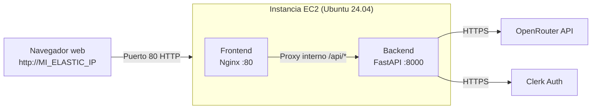

# Mi despliegue de App2 en AWS (Laboratorio de AWS Academy)

En esta guía recojo paso a paso cómo he realizado el despliegue de **App2** en una máquina virtual EC2 de AWS Academy utilizando Docker Compose, y cómo le he asignado una IP pública fija (Elastic IP) para que la dirección no cambie al reiniciar la máquina.

---

## ¿Cómo funciona la arquitectura?

Para no complicarme exponiendo puertos raros ni peleándome con CORS entre diferentes dominios, he montado la aplicación completa dentro de una sola máquina EC2 usando Docker Compose con dos servicios:



- **Frontend (Nginx en puerto 80):** Sirve los archivos estáticos de la aplicación Vue 3. Además, cuando el navegador hace una petición a `/api/...`, Nginx actúa como proxy inverso y se la pasa internamente al backend.
- **Backend (FastAPI en puerto interno 8000):** Procesa los resúmenes, valida los tokens de Clerk y consulta los modelos de OpenRouter. No está expuesto directamente a internet, lo cual es mucho más limpio y seguro.

---

## Paso 1: Lanzar la instancia EC2 en AWS

Entré en la consola de AWS Academy y creé la máquina con estos datos:

1. Fui a **EC2 → Instances → Launch Instances**.
2. Parámetros que seleccioné:
   - **Nombre:** `app2-server`
   - **Sistema operativo (AMI):** **Ubuntu Server 24.04 LTS** (es el más cómodo y estable para Docker).
   - **Tipo de instancia:** `t2.micro` (es la que entra en el lab sin gastar créditos extra).
   - **Key pair (clave SSH):** Creé una clave nueva llamada `clave-aws.pem` y me la guardé en mi equipo.
3. **Grupo de seguridad (Security Group):**
   Creé un grupo nuevo abriendo únicamente dos puertos:
   - **SSH (puerto 22):** Para poder entrar a la terminal (desde mi IP o cualquiera si cambia mi conexión).
   - **HTTP (puerto 80):** Con origen `0.0.0.0/0` (Anywhere) para que cualquiera pueda abrir la web desde su navegador.
4. Le di a **Launch Instance** y esperé un par de minutos hasta que estuviera en estado **Running**.

---

## Paso 2: Crear y asignarle una IP fija (Elastic IP)

Las máquinas de AWS Academy cambian de IP pública cada vez que las apagas o cuando reinicias la sesión del lab. Para no tener que estar reescribiendo la IP en los archivos `.env` y recompilando el frontend cada dos por tres, le asocié una **Elastic IP**:

1. En el menú de la izquierda de EC2, bajé a **Network & Security → Elastic IPs**.
2. Pulsé el botón **Allocate Elastic IP address** y le di a **Allocate** (dejando la configuración por defecto de Amazon).
3. Con la IP seleccionada en la lista, fui a **Actions → Associate Elastic IP address**:
   - En **Resource type** elegí **Instance**.
   - En el desplegable **Instance** seleccioné mi máquina `app2-server`.
   - En **Private IP address** seleccioné la IP privada de la máquina.
   - Pulsé **Associate**.

A partir de este momento, mi máquina tiene una IP pública que se queda fija (en los ejemplos la llamo `54.123.45.67`).

---

## Paso 3: Conectarme por SSH con Termius

Como suelo usar **Termius** para gestionar mis servidores:

1. Creé un nuevo Host en Termius.
2. En **Address / Hostname** puse mi Elastic IP fija.
3. En **Username** puse `ubuntu` (ojo, no `ec2-user`, ya que elegí Ubuntu).
4. En **Key** cargué mi archivo `.pem`.
5. Me conecté con doble clic y ya estaba dentro de la terminal de la máquina.

*(Si alguna vez me conecto desde PowerShell en local, el comando que uso es: `ssh -i "C:\ruta\mi-clave.pem" ubuntu@54.123.45.67`)*.

---

## Paso 4: Instalar Docker y Docker Compose en la EC2

Una vez dentro de la máquina por SSH, instalé Docker usando el script oficial para tener la versión moderna:

```bash
# 1. Actualizo la lista de paquetes
sudo apt update -y

# 2. Descargo e instalo Docker con el script oficial
curl -fsSL https://get.docker.com -o get-docker.sh
sudo sh get-docker.sh

# 3. Arranco el servicio de Docker y hago que se inicie solo si la máquina se reinicia
sudo systemctl start docker
sudo systemctl enable docker

# 4. Agrego mi usuario (ubuntu) al grupo docker para no tener que poner sudo todo el rato
sudo usermod -aG docker $USER

# 5. Instalo el plugin moderno de Docker Compose
sudo apt install -y docker-compose-plugin
```

> **Nota:** Después de hacer esto, salí de la sesión SSH con `exit` y volví a entrar desde Termius para que se aplicaran los permisos del grupo `docker`.

Comprobé que todo estaba bien instalado ejecutando:
```bash
docker --version
docker compose version
```

---

## Paso 5: Subir los archivos del proyecto

Para subir el código de `app2` desde mi ordenador a la EC2 usé la pestaña **SFTP de Termius**:

1. Abrí la pestaña SFTP en Termius.
2. Me conecté a la máquina EC2 en el panel derecho (se abre en `/home/ubuntu`).
3. En el panel izquierdo navegué hasta la carpeta de mi proyecto en mi PC.
4. Arrastré la carpeta **`app2`** completa directamente a `/home/ubuntu`.
   *(Omití las carpetas `node_modules` y `.venv` locales para que la subida fuera rápida y limpia)*.

---

## Paso 6: Configurar las variables de entorno en la máquina

Entré en la carpeta de infraestructura de la app:

```bash
cd ~/app2/infra
```

Creé el archivo `.env` con mis credenciales y puse mi IP pública fija en los orígenes permitidos:

```bash
nano .env
```

Dentro guardé la siguiente configuración:

```ini
# Configuración del Backend
OPENROUTER_API_KEY=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
OPENROUTER_MODEL=nvidia/nemotron-3.5-lightning:free
OPENROUTER_TIMEOUT=30
CLERK_ISSUER=https://calm-muskrat-1486.clerk.accounts.dev
CLERK_JWKS_URL=https://calm-muskrat-1486.clerk.accounts.dev/.well-known/jwks.json
CLERK_JWKS_TIMEOUT=5

# Origen permitido para CORS (usando la Elastic IP)
CORS_ORIGINS=http://54.123.45.67

# Clave pública de Clerk para el Frontend
VITE_CLERK_PUBLISHABLE_KEY=pk_test_Y2FsbS1tdXNrcmF0LTE0ODYuY2xlcmsuYWNjb3VudHMuZGV2JA
```

Guardé con `Ctrl + O`, pulsé `Enter` y salí con `Ctrl + X`.

---

## Paso 7: Compilar y arrancar los contenedores

Con todo en su sitio, lancé el despliegue con Docker Compose en segundo plano:

```bash
sudo docker compose up --build -d
```

Docker se encargó de:
1. Instalar las dependencias de Python y dejar listo el servidor FastAPI.
2. Compilar el frontend Vue con Vite inyectando la clave de Clerk.
3. Copiar el resultado de la compilación a la imagen ligera de Nginx.
4. Levantar ambos contenedores interconectados.

Para verificar que todo había arrancado bien, comprobé el estado:

```bash
sudo docker compose ps
```

Ambos contenedores estaban activos y el backend aparecía como `Up (healthy)`.

---

## Paso 8: Comprobación final desde el navegador

Abrí mi navegador web e introduje la dirección:

```text
http://54.123.45.67
```

La aplicación cargó inmediatamente por el puerto 80 sin necesidad de escribir puertos raros en la URL. Probé a iniciar sesión con Clerk y a generar un resumen, y la comunicación entre frontend, Nginx, backend y OpenRouter funcionó a la primera.

---

## Comandos que uso para el mantenimiento diario

Cuando necesito ver qué está pasando o si hago algún cambio:

- **Ver logs de todo en tiempo real:**
  ```bash
  sudo docker compose logs -f
  ```
- **Ver logs solo del backend:**
  ```bash
  sudo docker compose logs -f backend
  ```
- **Reiniciar los servicios:**
  ```bash
  sudo docker compose restart
  ```
- **Reconstruir tras cambiar código:**
  ```bash
  sudo docker compose up --build -d
  ```
- **Parar la aplicación:**
  ```bash
  sudo docker compose down
  ```

