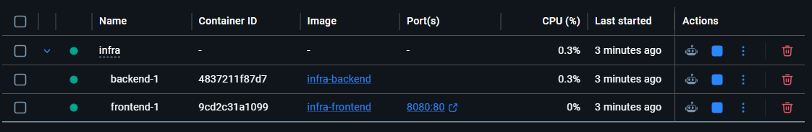

# Despliegue de App 1 y App 2

## 1. Despliegue de App 1 en Vercel

Para este caso se ha conectado Vercel con el repositorio de GitHub. El despliegue de App 1 se hizo a través de Vercel CLI, seleccionando la carpetadesde la que ejecutar la aplicación:

| App   | URL                                               |
| ----- | ------------------------------------------------- |
| App 1 | [Resumidor IA v1](https://resumidoria.vercel.app) |

## 2. Despliegue de App2 en AWS

### 2.1. Objetivo

Este documento recoge los procedimientos necesarios para ejecutar y desplegar la aplicación 2 tanto en local mediante Docker como en los servicios de despliegue utilizados en el proyecto.

### 2.2. Entornos de despliegue

| Entorno                     | Tecnología              | Estado                                                                                         |
| --------------------------- | ----------------------- | ---------------------------------------------------------------------------------------------- |
| Frontend y backend en local | Vue 3 y FastAPI         | Disponible                                                                                     |
| Aplicación 2 en Vercel      | Vercel                  | Referencia anterior; no es el despliegue objetivo de esta entrega                              |
| Aplicación 2 con Docker     | Docker Compose y Nginx  | Configuración revisada; construcción y ejecución pendientes de validar en un equipo con Docker |
| Aplicación 2 en AWS EC2     | Docker y Docker Compose | Pendiente, no se dispone de una URL ni de evidencias verificadas en esta revisión              |

### 2.3. Despliegue con Docker en local

#### 2.3.1. Arquitectura

La aplicación 2 se ejecuta mediante dos contenedores coordinados con Docker Compose:

- **Frontend:** aplicación Vue 3 compilada y servida por Nginx.
- **Backend:** API desarrollada con FastAPI, encargada de procesar las peticiones y comunicarse con OpenRouter.
- **Nginx:** sirve el frontend y actúa como proxy inverso para redirigir las peticiones a la API.
- **Docker Compose:** configura y coordina los contenedores.

#### 2.3.2. Estructura de los archivos

Los archivos relacionados con Docker se encuentran en `app2/infra/`:

```text
app2/
├── backend/
├── frontend/
└── infra/
    ├── Dockerfile.backend
    ├── Dockerfile.frontend
    ├── compose.yaml
    ├── nginx.conf
    ├── Caddyfile.example
    └── .env.example
```

El archivo `infra/.env` se crea localmente a partir de `infra/.env.example`; no forma parte del repositorio.

- `Dockerfile.backend`: define la imagen del backend con Python y sus dependencias.
- `Dockerfile.frontend`: compila la aplicación Vue y utiliza Nginx para servir los archivos generados.
- `compose.yaml`: define los servicios, sus configuraciones y la comunicación entre ellos.
- `nginx.conf`: configura el servidor web y la redirección de peticiones hacia el backend.
- `.env`: contiene las variables de entorno utilizadas durante la ejecución y construcción de la aplicación.
- `.env.example`: documenta las variables necesarias sin incluir credenciales reales.
- `.dockerignore`: excluye del contexto de construcción archivos, entornos virtuales, dependencias y secretos.
- `Caddyfile.example`: ejemplo de proxy HTTPS en el host EC2, delante del puerto local de Nginx.

#### 2.3.3. Requisitos previos

Es necesario disponer de:

- Docker instalado y en ejecución.
- Docker Compose disponible mediante el comando `docker compose`.
- El repositorio descargado en el equipo.
- Las variables de entorno configuradas en `app2/infra/.env`.

El archivo `.env` debe crearse a partir de `.env.example`, completando los valores necesarios para el entorno local.

Las variables utilizadas incluyen:

| Variable                     | Finalidad                                                                |
| ---------------------------- | ------------------------------------------------------------------------ |
| `VITE_CLERK_PUBLISHABLE_KEY` | Clave pública de Clerk utilizada por el frontend.                        |
| `OPENROUTER_API_KEY`         | Clave privada para acceder a OpenRouter.                                 |
| `OPENROUTER_MODEL`           | Modelo de IA utilizado para generar los resúmenes.                       |
| `OPENROUTER_TIMEOUT`         | Tiempo límite de espera para las peticiones a OpenRouter.                |
| `CLERK_ISSUER`               | Emisor esperado para los tokens de Clerk.                                |
| `CLERK_JWKS_URL`             | URL utilizada para obtener las claves públicas de verificación de Clerk. |
| `CLERK_JWKS_TIMEOUT`         | Tiempo límite de espera para obtener las claves de verificación.         |
| `CORS_ORIGINS`               | Orígenes autorizados para las peticiones al backend.                     |

#### 2.3.4. Construcción y ejecución

Desde la raíz del repositorio, acceder al directorio de la aplicación:

```powershell
cd app2
```

Antes de construir los contenedores, se puede comprobar la configuración de Docker Compose:

```powershell
docker compose --env-file infra/.env -f infra/compose.yaml config
```

Para construir las imágenes y arrancar los servicios:

```powershell
docker compose --env-file infra/.env -f infra/compose.yaml up --build -d
```

El parámetro `--build` fuerza la construcción de las imágenes y `-d` permite ejecutar los contenedores en segundo plano.

Para comprobar el estado de los servicios:

```powershell
docker compose --env-file infra/.env -f infra/compose.yaml ps
```

Una vez iniciados, la aplicación está disponible en:

URL local: [http://localhost:8080](http://localhost:8080). En Compose, el puerto se publica solo en `127.0.0.1`; si se necesita acceso remoto, debe hacerse a través de un proxy HTTPS en el host.

#### 2.3.5. Comprobación del funcionamiento

Con los contenedores en ejecución, se comprueba que:

1. La aplicación se carga correctamente en `http://localhost:8080`.
2. El usuario puede autenticarse mediante Clerk.
3. Se puede enviar un texto y obtener un resumen.
4. Las peticiones del frontend llegan correctamente al backend.
5. Los errores se gestionan de forma controlada.

Para consultar los registros de los servicios:

```powershell
docker compose --env-file infra/.env -f infra/compose.yaml logs
```

Para seguir los registros en tiempo real:

```powershell
docker compose --env-file infra/.env -f infra/compose.yaml logs -f
```

#### 2.3.6. Parada de los contenedores

Para detener y eliminar los contenedores creados por Docker Compose:

```powershell
docker compose --env-file infra/.env -f infra/compose.yaml down
```

Este comando no elimina las imágenes construidas.

#### 2.3.7. Resultado

La configuración Docker Compose está preparada para construir y ejecutar ambos servicios. En esta revisión no se ha podido ejecutar Docker porque el entorno de trabajo no dispone del cliente Docker; por tanto, la construcción y el funcionamiento no se declaran verificados.

El mapeo de Nginx se limita a `127.0.0.1:8080`, de modo que un proxy HTTPS del host puede publicarlo sin exponer el puerto de aplicación directamente.



### 2.4. Referencia del despliegue anterior de la aplicación 2 en Vercel

Esta sección conserva los pasos de la configuración anterior de App 2 en Vercel. El despliegue que queda por completar en esta práctica es App 2 en AWS EC2, documentado en las secciones anteriores y pendiente de evidencias.

#### 2.4.1. Configuración del proyecto

La aplicación 2, denominada _ResumidorIA_, se ha desplegado en Vercel mediante el proyecto `resumidoria-v2`.

El frontend está desarrollado con Vue 3, TypeScript y Vite. La aplicación utiliza Clerk para la autenticación de usuarios y se comunica con un backend desarrollado con FastAPI para procesar los textos y generar los resúmenes mediante OpenRouter.

**URL documentada anteriormente:** https://resumidoria-v2.vercel.app/

#### 2.4.2. Instalación y vinculación mediante Vercel CLI

Para gestionar el despliegue desde la terminal, se utilizó Vercel CLI.

Los comandos se ejecutaron desde el directorio `app2` del repositorio.

Primero, se inició sesión en Vercel:

```powershell
vercel login
```

A continuación, se vinculó el directorio local con el proyecto de Vercel:

```powershell
vercel link
```

Durante este proceso se seleccionó el proyecto `resumidoria-v2`, asociado a la cuenta. La vinculación permite que los comandos ejecutados desde ese directorio actúen sobre el proyecto correspondiente.

Vercel generó también el archivo `.env.local` durante la configuración. Este archivo puede contener configuración local y valores sensibles, por lo que no debe subirse al repositorio.

#### 2.4.3. Despliegue de prueba y despliegue de producción

Una vez vinculado el proyecto, se utilizó el siguiente comando para iniciar un despliegue de prueba:

```powershell
vercel
```

Este comando permite generar un despliegue de vista previa (Preview Deployment), útil para comprobar el resultado antes de publicar los cambios en producción.

Para publicar la versión definitiva se utilizó:

```powershell
vercel --prod
```

Este comando genera un despliegue de producción y actualiza la versión publicada de la aplicación.

Durante el primer intento de despliegue se produjo un error en la fase de construcción, asociado a `npm run build`. Tras resolver los problemas de configuración y construcción, se continuó con el despliegue hasta publicar la aplicación.

#### 2.4.4. Gestión de la integración con GitHub

Inicialmente, el proyecto de Vercel se vinculó con el repositorio de GitHub. Posteriormente, se desconectó dicha integración desde la configuración del proyecto, en la sección Settings → Git, para evitar que los cambios enviados al repositorio desencadenaran despliegues automáticos.

A partir de ese momento, el procedimiento de publicación se realiza manualmente mediante Vercel CLI:

```powershell
vercel --prod
```

De esta forma, el envío de cambios a GitHub y la publicación de una nueva versión en Vercel son operaciones independientes.

#### 2.4.5. Variables de entorno

En la configuración del frontend se utiliza la variable:

| Variable                   | Finalidad                                 |
| -------------------------- | ----------------------------------------- |
| VITE_CLERK_PUBLISHABLE_KEY | Permite inicializar Clerk en el frontend. |

Esta variable contiene la clave pública de Clerk. No debe confundirse con las claves secretas de Clerk, que no deben exponerse en el navegador.

Las variables necesarias deben estar configuradas en el entorno de Vercel.

La clave privada `OPENROUTER_API_KEY` debe permanecer exclusivamente en el entorno del backend.

#### 2.4.6. Verificación del despliegue

Después de publicar la aplicación, se debe comprobar que:

1. La aplicación carga correctamente desde su URL pública.
2. Clerk se inicializa y permite autenticar a los usuarios.
3. El frontend se comunica correctamente con el backend.
4. Se pueden enviar textos y obtener resúmenes.
5. Los errores se gestionan de forma controlada.

### 2.5. Despliegue de la aplicación 2 en AWS EC2

> Estado: pendiente. Esta documentación describe el procedimiento que deberá seguirse, pero no afirma que la instancia EC2 se haya creado ni que la aplicación esté publicada. Completar los datos y comandos solo después de ejecutar y verificar el despliegue real.

#### 2.5.1. Información de la instancia

| Parámetro                   | Valor       |
| --------------------------- | ----------- |
| Proveedor                   | AWS Academy |
| Servicio                    | Amazon EC2  |
| Sistema operativo           | [Completar] |
| Región                      | [Completar] |
| Tipo de instancia           | [Completar] |
| Dirección pública o dominio | [Completar] |
| URL HTTPS de la aplicación  | [Completar] |

#### 2.5.2. Configuración de acceso y red

Documentar la configuración aplicada a la instancia:

- Grupo de seguridad utilizado.
- Acceso SSH limitado a las direcciones IP autorizadas.
- Puertos públicos necesarios para acceder a la aplicación.
- Configuración del dominio y HTTPS.

No se debe publicar el puerto interno del backend directamente en Internet. El acceso web debe realizarse a través del proxy inverso.

#### 2.5.3. Preparación del servidor

Describir los pasos realizados para:

1. Conectarse a la instancia mediante SSH.
2. Instalar Docker y Docker Compose.
3. Obtener el repositorio o la versión del código que se va a desplegar.
4. Crear el archivo de configuración de entorno en el servidor.
5. Verificar que las credenciales no están incluidas en el repositorio.

Añadir los comandos reales utilizados durante la configuración.

#### 2.5.4. Construcción y puesta en marcha

Documentar los comandos ejecutados en el servidor para construir las imágenes y arrancar los contenedores.

Por ejemplo, si se utiliza la misma estructura de directorios que en local, los comandos serán equivalentes a los siguientes, adaptados al sistema operativo y al método de acceso al repositorio:

```
cd app2

docker compose --env-file infra/.env -f infra/compose.yaml config

docker compose --env-file infra/.env -f infra/compose.yaml up --build -d

docker compose --env-file infra/.env -f infra/compose.yaml ps
```

Registrar cualquier cambio que haya sido necesario respecto a la configuración local.

#### 2.5.5. Preparación recomendada de HTTPS en EC2

La configuración de Compose enlaza el frontend únicamente a `127.0.0.1:8080`. Para publicar la aplicación se recomienda terminar TLS en el host mediante Caddy, que obtiene y renueva certificados automáticamente cuando el dominio apunta a la instancia y los puertos 80/443 están accesibles.

1. En el grupo de seguridad de EC2, permitir TCP 80 y 443 desde Internet. Restringir TCP 22 a la IP o red administrativa del equipo. No abrir 8000 ni 8080.
2. Instalar Caddy siguiendo la documentación oficial correspondiente a la distribución Linux utilizada.
3. Copiar `app2/infra/Caddyfile.example` a `/etc/caddy/Caddyfile` y sustituir el dominio de ejemplo por el dominio real.
4. Validar y recargar Caddy con los comandos de la distribución instalada.
5. Configurar en Clerk el dominio de producción y añadir el origen HTTPS exacto a `CORS_ORIGINS`.
6. Verificar la renovación automática del certificado y el acceso desde una conexión externa.

Ejemplo de configuración del proxy (no es un dominio real):

```caddyfile
resumidor.ejemplo.com {
    encode zstd gzip
    reverse_proxy 127.0.0.1:8080
}
```

Comandos de actualización y diagnóstico desde el directorio `app2` del servidor:

```bash
docker compose --env-file infra/.env -f infra/compose.yaml pull
docker compose --env-file infra/.env -f infra/compose.yaml up --build -d
docker compose --env-file infra/.env -f infra/compose.yaml ps
docker compose --env-file infra/.env -f infra/compose.yaml logs --tail=100
docker compose --env-file infra/.env -f infra/compose.yaml down
```

No ejecutar `down -v` salvo que se quiera eliminar deliberadamente el almacenamiento persistente (si se añade en el futuro).

#### 2.5.6. HTTPS, Clerk y configuración de producción

Documentar:

- Dominio o URL HTTPS de acceso.
- Método utilizado para habilitar HTTPS.
- Configuración del dominio en Clerk.
- Orígenes autorizados y configuración de CORS, si procede.
- Variables de entorno específicas del entorno de producción.

La aplicación debe funcionar con autenticación habilitada. No se deben desactivar las comprobaciones de los tokens para facilitar el despliegue.

#### 2.5.7. Verificación del despliegue

Desde otro dispositivo o una conexión distinta a la del servidor, comprobar:

1. Que la aplicación responde en su URL pública.
2. Que el inicio de sesión y la autenticación funcionan.
3. Que el backend acepta peticiones autenticadas.
4. Que las peticiones sin autenticación válida son rechazadas.
5. Que se puede generar un resumen correctamente.
6. Que los errores se gestionan de forma controlada.

Añadir capturas de pantalla o evidencias del funcionamiento real.

#### 2.5.8. Actualización y recuperación

Documentar el procedimiento seguido para actualizar la aplicación cuando se modifica el código:

1. Obtener la versión actualizada del repositorio.
2. Reconstruir las imágenes si es necesario.
3. Recrear los contenedores.
4. Comprobar que los servicios vuelven a funcionar.

Incluir también los comandos utilizados para consultar los servicios y recuperar la aplicación en caso de una interrupción.

#### 2.5.9. Costes y eliminación de recursos

Registrar los recursos de AWS utilizados y las precauciones necesarias para evitar costes innecesarios.

Al terminar las pruebas, seguir las indicaciones del profesorado para detener o eliminar los recursos. Comprobar también si quedan discos, direcciones IP reservadas u otros recursos que puedan seguir generando costes.

### 2.6. Seguridad y gestión de credenciales

- Las claves privadas de OpenRouter se mantienen exclusivamente en el backend.
- Los archivos `.env` no deben subirse al repositorio.
- Los archivos `.env.example` contienen únicamente nombres de variables y valores ficticios o de ejemplo.
- Las claves públicas de Clerk pueden ser utilizadas por el frontend, pero no deben confundirse con las claves secretas de Clerk.
- Las credenciales de AWS, las claves SSH y los tokens no deben incluirse en el código ni en las capturas de pantalla.
- Las peticiones al backend deben seguir validando los tokens de autenticación.
- No se deben registrar innecesariamente los textos introducidos por los usuarios ni los resultados generados.

### 2.7. Evidencias y documentación complementaria

Incluir o enlazar las siguientes evidencias:

- [Repositorio del proyecto](https://github.com/mdelrui/Practica01-Mini_App_Web) (**ACCESIBLE CON INVITACIÓN**)
- [README de la aplicación 2](../README.md)
- [Captura de Docker Compose en ejecución]
- [Ver la URL de la app 2 del punto 1](#1-despliegue-de-ambas-aplicaciones-en-vercel)
- [URL HTTPS de la aplicación 2 en EC2]
- [Capturas de las pruebas de autenticación y generación de resúmenes]

## 3. Estado de verificación de los despliegues

Revisión documental: 02/11/2026.

| Comprobación                | Estado en esta revisión                                      | Evidencia necesaria                                                                        |
| --------------------------- | ------------------------------------------------------------ | ------------------------------------------------------------------------------------------ |
| URLs de Vercel documentadas | URL anotadas en el documento                                 | Abrir cada URL y probar el flujo completo antes de darla por verificada                    |
| Procedimiento Vercel CLI    | Comandos de login, link, preview y producción documentados   | Registrar la ejecución real y el resultado del último despliegue                           |
| Docker Compose local        | Configuración revisada; no ejecutado en este entorno         | Capturar `docker compose config`, `ps` y pruebas funcionales en un equipo con Docker       |
| AWS EC2                     | No desplegado o no acreditado en la documentación disponible | Registrar región, tipo de instancia, sistema operativo, URL, versión Git y comandos reales |
| Clerk y CORS en producción  | Configuración pendiente de confirmar para el dominio de EC2  | Probar login y peticiones con/sin token desde el dominio publicado                         |
| HTTPS                       | Pendiente de acreditar para EC2                              | URL HTTPS y comprobación desde un dispositivo externo                                      |

No se deben completar los campos de AWS con valores supuestos. Tampoco se debe considerar una URL operativa solo porque aparezca escrita en este documento.
