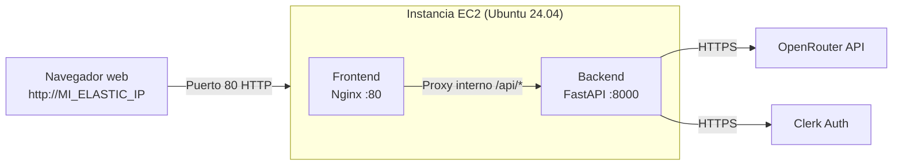

# Despliegue de App 1 y App 2

## 1. Despliegue de App 1 en Vercel

El despliegue de App 1 se hizo a través de Vercel CLI, seleccionando la carpeta desde la que ejecutar la aplicación:

| App   | URL                                                   |
| ----- | ----------------------------------------------------- |
| App 1 | [Resumidor IA v1](https://app1-resumidor.vercel.app/) |

## 2. Despliegue de App 2 en AWS EC2 con Docker

App 2 se despliega exclusivamente en una instancia AWS EC2 mediante Docker Compose.

### 2.1. Objetivo

Este documento recoge los procedimientos necesarios para ejecutar y desplegar la aplicación 2 tanto en local mediante Docker como en los servicios de despliegue utilizados en el proyecto.

### 2.2. Entornos de despliegue

| Entorno                     | Tecnología              | Estado                                                                                         |
| --------------------------- | ----------------------- | ---------------------------------------------------------------------------------------------- |
| Frontend y backend en local | Vue 3 y FastAPI         | Disponible                                                                                     |
| Aplicación 2 con Docker     | Docker Compose y Nginx  | Configuración revisada; construcción y ejecución pendientes de validar en un equipo con Docker |
| Aplicación 2 en AWS EC2     | Docker y Docker Compose | Desplegada en EC2                                                                              |

### 2.3. Despliegue con Docker en local

#### 2.3.1. Arquitectura

La aplicación 2 se ejecuta mediante dos contenedores coordinados con Docker Compose:

- **Frontend:** aplicación Vue 3 compilada y servida por Nginx.
- **Backend:** API desarrollada con FastAPI, encargada de procesar las peticiones y comunicarse con OpenRouter.
- **Nginx:** sirve el frontend y actúa como proxy inverso para redirigir las peticiones a la API.
- **Docker Compose:** configura y coordina los contenedores.

#### 2.3.2. Estructura de los archivos

Los archivos relacionados con Docker se encuentran en `app2/infra/`:

```text
app2/
├── backend/
├── frontend/
└── infra/
    ├── Dockerfile.backend
    ├── Dockerfile.frontend
    ├── compose.yaml
    ├── nginx.conf
    ├── Caddyfile.example
    └── .env.example
```

El archivo `infra/.env` se crea localmente a partir de `infra/.env.example`; no forma parte del repositorio.

- `Dockerfile.backend`: define la imagen del backend con Python y sus dependencias.
- `Dockerfile.frontend`: compila la aplicación Vue y utiliza Nginx para servir los archivos generados.
- `compose.yaml`: define los servicios, sus configuraciones y la comunicación entre ellos.
- `nginx.conf`: configura el servidor web y la redirección de peticiones hacia el backend.
- `.env`: contiene las variables de entorno utilizadas durante la ejecución y construcción de la aplicación.
- `.env.example`: documenta las variables necesarias sin incluir credenciales reales.
- `.dockerignore`: excluye del contexto de construcción archivos, entornos virtuales, dependencias y secretos.
- `Caddyfile.example`: ejemplo de proxy HTTPS en el host EC2, delante del puerto local de Nginx.

#### 2.3.3. Requisitos previos

Es necesario disponer de:

- Docker instalado y en ejecución.
- Docker Compose disponible mediante el comando `docker compose`.
- El repositorio descargado en el equipo.
- Las variables de entorno configuradas en `app2/infra/.env`.

El archivo `.env` debe crearse a partir de `.env.example`, completando los valores necesarios para el entorno local.

Las variables utilizadas incluyen:

| Variable                     | Finalidad                                                                |
| ---------------------------- | ------------------------------------------------------------------------ |
| `VITE_CLERK_PUBLISHABLE_KEY` | Clave pública de Clerk utilizada por el frontend.                        |
| `OPENROUTER_API_KEY`         | Clave privada para acceder a OpenRouter.                                 |
| `OPENROUTER_MODEL`           | Modelo de IA utilizado para generar los resúmenes.                       |
| `OPENROUTER_TIMEOUT`         | Tiempo límite de espera para las peticiones a OpenRouter.                |
| `CLERK_ISSUER`               | Emisor esperado para los tokens de Clerk.                                |
| `CLERK_JWKS_URL`             | URL utilizada para obtener las claves públicas de verificación de Clerk. |
| `CLERK_JWKS_TIMEOUT`         | Tiempo límite de espera para obtener las claves de verificación.         |
| `CORS_ORIGINS`               | Orígenes autorizados para las peticiones al backend.                     |

#### 2.3.4. Construcción y ejecución

Desde la raíz del repositorio, acceder al directorio de la aplicación:

```powershell
cd app2
```

Antes de construir los contenedores, se puede comprobar la configuración de Docker Compose:

```powershell
docker compose --env-file infra/.env -f infra/compose.yaml config
```

Para construir las imágenes y arrancar los servicios:

```powershell
docker compose --env-file infra/.env -f infra/compose.yaml up --build -d
```

El parámetro `--build` fuerza la construcción de las imágenes y `-d` permite ejecutar los contenedores en segundo plano.

Para comprobar el estado de los servicios:

```powershell
docker compose --env-file infra/.env -f infra/compose.yaml ps
```

Una vez iniciados, la aplicación está disponible en:

URL local: [http://localhost:8080](http://localhost:8080). En Compose, el puerto se publica solo en `127.0.0.1`; si se necesita acceso remoto, debe hacerse a través de un proxy HTTPS en el host.

#### 2.3.5. Comprobación del funcionamiento

Con los contenedores en ejecución, se comprueba que:

1. La aplicación se carga correctamente en `http://localhost:8080`.
2. El usuario puede autenticarse mediante Clerk.
3. Se puede enviar un texto y obtener un resumen.
4. Las peticiones del frontend llegan correctamente al backend.
5. Los errores se gestionan de forma controlada.

Para consultar los registros de los servicios:

```powershell
docker compose --env-file infra/.env -f infra/compose.yaml logs
```

Para seguir los registros en tiempo real:

```powershell
docker compose --env-file infra/.env -f infra/compose.yaml logs -f
```

#### 2.3.6. Parada de los contenedores

Para detener y eliminar los contenedores creados por Docker Compose:

```powershell
docker compose --env-file infra/.env -f infra/compose.yaml down
```

Este comando no elimina las imágenes construidas.

#### 2.3.7. Resultado

La configuración Docker Compose está preparada para construir y ejecutar ambos servicios. En esta revisión no se ha podido ejecutar Docker porque el entorno de trabajo no dispone del cliente Docker; por tanto, la construcción y el funcionamiento no se declaran verificados.

El mapeo de Nginx se limita a `127.0.0.1:8080`, de modo que un proxy HTTPS del host puede publicarlo sin exponer el puerto de aplicación directamente.

### 2.4. Despliegue de la aplicación 2 en AWS EC2

> Estado: desplegada mediante Docker Compose en una instancia EC2. La URL pública y las evidencias concretas deben mantenerse actualizadas con los datos reales de la instancia.

#### 2.4.1. Información de la instancia

| Parámetro              | Valor                                                 |
| ---------------------- | ----------------------------------------------------- |
| Proveedor y servicio   | AWS Academy — Amazon EC2                              |
| Nombre de la instancia | `app2-server`                                         |
| Sistema operativo      | Ubuntu Server 24.04 LTS                               |
| Tipo de instancia      | `t2.micro`                                            |
| Región                 | Región por defecto                                    |
| Dirección pública      | Elastic IP asociada; el valor real no se incluye aquí |
| URL utilizada          | `http://<Elastic-IP>`                                 |
| HTTPS                  | No configurado; el acceso documentado es HTTP         |

#### 2.4.2. Pasos del despliegue en AWS (Laboratorio de AWS Academy)

En esta guía recojo paso a paso cómo he realizado el despliegue de **App2** en una máquina virtual EC2 de AWS Academy utilizando Docker Compose, y cómo le he asignado una IP pública fija (Elastic IP) para que la dirección no cambie al reiniciar la máquina.

---

### ¿Cómo funciona la arquitectura?

Para no complicarme exponiendo puertos raros ni peleándome con CORS entre diferentes dominios, he montado la aplicación completa dentro de una sola máquina EC2 usando Docker Compose con dos servicios:



- **Frontend (Nginx en puerto 80):** Sirve los archivos estáticos de la aplicación Vue 3. Además, cuando el navegador hace una petición a `/api/...`, Nginx actúa como proxy inverso y se la pasa internamente al backend.
- **Backend (FastAPI en puerto interno 8000):** Procesa los resúmenes, valida los tokens de Clerk y consulta los modelos de OpenRouter. No está expuesto directamente a internet, lo cual es mucho más limpio y seguro.

---

### Paso 1: Lanzar la instancia EC2 en AWS

Entré en la consola de AWS Academy y creé la máquina con estos datos:

1. Fui a **EC2 → Instances → Launch Instances**.
2. Parámetros que seleccioné:
   - **Nombre:** `app2-server`
   - **Sistema operativo (AMI):** **Ubuntu Server 24.04 LTS** (es el más cómodo y estable para Docker).
   - **Tipo de instancia:** `t2.micro` (es la que entra en el lab sin gastar créditos extra).
   - **Key pair (clave SSH):** Creé una clave nueva llamada `clave-aws.pem` y me la guardé en mi equipo.
3. **Grupo de seguridad (Security Group):**
   Creé un grupo nuevo abriendo únicamente dos puertos:
   - **SSH (puerto 22):** Para poder entrar a la terminal (desde mi IP o cualquiera si cambia mi conexión).
   - **HTTP (puerto 80):** Con origen `0.0.0.0/0` (Anywhere) para que cualquiera pueda abrir la web desde su navegador.
4. Le di a **Launch Instance** y esperé un par de minutos hasta que estuviera en estado **Running**.

---

### Paso 2: Crear y asignarle una IP fija (Elastic IP)

Las máquinas de AWS Academy cambian de IP pública cada vez que las apagas o cuando reinicias la sesión del lab. Para no tener que estar reescribiendo la IP en los archivos `.env` y recompilando el frontend cada dos por tres, le asocié una **Elastic IP**:

1. En el menú de la izquierda de EC2, bajé a **Network & Security → Elastic IPs**.
2. Pulsé el botón **Allocate Elastic IP address** y le di a **Allocate** (dejando la configuración por defecto de Amazon).
3. Con la IP seleccionada en la lista, fui a **Actions → Associate Elastic IP address**:
   - En **Resource type** elegí **Instance**.
   - En el desplegable **Instance** seleccioné mi máquina `app2-server`.
   - En **Private IP address** seleccioné la IP privada de la máquina.
   - Pulsé **Associate**.

A partir de este momento, mi máquina tiene una IP pública que se queda fija (en los ejemplos la llamo `54.123.45.67`).

---

### Paso 3: Conectarme por SSH con Termius

Como suelo usar **Termius** para gestionar mis servidores:

1. Creé un nuevo Host en Termius.
2. En **Address / Hostname** puse mi Elastic IP fija.
3. En **Username** puse `ubuntu` (ojo, no `ec2-user`, ya que elegí Ubuntu).
4. En **Key** cargué mi archivo `.pem`.
5. Me conecté con doble clic y ya estaba dentro de la terminal de la máquina.

_(Si alguna vez me conecto desde PowerShell en local, el comando que uso es: `ssh -i "C:\ruta\mi-clave.pem" ubuntu@54.123.45.67`)_.

---

### Paso 4: Instalar Docker y Docker Compose en la EC2

Una vez dentro de la máquina por SSH, instalé Docker usando el script oficial para tener la versión moderna:

```bash
# 1. Actualizo la lista de paquetes
sudo apt update -y

# 2. Descargo e instalo Docker con el script oficial
curl -fsSL https://get.docker.com -o get-docker.sh
sudo sh get-docker.sh

# 3. Arranco el servicio de Docker y hago que se inicie solo si la máquina se reinicia
sudo systemctl start docker
sudo systemctl enable docker

# 4. Agrego mi usuario (ubuntu) al grupo docker para no tener que poner sudo todo el rato
sudo usermod -aG docker $USER

# 5. Instalo el plugin moderno de Docker Compose
sudo apt install -y docker-compose-plugin
```

> **Nota:** Después de hacer esto, salí de la sesión SSH con `exit` y volví a entrar desde Termius para que se aplicaran los permisos del grupo `docker`.

Comprobé que todo estaba bien instalado ejecutando:

```bash
docker --version
docker compose version
```

---

### Paso 5: Subir los archivos del proyecto

Para subir el código de `app2` desde mi ordenador a la EC2 usé la pestaña **SFTP de Termius**:

1. Abrí la pestaña SFTP en Termius.
2. Me conecté a la máquina EC2 en el panel derecho (se abre en `/home/ubuntu`).
3. En el panel izquierdo navegué hasta la carpeta de mi proyecto en mi PC.
4. Arrastré la carpeta **`app2`** completa directamente a `/home/ubuntu`.
   _(Omití las carpetas `node_modules` y `.venv` locales para que la subida fuera rápida y limpia)_.

---

### Paso 6: Configurar las variables de entorno en la máquina

Entré en la carpeta de infraestructura de la app:

```bash
cd ~/app2/infra
```

Creé el archivo `.env` con mis credenciales y puse mi IP pública fija en los orígenes permitidos:

```bash
nano .env
```

Dentro guardé la siguiente configuración:

```ini
# Configuración del Backend
OPENROUTER_API_KEY=tu_api_key
OPENROUTER_MODEL=tu_modelo_openrouter
OPENROUTER_TIMEOUT=tu_timeout_openrouter
CLERK_ISSUER=tu_clerk_issuer
CLERK_JWKS_URL=tu_clerk_jwks_url
CLERK_JWKS_TIMEOUT=tu_clerk_jwks_timeout

# Origen permitido para CORS (usando la Elastic IP)
CORS_ORIGINS=http://54.123.45.67

# Clave pública de Clerk para el Frontend
VITE_CLERK_PUBLISHABLE_KEY=tu_vite_clerk_publishable_key
```

Guardé con `Ctrl + O`, pulsé `Enter` y salí con `Ctrl + X`.

---

### Paso 7: Compilar y arrancar los contenedores

Con todo en su sitio, lancé el despliegue con Docker Compose en segundo plano:

```bash
sudo docker compose up --build -d
```

Docker se encargó de:

1. Instalar las dependencias de Python y dejar listo el servidor FastAPI.
2. Compilar el frontend Vue con Vite inyectando la clave de Clerk.
3. Copiar el resultado de la compilación a la imagen ligera de Nginx.
4. Levantar ambos contenedores interconectados.

Para verificar que todo había arrancado bien, comprobé el estado:

```bash
sudo docker compose ps
```

Ambos contenedores estaban activos y el backend aparecía como `Up (healthy)`.

---

### Paso 8: Comprobación final desde el navegador

Abrí mi navegador web e introduje la dirección:

```text
http://54.123.45.67
```

La aplicación cargó inmediatamente por el puerto 80 sin necesidad de escribir puertos raros en la URL. Probé a iniciar sesión con Clerk y a generar un resumen, y la comunicación entre frontend, Nginx, backend y OpenRouter funcionó a la primera.

---

### Comandos que uso para el mantenimiento diario

Cuando necesito ver qué está pasando o si hago algún cambio:

- **Ver logs de todo en tiempo real:**
  ```bash
  sudo docker compose logs -f
  ```
- **Ver logs solo del backend:**
  ```bash
  sudo docker compose logs -f backend
  ```
- **Reiniciar los servicios:**
  ```bash
  sudo docker compose restart
  ```
- **Reconstruir tras cambiar código:**
  ```bash
  sudo docker compose up --build -d
  ```
- **Parar la aplicación:**
  ```bash
  sudo docker compose down
  ```

---

### 2.6. Seguridad y gestión de credenciales

- Las claves privadas de OpenRouter se mantienen exclusivamente en el backend.
- Los archivos `.env` no deben subirse al repositorio.
- Los archivos `.env.example` contienen únicamente nombres de variables y valores ficticios o de ejemplo.
- Las claves públicas de Clerk pueden ser utilizadas por el frontend, pero no deben confundirse con las claves secretas de Clerk.
- Las credenciales de AWS, las claves SSH y los tokens no deben incluirse en el código ni en las capturas de pantalla.
- Las peticiones al backend deben seguir validando los tokens de autenticación.
- No se deben registrar innecesariamente los textos introducidos por los usuarios ni los resultados generados.

### 2.7. Evidencias y documentación complementaria

Incluir o enlazar las siguientes evidencias:

- [Repositorio del proyecto](https://github.com/mdelrui/Practica01-Mini_App_Web) (**ACCESIBLE CON INVITACIÓN**)
- [README de la aplicación 2](../README.md)
- [Captura de Docker Compose en ejecución]
- [URL pública de la aplicación 2 en EC2]
- [Capturas de las pruebas de autenticación y generación de resúmenes]

## 3. Estado de verificación de los despliegues

Revisión documental: 02/11/2026.

| Comprobación               | Estado en esta revisión                                     | Evidencia necesaria                                                                        |
| -------------------------- | ----------------------------------------------------------- | ------------------------------------------------------------------------------------------ |
| URL de App 1 en Vercel     | URL anotada en el documento                                 | Abrir la URL y probar el flujo completo antes de darla por verificada                      |
| Docker Compose local       | Configuración revisada; no ejecutado en este entorno        | Capturar `docker compose config`, `ps` y pruebas funcionales en un equipo con Docker       |
| AWS EC2 para App 2         | Desplegada mediante Docker Compose                          | Registrar región, tipo de instancia, sistema operativo, URL, versión Git y comandos reales |
| Clerk y CORS en producción | Configuración pendiente de confirmar para el dominio de EC2 | Probar login y peticiones con/sin token desde el dominio publicado                         |
| HTTPS                      | Pendiente de acreditar para EC2                             | URL HTTPS y comprobación desde un dispositivo externo                                      |

No se deben completar los campos de AWS con valores supuestos. Tampoco se debe considerar una URL operativa solo porque aparezca escrita en este documento.
